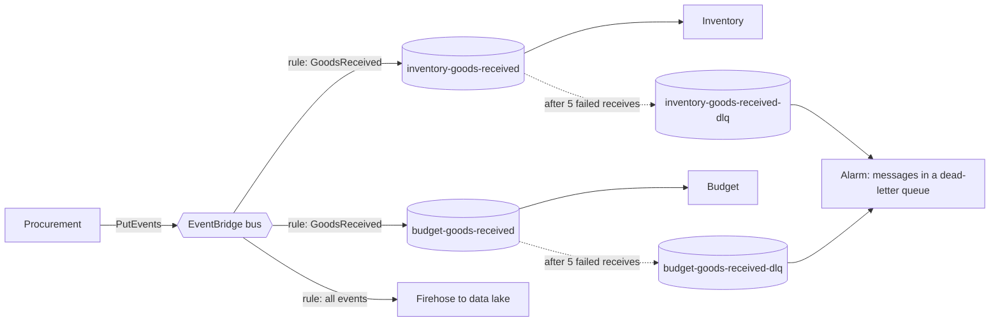

# 0006: Use EventBridge with a queue per consumer, and one set of messaging conventions

|        |            |
| ------ | ---------- |
| Status | Accepted   |
| Date   | 2026-11-11 |
| Issue  | #7         |

## Context

Services communicate mostly through events ([architecture overview](../architecture/overview.md#how-the-parts-talk)). AWS has four services that move messages, and they are not interchangeable:

| Service              | Shape                          | Strength                                                                   | Weakness                                        |
| -------------------- | ------------------------------ | -------------------------------------------------------------------------- | ----------------------------------------------- |
| SQS                  | Queue, one consumer group      | Buffering, retries, dead-letter queues, back-pressure                      | No fan-out, no routing                          |
| SNS                  | Topic, push fan-out            | Simple fan-out to many subscribers                                         | Limited filtering, no replay                    |
| EventBridge          | Bus with content-based routing | Rules on any field, many target types, schema registry, archive and replay | Lower throughput, no ordering                   |
| Kinesis Data Streams | Ordered, partitioned log       | Order per key, replay, high throughput, several independent readers        | Shards to size, consumers manage their position |

Without conventions, each producer invents its own event shape and each consumer its own failure handling, and "what happens when this fails?" has a different answer everywhere.

## Decision

### Which service for what

| Need                                     | Service                                                                                                       |
| ---------------------------------------- | ------------------------------------------------------------------------------------------------------------- |
| Business events between services         | **EventBridge**: one custom bus per environment                                                               |
| Delivery to a consuming service          | **SQS**: one queue per consumer per interest, fed by an EventBridge rule, each with its own dead-letter queue |
| High-volume, ordered warehouse movements | **Kinesis**, partitioned by warehouse                                                                         |
| Notifying people and fanning out alarms  | **SNS**                                                                                                       |

Producers publish to the bus and never to a queue. They do not know who consumes. A consumer never reads from the bus directly: it reads from its own queue, which gives it buffering, retries and isolation from every other consumer.



### Event naming

- **Type**: past tense, `PascalCase`, in the language of the [glossary](../domain/glossary.md): `GoodsReceived`, `StockChanged`, `BudgetCommitted`. An event states a fact that has happened. It is not a command.
- **Source**: `meridian.<service>`, for example `meridian.procurement`.
- **Queue**: `<consumer>-<event-in-kebab-case>`, with `-dlq` for its dead-letter queue.

### Envelope

Every event carries the same envelope in its detail. Business data lives under `data`.

```json
{
  "id": "0193b2a4-7c1e-7d3a-9f0b-2a6c1e4d5f60",
  "type": "GoodsReceived",
  "version": 1,
  "source": "meridian.procurement",
  "occurredAt": "2026-11-11T09:30:00Z",
  "correlationId": "0193b2a4-6f00-7b11-8e2a-91c0d4e7a3b2",
  "causationId": "0193b2a4-6f9d-7c40-a1d3-5b8e2f0c9a71",
  "data": {}
}
```

| Field             | Purpose                                                                         |
| ----------------- | ------------------------------------------------------------------------------- |
| `id`              | Unique per event. The idempotency key                                           |
| `type`, `version` | What happened, and which schema version describes `data`                        |
| `occurredAt`      | When it happened in the business, not when it was published                     |
| `correlationId`   | The same value on every event and log line that stems from one original request |
| `causationId`     | The `id` of the event or request that directly caused this one                  |

### Delivery rules

1. **Delivery is at least once.** Every consumer is idempotent: it records the event `id` in the same transaction as its effect and ignores an `id` it has seen.
2. **No ordering is assumed** on the bus. A consumer that needs order uses a sequence number in `data`, or reads from Kinesis.
3. **Publishing is atomic with the state change.** A service writes the event to an outbox table in the same database transaction as the change, and a relay publishes it. A change is never saved without its event, or the reverse.
4. **Failures go to a dead-letter queue** after five receives. A message there raises an alarm, and the runbook covers inspecting and replaying it. Messages are never dropped silently.
5. **Schemas evolve additively.** New optional fields only. A breaking change is a new `version`, published alongside the old one until every consumer has moved.
6. **Events carry facts, not instructions,** and enough data that a consumer rarely needs to call back. They never carry secrets, and personal data only where the consumer needs it.

## Consequences

- Adding a consumer is a rule and a queue. No producer changes.
- A slow or failing consumer affects only its own queue.
- Every failure has the same path: retry, dead-letter queue, alarm, runbook.
- Every event reaches the data lake through one catch-all rule, so analytics needs no per-event work.
- The outbox adds a table and a relay to every producing service, and events lag the transaction slightly. That is the price of never losing or inventing an event.
- Idempotency costs every consumer a table of processed identifiers.
- EventBridge has lower throughput and higher per-event cost than Kinesis or SNS. It is fine for business events (hundreds per second at most). The movement stream, which is orders of magnitude busier, goes through Kinesis for that reason.
- Two delivery paths exist: bus to queue for business events, and stream for movements. The inventory service consumes both.

## Alternatives considered

- **SNS topics with SQS subscriptions.** The classic fan-out, cheaper and faster. Filtering is limited to message attributes, there is no archive or replay, and a topic per event type multiplies resources. A sound choice at higher volumes.
- **Kinesis for everything.** Ordered and replayable. Every consumer then manages shard positions, and routing by content has to be built by hand.
- **Managed Kafka (MSK).** The most capable log, and the most to operate and pay for. Not justified at this scale.
- **Synchronous calls between services.** Simple to reason about, and it couples availability: one slow service slows every caller. Used only where the caller needs the answer.
- **Consumers attached directly to the bus (Lambda targets).** Fewer resources, but no buffering or back-pressure, and retry behaviour is harder to control.
