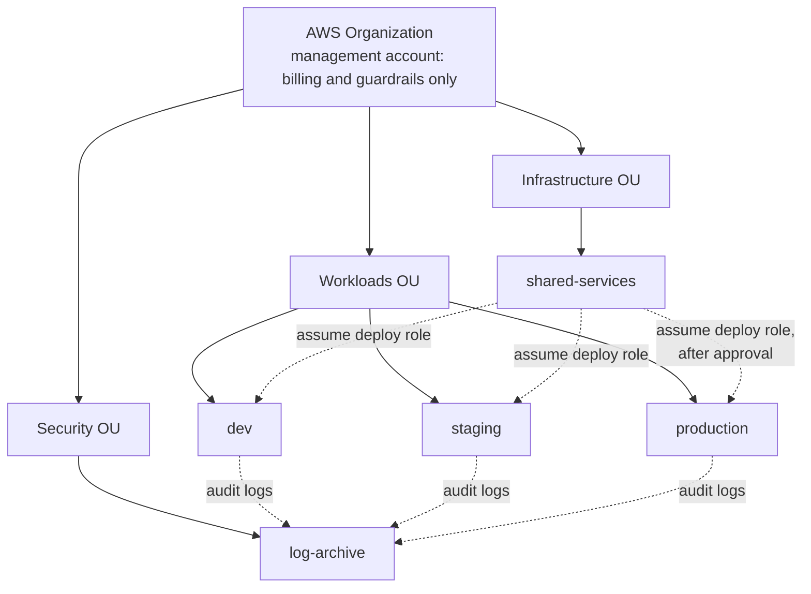

# 0007: Three environments, one AWS account each

|        |            |
| ------ | ---------- |
| Status | Accepted   |
| Date   | 2026-11-11 |
| Issue  | #8         |

## Context

Changes need somewhere to be tried before they reach real users, and production needs to be protected from mistakes made elsewhere. The questions are how many environments, how strongly they are isolated, and how that isolation is represented when developing against an emulator ([0002](0002-develop-against-an-aws-emulator.md)).

Isolation inside one AWS account (separate VPCs, name prefixes, IAM conditions) is possible, and it is leaky: account-wide quotas are shared, a broad IAM policy reaches everything, and a mistake in a script that lists and deletes resources does not stop at a name prefix.

## Decision

There are three long-lived environments, and in a real deployment each is its own AWS account inside an AWS Organization.

| Environment  | Purpose                                                             | Who deploys                            | Data                           |
| ------------ | ------------------------------------------------------------------- | -------------------------------------- | ------------------------------ |
| `dev`        | Integration of merged work. May be broken                           | The pipeline, on every merge to `main` | Synthetic                      |
| `staging`    | A production-shaped rehearsal. Release candidates are verified here | The pipeline, on a release tag         | Synthetic, at realistic volume |
| `production` | Real users                                                          | The pipeline, after a manual approval  | Real                           |

Two further accounts hold what must outlive or stand apart from any one environment:

| Account           | Holds                                                                                            |
| ----------------- | ------------------------------------------------------------------------------------------------ |
| `shared-services` | Container registry, pipeline roles, Terraform state                                              |
| `log-archive`     | Audit logs from every account, written once and not deletable by the accounts that produced them |

Each environment is a directory under `infra/environments`, with its own state and its own variable values. The same modules, at the same version, are applied to all three. Environments differ only in values, never in structure.

**Against the emulator**, each environment is applied with its own account identifier, its own state key and its own name prefix. This exercises the code path for separate accounts. It does not prove real cross-account isolation, which only AWS can enforce.

## Consequences

- The blast radius of a mistake is one account. A broad permission in `dev` cannot touch production.
- Quotas, costs and audit trails are separated by construction.
- Production access can be restricted at the account boundary: nobody has standing write access, and the pipeline's role is the only path.
- Cross-account plumbing is needed: deploy roles, registry access, log delivery. It is defined once in milestone 2.
- Three environments cost roughly three times one. The differences table keeps `dev` cheap. See [environments](../architecture/environments.md).
- Because structure is identical, a change that works in staging is the same change that reaches production. The price is that an expensive production feature (three NAT gateways, multi-AZ databases) cannot simply be left out of `dev`. It is made a variable, and `dev` sets it lower.
- Short-lived preview environments per pull request are not provided. Against the emulator, CI creates a fresh one per run anyway.

## Alternatives considered

- **One account, environments separated by VPC and naming.** Cheaper to set up. Isolation relies on every policy being written correctly forever.
- **Two environments (staging and production).** Fewer resources. Integration problems then surface in the environment meant for release verification.
- **Terraform workspaces for environments.** One directory, switched by a command. It hides which environment is targeted, shares one backend configuration, and makes it easy to apply to the wrong one. Directories are explicit and reviewable.
- **A separate branch per environment.** Environments drift as branches diverge, and promotion becomes merging. One branch with values per environment keeps them identical in structure.
