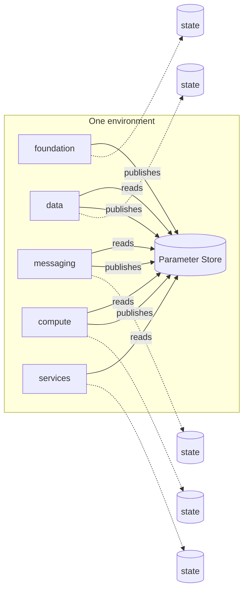

# 0008: Split each environment's state into layers

|        |            |
| ------ | ---------- |
| Status | Accepted   |
| Date   | 2026-11-11 |
| Issue  | #10        |

## Context

An environment will contain several hundred resources: network, keys, databases, queues, clusters, services. Terraform keeps what it manages in a state file, and one decision shapes daily work more than any other: how much goes into each state.

One state per environment is the simplest. It also means every plan refreshes every resource, a mistake in a service definition is one `apply` away from the network, anyone who can change a queue can read the database password in state, and two people cannot work on unrelated parts at the same time because the state is locked.

[Decision record 0007](0007-environments-and-account-isolation.md) requires environments to be identical in structure and to differ only in values. Copying files between environment directories breaks that over time, quietly.

## Decision

**Layers.** Each environment is a directory, and inside it each layer is a directory with its own state:

```
infra/
  modules/                  reusable building blocks, no provider configuration
  environments/
    _shared/                provider, version and variable files, defined once
    dev/
      env.tfvars            the values that make dev different
      foundation/           network and security baseline
      data/                 databases, tables, buckets
      messaging/            bus, queues, streams
      compute/              clusters, registry, load balancers
      services/             what runs on them
    staging/                same layers
    production/             same layers
```

Layers are ordered by how often they change and how much depends on them. A layer may depend only on layers above it in that list.

| Layer      | Changes      | Blast radius if it goes wrong |
| ---------- | ------------ | ----------------------------- |
| foundation | Rarely       | Everything                    |
| data       | Occasionally | Stored data                   |
| messaging  | Occasionally | Event delivery                |
| compute    | Regularly    | Running workloads             |
| services   | Constantly   | One service                   |

A layer is created when the first module that belongs in it is merged. Only `foundation` exists at the time of writing.

**Sharing between layers.** A layer publishes the facts others need (the VPC identifier, subnet identifiers, a queue's address) as Parameter Store entries under `/<project>/<environment>/<component>/`. Consumers read parameters. They do not read another layer's state.

**No copies.** The provider, version and variable definitions exist once, in `_shared`, and each layer links to them. A layer's own files contain only what is specific to it.



## Consequences

- A plan for a service touches only service resources. It is fast, and it cannot propose changes to the network.
- Access can differ by layer: few people need to apply `foundation`, and a service pipeline needs only `services` and read access to parameters.
- Different layers can be changed at the same time without waiting on a lock.
- Parameter Store is a contract. A consumer needs permission to read a path, not a state file that may hold secrets, and services read the same parameters at run time that Terraform reads at plan time.
- Applying an environment from nothing means applying layers in order. The pipeline does this, and `make` targets take a layer.
- A change that spans layers is applied in two steps and must be safe between them: add in the upper layer first, remove last.
- A parameter that is renamed or removed breaks consumers at their next plan, not at the producer's. Parameter names are therefore part of each module's documented interface.
- Symbolic links need a filesystem and a Git client that support them. Linux and macOS do. On Windows this repository needs WSL or `core.symlinks=true`.
- There are more directories to navigate than with a single root.

## Alternatives considered

- **One state per environment.** Simplest, and fine for a small system. The costs above grow with every resource.
- **One state per module or per resource group.** The smallest blast radius, and dependency ordering becomes a project of its own. Usually managed with an extra tool.
- **Terragrunt.** Solves duplication and ordering well. It adds a tool and a configuration language on top of Terraform, and the same result is reached here with links and a short `Makefile`. Worth revisiting if the number of layers grows.
- **`terraform_remote_state` between layers.** Built in and typed. It grants the consumer read access to the producer's whole state, including any secret in it, and couples the two states' backends.
- **Workspaces.** Rejected in 0007 for environments, and for the same reason here.
- **Copying shared files into each layer.** No links needed. Drift is then a matter of time, and a check would be needed to catch it.
