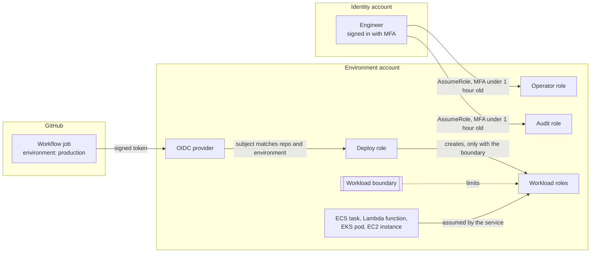
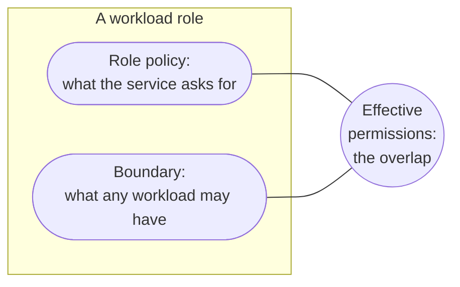

# Access model

Who can do what in an environment, how they prove who they are, and what stops each of them from doing more. The reasoning is in [decision record 0011](../adr/0011-roles-not-users-and-a-boundary-on-every-workload.md).

- [Principals](#principals)
- [How access is obtained](#how-access-is-obtained)
- [The permission boundary](#the-permission-boundary)
- [The deploy role](#the-deploy-role)
- [The operator and audit roles](#the-operator-and-audit-roles)
- [Workload roles](#workload-roles)
- [Account baseline](#account-baseline)
- [How it is enforced](#how-it-is-enforced)
- [What the emulator does not prove](#what-the-emulator-does-not-prove)

## Principals

There are no IAM users and no access keys. Every principal is a role with credentials that last an hour.

| Role     | Name                                | Assumed by                                                     | Purpose                                            |
| -------- | ----------------------------------- | -------------------------------------------------------------- | -------------------------------------------------- |
| Deploy   | `meridian-<env>-access-deploy`      | GitHub Actions, for this repository and one GitHub environment | Plan and apply Terraform                           |
| Operator | `meridian-<env>-access-operator`    | People, from the identity account, with MFA                    | Investigate and operate. Changes no infrastructure |
| Audit    | `meridian-<env>-access-audit`       | People, from the identity account, with MFA                    | Read configuration. Never data                     |
| Workload | `meridian-<env>-<service>-...-role` | ECS, Lambda, EKS, EC2, Step Functions                          | What a service needs at run time                   |

## How access is obtained

**Pipeline.** A workflow job asks GitHub for an OpenID Connect token and exchanges it with AWS for credentials. The trust policy checks two claims: the audience is `sts.amazonaws.com`, and the subject is exactly `repo:<owner>/<repository>:environment:<name>`. No wildcard is accepted in the subject. The module refuses one at plan time, because `repo:owner/repository:*` would also match a pull request from a fork.

**People.** Engineers sign in to the identity account. From there they assume a role in an environment. The trust policy requires multi-factor authentication that is less than an hour old.

**Workloads.** The compute service assumes the role. Where the service supports it, the trust policy adds `aws:SourceAccount`, so the service cannot be made to assume the role on behalf of another account.

## The permission boundary

One managed policy per environment, `meridian-<env>-workload-boundary`, built by the [`permission-boundary` module](../../infra/modules/permission-boundary/README.md). It grants nothing. It is the outer limit of what any workload role can be granted.

| The boundary allows                                     | Limited to                                                                     |
| ------------------------------------------------------- | ------------------------------------------------------------------------------ |
| Reading and writing objects, items, messages and events | Resources named `meridian-<env>-*` in this account and region                  |
| Reading parameters and secrets, writing logs            | Paths under `/meridian/<env>/`                                                 |
| Using encryption keys                                   | Keys in this account and region. Which key is decided by the role's own policy |
| Publishing metrics and traces                           | Not limitable to a resource                                                    |

| The boundary denies, whatever a role's policy says                      | Why                                                                            |
| ----------------------------------------------------------------------- | ------------------------------------------------------------------------------ |
| Every IAM, Organizations and account action                             | A workload never changes who can do what                                       |
| Disabling or deleting keys, changing key policies, creating grants      | A workload uses keys and does not administer them                              |
| Deleting object versions, changing bucket versioning or lifecycle rules | A workload can replace or delete the current object. It cannot destroy history |
| Stopping the audit trail, deleting logs, changing log retention         | A compromised workload cannot cover its tracks                                 |
| Any request to another region                                           | Data stays where it is meant to be                                             |

## The deploy role

Built by the [`access-roles` module](../../infra/modules/access-roles/README.md).

| It can                             | Limited by                                       |
| ---------------------------------- | ------------------------------------------------ |
| Manage the platform's AWS services | One region                                       |
| Manage IAM roles and policies      | Names starting `meridian-<env>-`                 |
| Read and write Terraform state     | Its own environment's prefix in the state bucket |

| It cannot                                                                                                 | How                                                                                   |
| --------------------------------------------------------------------------------------------------------- | ------------------------------------------------------------------------------------- |
| Create or modify a role without the workload boundary                                                     | A deny conditioned on `iam:PermissionsBoundary`                                       |
| Remove a boundary from a role                                                                             | An explicit deny                                                                      |
| Change the boundary policy, its own role or policy, the operator or audit roles, or the identity provider | An explicit deny on those ARNs                                                        |
| Read another environment's state                                                                          | The allow covers one prefix only                                                      |
| Disable an encryption key or schedule it for deletion, in staging and production                          | An explicit deny. Dev is marked disposable and is exempt, so that it can be torn down |

Together these close the usual escalation path, where a pipeline that may create roles creates one more powerful than itself. They also mean that changes to the access model itself are applied by an administrator and not by the pipeline.

## The operator and audit roles

|                                                                                                                      | Operator                                                         | Audit                 |
| -------------------------------------------------------------------------------------------------------------------- | ---------------------------------------------------------------- | --------------------- |
| List and describe resources                                                                                          | Yes, `ViewOnlyAccess`                                            | Yes, `ViewOnlyAccess` |
| Read security configuration                                                                                          | Through `ViewOnlyAccess`                                         | Yes, `SecurityAudit`  |
| Read application logs                                                                                                | Yes, under `/meridian/<env>/`, decrypting with the logs key only | No                    |
| Restart a service, stop a task, redrive a dead-letter queue, start or stop a workflow, reboot or snapshot a database | Yes, on resources named for the environment                      | No                    |
| Read objects, items, messages or secrets                                                                             | No                                                               | No                    |
| Create, change or delete infrastructure                                                                              | No                                                               | No                    |

`ReadOnlyAccess` is deliberately not used. Despite the name it can read the contents of buckets and tables. `ViewOnlyAccess` lists and describes without reading data.

## Workload roles

Every service gets its roles from the [`workload-role` module](../../infra/modules/workload-role/README.md), which:

- sets the trust policy from the compute type, so a role cannot be given an arbitrary principal
- requires the boundary, so there is no way to create a workload role without one
- refuses `AdministratorAccess`, `PowerUserAccess` and the `FullAccess` managed policies

| Compute        | Trusted service                                                                        | Extra condition     |
| -------------- | -------------------------------------------------------------------------------------- | ------------------- |
| ECS task       | `ecs-tasks.amazonaws.com`                                                              | `aws:SourceAccount` |
| Lambda         | `lambda.amazonaws.com`                                                                 |                     |
| EKS pod        | `pods.eks.amazonaws.com`, with session tags for cluster, namespace and service account | `aws:SourceAccount` |
| EC2            | `ec2.amazonaws.com`, through an instance profile                                       |                     |
| Step Functions | `states.amazonaws.com`                                                                 | `aws:SourceAccount` |
| Scheduler      | `scheduler.amazonaws.com`                                                              | `aws:SourceAccount` |
| Firehose       | `firehose.amazonaws.com`                                                               | `aws:SourceAccount` |

The pattern for a service's permissions is one inline policy per capability, named for what it allows (`read-own-parameters`, `consume-goods-received-queue`), with exact actions on exact resources.

## Account baseline

Settings that apply to the whole account, from the [`account-baseline` module](../../infra/modules/account-baseline/README.md). They hold for resources created outside Terraform too.

| Setting                                      | Effect                                                                                                   |
| -------------------------------------------- | -------------------------------------------------------------------------------------------------------- |
| S3 public access block, account level        | No bucket can be made public                                                                             |
| EBS encryption by default, with the data key | Every new volume and snapshot is encrypted                                                               |
| IAM Access Analyzer                          | Reports any resource policy that shares a resource outside the account                                   |
| Password policy                              | 14 characters, all character classes, no reuse of the last 24. There are no users, so this is a backstop |

## How it is enforced

| Rule                                                                           | Where                                                                                                                         |
| ------------------------------------------------------------------------------ | ----------------------------------------------------------------------------------------------------------------------------- |
| No policy allows every action on every resource                                | Policy `POL-IAM-1`                                                                                                            |
| No policy allows a whole service on every resource, except recorded exceptions | Policy `POL-IAM-2`. The deploy policy is the one exception, in [`exceptions.yaml`](../../infra/policies/data/exceptions.yaml) |
| No role can be assumed by anyone                                               | Policy `POL-IAM-3`                                                                                                            |
| Every role carries a boundary, except the three access roles                   | Policy `POL-IAM-4`                                                                                                            |
| A policy document that could not be checked is reported                        | Policy `POL-IAM-5`, a warning                                                                                                 |
| The boundary never grants a whole service and stays inside the environment     | Module tests that read the rendered JSON                                                                                      |
| The deploy trust policy names one repository and environment                   | Module validation, module tests and `make smoke`                                                                              |
| Operator and audit roles require MFA                                           | Module tests and `make smoke`                                                                                                 |

### Policies are built so they can be checked

A policy check can only read a policy document that is known when the plan is made. A document that includes a value computed at apply, such as the ARN of a policy created in the same plan, is unknown at plan time and passes every check unread.

While building this, the deploy policy passed `POL-IAM-2` for exactly that reason. Three changes followed:

1. The boundary's ARN, the log group's ARN and the identity provider's ARN are built from account, region and name, which are known, instead of being read from the resource.
2. Operators are granted decryption by key alias and not by key ARN.
3. `POL-IAM-5` warns when any policy document is unknown at plan time, so a policy that slips through unread is visible.

After that, the deploy policy failed `POL-IAM-2` as it should, and its exception was recorded with its reason.

## What the emulator does not prove

The emulator stores roles, policies, boundaries and trust policies and returns them through the API. It does not evaluate them: any call succeeds with any credentials. So this document describes configuration that has been checked by tests and policies, and has not been proven by an access being denied. On a real account the first things to test are that a workload role cannot read another environment's bucket, that the deploy role cannot create a role without the boundary, and that the audit role cannot read an object.
