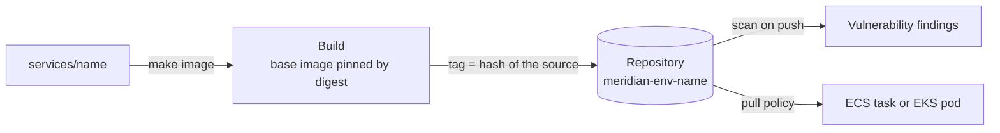
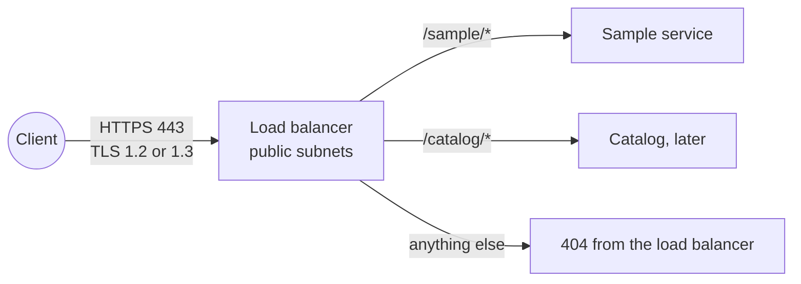

# Compute

Where workloads run, how their images get there, and what every container is expected to be. The choice of platform per workload is [decision record 0005](../adr/0005-compute-model-per-workload.md).

This document grows through milestone 5. It covers the layer, images, the sample service and the load balancer. ECS, EKS and the gateway host are added as they are built.

- [The compute layer](#the-compute-layer)
- [Images](#images)
- [What every container must be](#what-every-container-must-be)
- [The sample service](#the-sample-service)
- [The way in](#the-way-in)
- [How it is enforced](#how-it-is-enforced)
- [What the emulator does not prove](#what-the-emulator-does-not-prove)

## The compute layer

`infra/environments/<env>/compute`, applied after `messaging` and destroyed before it. It reads the network, the tier security groups, the keys and the workload boundary from Parameter Store.

| Platform       | For                                                         | Module                            |
| -------------- | ----------------------------------------------------------- | --------------------------------- |
| ECS on Fargate | Long-running services with steady load: catalog             | `ecs-cluster`, `ecs-service`      |
| EKS            | The busiest services: inventory, procurement, budget        | `eks-cluster`, `eks-pod-identity` |
| Lambda         | Short, event-driven work: scan intake, curation steps       | With each service                 |
| EC2            | The one host that needs installed software: the ERP gateway | `ec2-host`                        |

## Images

One repository per service and environment, built by the [`container-repository` module](../../infra/modules/container-repository/README.md).

**The tag is a hash of the source.** `make image` hashes every file that goes into the image and uses the first twelve characters as the tag. The consequences:

|                                           |                                                                                                                              |
| ----------------------------------------- | ---------------------------------------------------------------------------------------------------------------------------- |
| The same source is pushed once            | A second run finds the tag in the registry and stops                                                                         |
| A tag identifies one build                | Tags are immutable in the registry, and the tag is derived from content, so `sample:589969013abb` can only ever be one thing |
| A deployment says exactly what is running | The task definition and the chart carry the tag, never `latest`                                                              |
| A rollback is a redeploy of an older tag  | The registry keeps the newest 30                                                                                             |

**The base image is pinned by digest** in each Dockerfile and pulled from the public ECR mirror. A tag such as `3.13-alpine` moves when the maintainers rebuild it. A digest does not, so a build next month produces the same image as today. Updating the base is a pull request that changes the digest.

**Who can do what.** The role that builds gets the repository's push policy: it can add images and cannot delete one. What runs gets the pull policy for that one repository.

## What every container must be

These apply to every service, and the platform modules enforce what they can.

| Requirement                                                       | Why                                                                                           | Enforced by                                                  |
| ----------------------------------------------------------------- | --------------------------------------------------------------------------------------------- | ------------------------------------------------------------ |
| Runs as a non-root, numeric user                                  | A process that escapes the container is then an unprivileged user on the node                 | The Dockerfile. On EKS, the restricted pod security standard |
| Root filesystem is read-only                                      | An attacker cannot drop a tool or change the code. Anything written goes to a declared volume | The task definition and the pod spec                         |
| No Linux capabilities, no privilege escalation                    | A web service needs none                                                                      | The task definition and the pod spec                         |
| Handles `SIGTERM`                                                 | Deployments and scale-in stop containers. In-flight requests must finish                      | The service's code                                           |
| Logs to standard output as JSON                                   | The platform collects and ships it. No log files, no agents in the image                      | The service's code                                           |
| Takes configuration from the environment and secrets by reference | The same image runs in every environment                                                      | The task definition and the chart                            |
| Has a health endpoint that does no work                           | It is called every few seconds                                                                | The service's code                                           |
| Has a role of its own                                             | Its permissions are its own, and a breach of one service is not a breach of another           | The `workload-role` module                                   |

## The sample service

[`services/sample`](../../services/sample/README.md) is a container that does nothing useful and meets every requirement above. It is what milestone 5 deploys to prove each platform, and its `/identity` endpoint reports which role the platform gave it, without ever returning a credential. Real services replace it from milestone 6 on.

## The way in

One application load balancer per environment, built by the [`load-balancer` module](../../infra/modules/load-balancer/README.md). It is the only thing in the environment that accepts traffic from outside the VPC.

| Decision                                                            | Reason                                                                                                                                                |
| ------------------------------------------------------------------- | ----------------------------------------------------------------------------------------------------------------------------------------------------- |
| One load balancer, routed by path                                   | One certificate, one entry point to defend and to watch. A service is added with a rule, not with another public endpoint                             |
| The default action is a refusal                                     | A path with no rule should not reach whichever service was attached first                                                                             |
| No plain HTTP at all                                                | The load balancer security group opens 443 only. There is nothing on port 80 to redirect from                                                         |
| TLS ends at the load balancer                                       | Certificates live in one place. Traffic from the load balancer to a service stays inside the VPC, in the private subnets, between two security groups |
| The certificate is requested by the layer and validated through DNS | ACM renews it without anyone acting, as long as the validation record stays in the zone                                                               |

The domain is a value of the environment: `dev.meridian.example`, `staging.meridian.example` and `meridian.example`. The `.example` domain is reserved for documentation. A real deployment sets a domain it controls and adds the validation record ACM asks for.

**What is not here yet.** Access logs need a log archive bucket, and a web application firewall in front of the load balancer is a hardening step. Both are noted for the review at the end of this milestone.

## How it is enforced

| Rule                                                                            | Where                                                      |
| ------------------------------------------------------------------------------- | ---------------------------------------------------------- |
| Tags are immutable, images are scanned, the repository is encrypted and bounded | Module tests, and `make smoke` reading the repository back |
| A puller cannot push, and a pusher cannot delete                                | Module tests on the rendered policies                      |
| The sample service behaves as documented, and never returns a credential        | `make service-test`, in CI                                 |
| Every service image builds                                                      | CI                                                         |
| The image can be pushed to an environment's repository                          | `make image`, in the pipeline after each apply             |

## What the emulator does not prove

- **Immutability, scanning and the lifecycle policy.** They are stored and not applied. The same tag can be pushed twice. Difference 30.
- **The registry's address.** Pushes go to the registry container directly. Difference 29.
- **Certificate validation.** The emulator issues a certificate at once. On AWS it stays pending until the DNS record exists. Difference 31.

The load balancer itself does behave: over HTTPS it returned the fixed refusal for an unmatched path, and it rejected plain HTTP on the same port.
