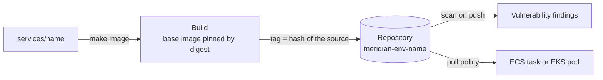
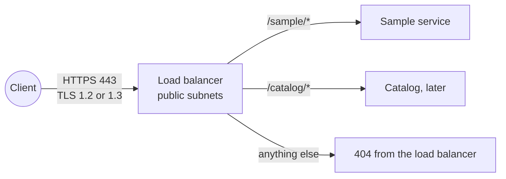
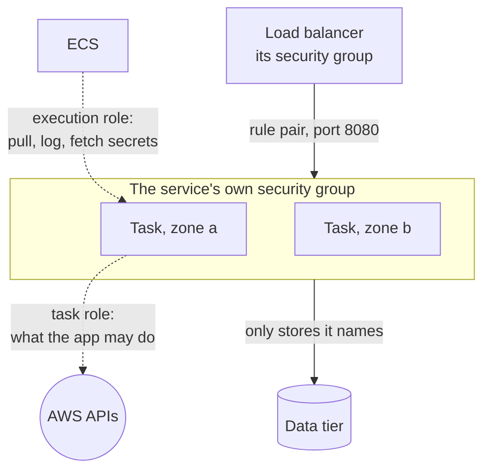
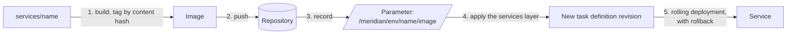

# Compute

Where workloads run, how their images get there, and what every container is expected to be. The choice of platform per workload is [decision record 0005](../adr/0005-compute-model-per-workload.md).

This document grows through milestone 5. It covers the layers, images, the sample service, the load balancer and ECS. EKS and the gateway host are added as they are built.

- [The compute layer](#the-compute-layer)
- [Images](#images)
- [What every container must be](#what-every-container-must-be)
- [The sample service](#the-sample-service)
- [The way in](#the-way-in)
- [ECS](#ecs)
- [Deploying](#deploying)
- [Checking the workloads](#checking-the-workloads)
- [How it is enforced](#how-it-is-enforced)
- [What the emulator does not prove](#what-the-emulator-does-not-prove)

## The compute layer

`infra/environments/<env>/compute`, applied after `messaging` and destroyed before it. It reads the network, the tier security groups, the keys and the workload boundary from Parameter Store.

| Platform       | For                                                         | Module                            |
| -------------- | ----------------------------------------------------------- | --------------------------------- |
| ECS on Fargate | Long-running services with steady load: catalog             | `ecs-cluster`, `ecs-service`      |
| EKS            | The busiest services: inventory, procurement, budget        | `eks-cluster`, `eks-pod-identity` |
| Lambda         | Short, event-driven work: scan intake, curation steps       | With each service                 |
| EC2            | The one host that needs installed software: the ERP gateway | `ec2-host`                        |

## Images

One repository per service and environment, built by the [`container-repository` module](../../infra/modules/container-repository/README.md).

**The tag is a hash of the source.** `make image` hashes every file that goes into the image and uses the first twelve characters as the tag. The consequences:

|                                           |                                                                                                                              |
| ----------------------------------------- | ---------------------------------------------------------------------------------------------------------------------------- |
| The same source is pushed once            | A second run finds the tag in the registry and stops                                                                         |
| A tag identifies one build                | Tags are immutable in the registry, and the tag is derived from content, so `sample:589969013abb` can only ever be one thing |
| A deployment says exactly what is running | The task definition and the chart carry the tag, never `latest`                                                              |
| A rollback is a redeploy of an older tag  | The registry keeps the newest 30                                                                                             |

**The base image is pinned by digest** in each Dockerfile and pulled from the public ECR mirror. A tag such as `3.13-alpine` moves when the maintainers rebuild it. A digest does not, so a build next month produces the same image as today. Updating the base is a pull request that changes the digest.

**Who can do what.** The role that builds gets the repository's push policy: it can add images and cannot delete one. What runs gets the pull policy for that one repository.

## What every container must be

These apply to every service, and the platform modules enforce what they can.

| Requirement                                                       | Why                                                                                           | Enforced by                                                  |
| ----------------------------------------------------------------- | --------------------------------------------------------------------------------------------- | ------------------------------------------------------------ |
| Runs as a non-root, numeric user                                  | A process that escapes the container is then an unprivileged user on the node                 | The Dockerfile. On EKS, the restricted pod security standard |
| Root filesystem is read-only                                      | An attacker cannot drop a tool or change the code. Anything written goes to a declared volume | The task definition and the pod spec                         |
| No Linux capabilities, no privilege escalation                    | A web service needs none                                                                      | The task definition and the pod spec                         |
| Handles `SIGTERM`                                                 | Deployments and scale-in stop containers. In-flight requests must finish                      | The service's code                                           |
| Logs to standard output as JSON                                   | The platform collects and ships it. No log files, no agents in the image                      | The service's code                                           |
| Takes configuration from the environment and secrets by reference | The same image runs in every environment                                                      | The task definition and the chart                            |
| Has a health endpoint that does no work                           | It is called every few seconds                                                                | The service's code                                           |
| Has a role of its own                                             | Its permissions are its own, and a breach of one service is not a breach of another           | The `workload-role` module                                   |

## The sample service

[`services/sample`](../../services/sample/README.md) is a container that does nothing useful and meets every requirement above. It is what milestone 5 deploys to prove each platform, and its `/identity` endpoint reports which role the platform gave it, without ever returning a credential. Real services replace it from milestone 6 on.

## The way in

One application load balancer per environment, built by the [`load-balancer` module](../../infra/modules/load-balancer/README.md). It is the only thing in the environment that accepts traffic from outside the VPC.

| Decision                                                            | Reason                                                                                                                                                |
| ------------------------------------------------------------------- | ----------------------------------------------------------------------------------------------------------------------------------------------------- |
| One load balancer, routed by path                                   | One certificate, one entry point to defend and to watch. A service is added with a rule, not with another public endpoint                             |
| The default action is a refusal                                     | A path with no rule should not reach whichever service was attached first                                                                             |
| No plain HTTP at all                                                | The load balancer security group opens 443 only. There is nothing on port 80 to redirect from                                                         |
| TLS ends at the load balancer                                       | Certificates live in one place. Traffic from the load balancer to a service stays inside the VPC, in the private subnets, between two security groups |
| The certificate is requested by the layer and validated through DNS | ACM renews it without anyone acting, as long as the validation record stays in the zone                                                               |

The domain is a value of the environment: `dev.meridian.example`, `staging.meridian.example` and `meridian.example`. The `.example` domain is reserved for documentation. A real deployment sets a domain it controls and adds the validation record ACM asks for.

**What is not here yet.** Access logs need a log archive bucket, and a web application firewall in front of the load balancer is a hardening step. Both are noted for the review at the end of this milestone.

## ECS

A cluster per environment, from the [`ecs-cluster` module](../../infra/modules/ecs-cluster/README.md), and one [`ecs-service`](../../infra/modules/ecs-service/README.md) per service.

**Two roles.** The execution role is used by ECS to start a task: pull the image, write the logs, fetch the secrets the task definition refers to. The task role is what the application's own code runs as. Keeping them apart means the application cannot pull other images or read secrets it was not given, and ECS's start-up permissions are never available to application code. Both come from the [`workload-role` module](../../infra/modules/workload-role/README.md), so both carry the permission boundary.

**A security group per service.** This closes review finding F6 of milestone 2, for ECS. The shared application group allowed any port between its members, so one compromised service could reach every other. A service now has a group of its own:

| Direction | Allowed                                                                    |
| --------- | -------------------------------------------------------------------------- |
| In        | The load balancer's group, on the container port. Nothing else             |
| Out       | The data stores the service names, each on one port. HTTPS. DNS to the VPC |

A service that calls another service adds a rule that refers to the other's group. Until then, they cannot reach each other.

**Deployments roll back by themselves.** New tasks must pass the load balancer's health check before old ones are stopped, and there are never fewer healthy tasks than desired. If the new version cannot become healthy, the circuit breaker stops the deployment and returns to the version that was.

**Scaling.** Between the desired count and a ceiling, on average CPU, adding tasks quickly and removing them slowly. Dev runs one task. Staging and production run at least two, in different zones.

## Deploying

The platform is the first four layers. Services are the fifth, `infra/environments/<env>/services`, which changes most often and is therefore the smallest plan.

| Step    | Done by                                                                                     |
| ------- | ------------------------------------------------------------------------------------------- |
| 1 to 3  | `scripts/push-image.sh`, for every service, before the services layer is planned or applied |
| 4 and 5 | `make apply LAYER=services`, or `make apply-all`                                            |

The parameter is the release pointer. Terraform creates it and ignores its value, and the pipeline sets the value. It is the record of what is deployed, and it is why the plan for a pull request shows the deployment that pull request would really make: its images are pushed before the plan is made.

| To                  | Do                                                                                                                |
| ------------------- | ----------------------------------------------------------------------------------------------------------------- |
| Deploy a change     | Merge it. The image gets a new tag because its source changed, and the services layer plans a new task definition |
| Roll back           | Set the parameter to the previous tag and apply the services layer. The image is still in the registry            |
| See what is running | Read the parameter, or `make smoke`, which checks the task definition against it                                  |

A change that touches only documentation produces the same tag, pushes nothing and plans nothing.

## Checking the workloads

`make compute-check ENV=<env>` runs [`scripts/compute-check.sh`](../../scripts/compute-check.sh). It makes real requests to an applied environment, as a client would.

| Check                                                                                                   | What it shows                     |
| ------------------------------------------------------------------------------------------------------- | --------------------------------- |
| The load balancer answers over TLS, and plain HTTP to the same port is refused                          | TLS only                          |
| A path no rule matches gets the load balancer's own 404                                                 | Nothing is served by default      |
| The service's path is not that 404                                                                      | Its rule exists and matches       |
| The answer comes from the sample service, in this environment, at the version the release pointer names | What was deployed is what answers |
| Its health endpoint answers, and a path it does not have is not found                                   | The service behaves               |
| `/identity` names how it gets credentials, and contains no key, secret or token                         | Nothing is given away             |
| The running task's image is the one the release pointer names                                           | The pointer is the truth          |

It runs in the pipeline after every apply, in every environment.

**One hop is checked in parts on the emulator.** The emulator's load balancer forwards to a target group only in its default account, and every environment here has its own. There, a request for `/sample/` matches the rule and then fails. The check sees that, reports the end-to-end line as skipped with the reason, and checks the remaining hop directly: the address the load balancer holds as its healthy target. Wherever the load balancer does forward, the end-to-end line runs and the detour is not taken. A skip is printed and counted. It is never silently passed.

## How it is enforced

| Rule                                                                            | Where                                                      |
| ------------------------------------------------------------------------------- | ---------------------------------------------------------- |
| Tags are immutable, images are scanned, the repository is encrypted and bounded | Module tests, and `make smoke` reading the repository back |
| A puller cannot push, and a pusher cannot delete                                | Module tests on the rendered policies                      |
| The sample service behaves as documented, and never returns a credential        | `make service-test`, in CI                                 |
| Every service image builds                                                      | CI                                                         |
| The image can be pushed to an environment's repository                          | `make image`, in the pipeline after each apply             |

## What the emulator does not prove

- **Immutability, scanning and the lifecycle policy.** They are stored and not applied. The same tag can be pushed twice. Difference 30.
- **The registry's address.** Pushes go to the registry container directly. Difference 29.
- **Certificate validation.** The emulator issues a certificate at once. On AWS it stays pending until the DNS record exists. Difference 31.
- **Forwarding through the load balancer.** The emulator's load balancer forwards only to target groups in its default account, and each environment here has an account of its own. A request for `/sample/` matches the service's rule and then fails with "Target group not found". Difference 34. The path is therefore verified in parts: the rule exists and matches, the target is registered and healthy, and the task answers at the address that was registered.
- **The task role in use.** The emulator gives a container static credentials in its environment and does not serve the task role's credentials. The service reports that for what it is. Difference 35.
- **Rollback and scaling.** Stored, and not exercised by a failing deployment or by load.

What it does do is worth stating, because it is more than expected. It pulls the image from its registry and runs the real container, with the user, the read-only root filesystem and the dropped capabilities the task definition asks for. Difference 33.
