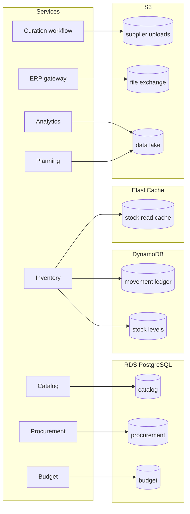
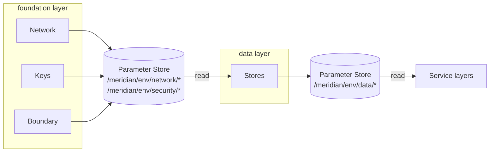

# Data architecture

Which store holds what, how sensitive it is, how long it is kept and how it is recovered. The stores are built by the `data` layer of each environment.

- [Stores](#stores)
- [One store per service](#one-store-per-service)
- [Classification](#classification)
- [Retention and recovery](#retention-and-recovery)
- [Differences between environments](#differences-between-environments)
- [The data layer](#the-data-layer)
- [How it is enforced](#how-it-is-enforced)

## Stores

| Store                           | Technology     | Module              | Owner       | Why this technology                                                                                                          |
| ------------------------------- | -------------- | ------------------- | ----------- | ---------------------------------------------------------------------------------------------------------------------------- |
| Product master, suppliers       | RDS PostgreSQL | `postgres-database` | Catalog     | Relational, with constraints between products, suppliers and units                                                           |
| Purchase orders, goods receipts | RDS PostgreSQL | `postgres-database` | Procurement | Transactions across order lines                                                                                              |
| Budgets, commitments, approvals | RDS PostgreSQL | `postgres-database` | Budget      | Strong consistency on money                                                                                                  |
| Movement ledger                 | DynamoDB       | `dynamodb-table`    | Inventory   | Append-only, very high write volume, read by batch and by warehouse. See the [inventory data model](inventory-data-model.md) |
| Stock levels                    | DynamoDB       | `dynamodb-table`    | Inventory   | Conditional writes enforce that stock never goes negative                                                                    |
| Stock read cache                | ElastiCache    | `redis-cache`       | Inventory   | Read far more often than it changes. Can be rebuilt from the tables                                                          |
| Supplier uploads                | S3             | `data-bucket`       | Curation    | Files, kept as received                                                                                                      |
| File exchange                   | S3             | `data-bucket`       | ERP gateway | Files to and from the finance system                                                                                         |
| Data lake                       | S3             | `data-bucket`       | Analytics   | Every event, kept cheaply, queried with Athena                                                                               |

The modules are added one at a time in this milestone. A store that belongs to a service is created in the `data` layer, with the service's name as its component, when that service is first needed. Keeping every store in this layer means a change to a service's compute can never produce a plan that touches its data. The supplier uploads bucket is the first.

## One store per service

A store has exactly one owner, and only the owner reads or writes it. Another service that needs the data calls the owner's API or consumes its events ([decision record 0006](../adr/0006-event-backbone-and-messaging-conventions.md)).

This is why catalog, procurement and budget each have a database of their own and not a shared one. A shared database couples services through its schema: one team's migration breaks another team's query, and nobody can say who is allowed to change a table.

The cost is that there are no joins across services. Reports that need them are built from events in the data lake, never by querying the operational databases.

## Classification

Every store carries a `DataClassification` tag. It says how bad it would be if the contents were disclosed, and it decides access, retention and backup.

| Level          | Meaning                                             | Examples here                                             | Consequences                                                           |
| -------------- | --------------------------------------------------- | --------------------------------------------------------- | ---------------------------------------------------------------------- |
| `public`       | Meant to be published                               | The dashboard's static files                              | No restriction on reading. Still encrypted and versioned               |
| `internal`     | For staff. Disclosure is embarrassing, not damaging | Stock levels, movements, the stock cache                  | Read by the owning service and by operators through its API            |
| `confidential` | Disclosure harms the business or a partner          | Supplier prices, purchase orders, budgets, supplier files | Read by the owning service only. Backed up. Access is logged           |
| `restricted`   | Disclosure has legal consequences                   | None at present. Personal data would be                   | As confidential, plus a key and a review of its own before it is added |

The platform holds business data about products, stock and money. It holds almost no personal data: the names and work contact details of supplier contacts and of users. If that changes, the new data is classified `restricted` and gets its own decision record.

## Retention and recovery

RPO is how much recent data may be lost in a recovery. RTO is how long the recovery may take. These are the targets the configuration is built to meet. They have not been measured, because the emulator cannot measure them.

| Store                                     | Classification | Kept for                                 | Protection                                                                                                                                                        | RPO target     | RTO target |
| ----------------------------------------- | -------------- | ---------------------------------------- | ----------------------------------------------------------------------------------------------------------------------------------------------------------------- | -------------- | ---------- |
| Catalog, procurement and budget databases | `confidential` | As long as the business needs            | Automated backups with point-in-time recovery for 14 days, a standby in a second zone, a final snapshot on deletion, a daily copy in the backup vault for 35 days | 5 minutes      | 1 hour     |
| Movement ledger                           | `internal`     | 7 years. It is the audit record of stock | Point-in-time recovery for 35 days, a daily copy in the backup vault                                                                                              | 5 minutes      | 1 hour     |
| Stock levels                              | `internal`     | Current state only                       | Point-in-time recovery for 35 days. Can also be rebuilt by replaying the ledger                                                                                   | 5 minutes      | 1 hour     |
| Stock read cache                          | `internal`     | Hours                                    | None needed. Rebuilt from the tables                                                                                                                              | Not applicable | 15 minutes |
| Supplier uploads                          | `confidential` | 1 year, then deleted                     | Versioning. Old versions kept 90 days                                                                                                                             | None lost      | Minutes    |
| File exchange                             | `confidential` | 1 year, then deleted                     | Versioning                                                                                                                                                        | None lost      | Minutes    |
| Data lake                                 | `confidential` | 7 years, in colder storage after 90 days | Versioning. Can be rebuilt from the source events for as long as those are retained                                                                               | None lost      | Minutes    |

## Differences between environments

Structure is identical. Sizes and redundancy differ, as values in each environment's `env.tfvars`.

|                                   | dev                                | staging   | production |
| --------------------------------- | ---------------------------------- | --------- | ---------- |
| Database standby in a second zone | No                                 | Yes       | Yes        |
| Database backup retention         | 1 day                              | 7 days    | 14 days    |
| Deletion protection               | Off, the environment is disposable | On        | On         |
| Cache replicas                    | None                               | One       | Two        |
| DynamoDB capacity                 | On demand                          | On demand | On demand  |

## The data layer

The `data` layer is applied after `foundation` and destroyed before it. It reads the subnets, the data security group, the keys and the boundary from Parameter Store, and publishes each store's name, ARN and endpoint the same way. It reads no other layer's state file, so a consumer needs access to a parameter path and not to a state file ([decision record 0008](../adr/0008-layered-state-per-environment.md)).

A missing parameter fails the plan with the parameter's name, which is the signal that the foundation layer has not been applied.

## How it is enforced

| Rule                                                                             | Where                                                                |
| -------------------------------------------------------------------------------- | -------------------------------------------------------------------- |
| Every data store carries a `DataClassification` from the scheme                  | Policy `POL-TAG-4`                                                   |
| A data store is not deleted or replaced outside dev without a recorded exception | Policy `POL-PROTECT-1`                                               |
| Stores are encrypted with the data key                                           | Each module, with tests, and the scanner                             |
| Stores are in the data subnets with the data security group                      | Each module's inputs, and the smoke test                             |
| Layers are applied and destroyed in order                                        | `scripts/layers.sh`, used by `make apply-all` and `make destroy-all` |
