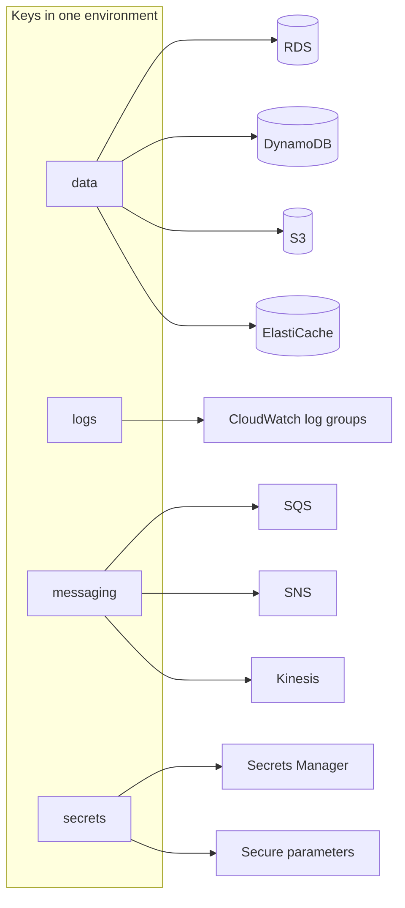

# Encryption standard

What is encrypted, with which key, and how that is checked. The reasoning for the key layout is in [decision record 0010](../adr/0010-one-encryption-key-per-data-class.md).

- [The standard](#the-standard)
- [Keys](#keys)
- [Which key for which resource](#which-key-for-which-resource)
- [Who can use a key](#who-can-use-a-key)
- [In transit](#in-transit)
- [Operations](#operations)
- [How it is enforced](#how-it-is-enforced)
- [What the emulator does not prove](#what-the-emulator-does-not-prove)

## The standard

1. **Everything stored is encrypted at rest with a customer managed key.** AWS managed keys and service-owned keys are not used where the service accepts a customer managed key.
2. **Everything sent is encrypted in transit.** TLS to every endpoint, and resource policies that refuse plain connections where a service supports such a policy.
3. **Keys rotate every year**, automatically.
4. **A key is never deleted in less than 14 days**, and 30 by default.
5. **Access to a key is granted through IAM**, to named roles, for named actions.

## Keys

Each environment has four keys, created by the `foundation` layer with the [`kms-key` module](../../infra/modules/kms-key/README.md).

| Key         | Alias                            | Parameter with its ARN                           |
| ----------- | -------------------------------- | ------------------------------------------------ |
| `data`      | `alias/meridian-<env>-data`      | `/meridian/<env>/security/kms/data-key-arn`      |
| `logs`      | `alias/meridian-<env>-logs`      | `/meridian/<env>/security/kms/logs-key-arn`      |
| `messaging` | `alias/meridian-<env>-messaging` | `/meridian/<env>/security/kms/messaging-key-arn` |
| `secrets`   | `alias/meridian-<env>-secrets`   | `/meridian/<env>/security/kms/secrets-key-arn`   |

Two further keys exist outside the four. The Terraform state bucket has its own in the shared account, created by the bootstrap stack. The backup vault has its own, `alias/meridian-<env>-backup`, created by the `data` layer, so that a role able to decrypt a store cannot by that fact read a backup of it.

## Which key for which resource

| Resource                                      | Key         | Set through                                     |
| --------------------------------------------- | ----------- | ----------------------------------------------- |
| RDS instance, snapshots, performance insights | `data`      | `kms_key_id`, `performance_insights_kms_key_id` |
| DynamoDB table                                | `data`      | `server_side_encryption`                        |
| S3 bucket                                     | `data`      | Default encryption, with a bucket key           |
| ElastiCache replication group                 | `data`      | `kms_key_id`                                    |
| EBS volume                                    | `data`      | `kms_key_id`                                    |
| CloudWatch log group                          | `logs`      | `kms_key_id`                                    |
| SQS queue                                     | `messaging` | `kms_master_key_id`                             |
| SNS topic                                     | `messaging` | `kms_master_key_id`                             |
| Kinesis stream                                | `messaging` | `encryption_type`, `kms_key_id`                 |
| Secrets Manager secret                        | `secrets`   | `kms_key_id`                                    |
| Secure string parameter                       | `secrets`   | `key_id`                                        |

A module that creates one of these takes the key's ARN as an input. It never looks a key up and never creates one of its own.

## Who can use a key

The key policy has at most two statements.

| Statement                             | Principal          | Why                                                                                                                                          |
| ------------------------------------- | ------------------ | -------------------------------------------------------------------------------------------------------------------------------------------- |
| Account manages access through IAM    | The account root   | Makes IAM policies effective for the key. Without it, only the key policy could grant access, and every new role would mean editing the key  |
| Services use the key for this account | Named AWS services | Only on keys a service must use directly. Conditioned on `aws:SourceAccount`, so the service cannot use the key on behalf of another account |

| Key         | Services named in the key policy | Reason                                                             |
| ----------- | -------------------------------- | ------------------------------------------------------------------ |
| `data`      | None                             | RDS, DynamoDB and S3 use the key through grants made by the caller |
| `logs`      | CloudWatch Logs                  | Logs encrypts with the key itself when a log event arrives         |
| `messaging` | EventBridge, S3, SNS             | Each delivers into encrypted queues and must generate a data key   |
| `secrets`   | None                             | Secrets Manager uses the caller's permission                       |

The account root statement allows `kms:*`. That does not give every principal in the account access: it means a principal has access only if an IAM policy grants it. Which roles get `kms:Decrypt` on which key is part of the IAM foundations.

## In transit

| Path                     | Protection                                                              |
| ------------------------ | ----------------------------------------------------------------------- |
| Client to load balancer  | TLS 1.2 or later, terminated at the load balancer                       |
| Workload to AWS API      | TLS, through VPC endpoints where one exists                             |
| Workload to database     | TLS required by a database parameter                                    |
| Workload to cache        | In-transit encryption on the replication group                          |
| Any client to S3         | A bucket policy that denies requests with `aws:SecureTransport` false   |
| Any client to SQS or SNS | A resource policy that denies requests with `aws:SecureTransport` false |

Each row is implemented by the module for that resource as it is built.

## Operations

**Rotation.** AWS replaces the key material once a year and keeps the old material, so nothing needs to be re-encrypted and no application changes.

**Disabling a key** is the emergency stop for a class of data. Disabling the `data` key makes every database, table and bucket in the environment unreadable until it is enabled again. It is reversible.

**Deleting a key** is not reversible. It is scheduled, with a waiting period of 30 days during which it can be cancelled. The policy check `POL-PROTECT-1` refuses a plan that deletes a key outside dev unless the deletion is a recorded exception.

**Seeing who used a key.** Every use of a key is an event in CloudTrail (`Decrypt`, `GenerateDataKey`) with the calling role and the resource it was used for.

## How it is enforced

| Rule                                                                  | Where                                                                                           |
| --------------------------------------------------------------------- | ----------------------------------------------------------------------------------------------- |
| Keys rotate                                                           | The module has no input to turn rotation off. Policy `POL-KMS-1` checks every key in every plan |
| Deletion window of at least 14 days                                   | Policy `POL-KMS-2`                                                                              |
| Log groups are encrypted with a customer managed key                  | Policy `POL-LOG-3`                                                                              |
| Key aliases carry the environment                                     | Policy `POL-NAME-4`                                                                             |
| Keys are not deleted by accident                                      | Policy `POL-PROTECT-1`                                                                          |
| The four keys exist, rotate, and the flow log group uses the logs key | `make smoke`                                                                                    |
| Unencrypted resources of other types                                  | `make scan`, as each module is added                                                            |

## What the emulator does not prove

The emulator creates keys, aliases and key policies and returns them through the API. It does not enforce a key policy: a principal the policy excludes can still use the key. It also does not report a custom rotation period, which is why the module leaves the period unset unless asked (row 9 in [emulator differences](emulator-differences.md)). That the right roles, and only those, can decrypt is checked statically and remains to be proven on a real account.
