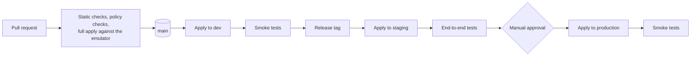

# Environments, naming and tagging

How environments differ, and the standard every resource name and tag follows. The reasoning is in [decision record 0007](../adr/0007-environments-and-account-isolation.md).

- [What differs between environments](#what-differs-between-environments)
- [Promotion](#promotion)
- [Naming standard](#naming-standard)
- [Tagging standard](#tagging-standard)
- [Network address plan](#network-address-plan)

## What differs between environments

Structure is identical everywhere. Only these values change. The figures are the intended settings for a real deployment and are design targets, not measurements.

| Setting                 | `dev`                           | `staging`                  | `production`                             |
| ----------------------- | ------------------------------- | -------------------------- | ---------------------------------------- |
| Availability zones      | 3                               | 3                          | 3                                        |
| NAT gateways            | 1, shared                       | 3, one per zone            | 3, one per zone                          |
| RDS                     | Single instance, smallest class | Multi-AZ, production class | Multi-AZ, production class, read replica |
| RDS backup retention    | 1 day                           | 7 days                     | 35 days                                  |
| RDS deletion protection | Off                             | On                         | On                                       |
| DynamoDB                | On-demand                       | On-demand                  | On-demand, point-in-time recovery        |
| EKS node group          | 2 nodes, spot                   | 3 nodes, on-demand         | 3 to 12 nodes, on-demand                 |
| ECS service task count  | 1                               | 2                          | 3 or more, autoscaled                    |
| Kinesis                 | 1 shard                         | 2 shards                   | On-demand                                |
| Log retention           | 7 days                          | 30 days                    | 365 days                                 |
| Alarms notify           | Nobody, dashboards only         | Team channel               | On-call                                  |
| Deploy trigger          | Merge to `main`                 | Release tag                | Release tag and manual approval          |
| WAF                     | Count mode                      | Block mode                 | Block mode                               |

`dev` trades resilience for cost. `staging` matches production in shape so that a release is rehearsed on the same topology.

## Promotion



The same commit moves through all three. Nothing is rebuilt or re-planned from a different source between staging and production: container images are promoted by digest, and Terraform applies the same module versions with different values.

## Naming standard

```
<project>-<environment>-<component>[-<qualifier>]
```

| Part        | Values                                         | Example                          |
| ----------- | ---------------------------------------------- | -------------------------------- |
| project     | `meridian`                                     |                                  |
| environment | `dev`, `stg`, `prod`                           |                                  |
| component   | The service or building block, in kebab case   | `inventory`, `network`, `events` |
| qualifier   | What distinguishes this resource from siblings | `private-a`, `dlq`, `task-role`  |

Examples:

| Resource                        | Name                                                                             |
| ------------------------------- | -------------------------------------------------------------------------------- |
| VPC                             | `meridian-prod-network`                                                          |
| Private subnet in zone a        | `meridian-prod-network-private-a`                                                |
| Catalog database                | `meridian-prod-catalog-db`                                                       |
| Movement ledger table           | `meridian-prod-inventory-movements`                                              |
| Queue and its dead-letter queue | `meridian-prod-budget-goods-received`, `meridian-prod-budget-goods-received-dlq` |
| ECS task role                   | `meridian-prod-catalog-task-role`                                                |
| KMS key alias                   | `alias/meridian-prod-data`                                                       |

Rules:

1. Lower case, hyphens, no underscores. It is valid in every AWS service, including S3 and DNS.
2. The environment is always the second part, so a name says where a resource lives without a console lookup.
3. S3 bucket names are global, so they also carry the account identifier and region: `meridian-prod-datalake-<account>-<region>`.
4. Names are built in one place, a naming module, and never concatenated by hand in a resource.
5. Kubernetes objects drop the project and environment, because the cluster and namespace already say it.

## Tagging standard

Every resource that supports tags carries these, applied through provider default tags so that none can be forgotten.

| Tag                  | Example                                            | Purpose                                                                                                                             |
| -------------------- | -------------------------------------------------- | ----------------------------------------------------------------------------------------------------------------------------------- |
| `Project`            | `meridian`                                         | Separates this platform from anything else in the account                                                                           |
| `Environment`        | `prod`                                             | Filtering, and conditions in IAM policies                                                                                           |
| `Component`          | `inventory`                                        | Which service or building block owns the resource                                                                                   |
| `Owner`              | `platform`                                         | The team to ask                                                                                                                     |
| `CostCentre`         | `supply-chain`                                     | Cost allocation                                                                                                                     |
| `ManagedBy`          | `terraform`                                        | Marks anything that must not be changed by hand                                                                                     |
| `Repository`         | `Akinz-bobo/meridian-supply-platform`              | Where the definition lives                                                                                                          |
| `DataClassification` | `public`, `internal`, `confidential`, `restricted` | On data stores only. Drives access, retention and backup. The levels are defined in the [data architecture](data.md#classification) |

A policy check fails any plan that creates a taggable resource without `Project`, `Environment`, `Component` and `ManagedBy`.

## Network address plan

Each environment gets a /16 that does not overlap any other, so that environments could be peered or connected to a shared network later without renumbering.

| Environment       | VPC CIDR       |
| ----------------- | -------------- |
| `dev`             | `10.10.0.0/16` |
| `staging`         | `10.20.0.0/16` |
| `production`      | `10.30.0.0/16` |
| `shared-services` | `10.0.0.0/16`  |

Inside each VPC, with three zones:

| Tier    | Size per zone | Zone a         | Zone b         | Zone c         | Addresses per subnet |
| ------- | ------------- | -------------- | -------------- | -------------- | -------------------- |
| Public  | /24           | `x.x.0.0/24`   | `x.x.1.0/24`   | `x.x.2.0/24`   | 251                  |
| Private | /19           | `x.x.32.0/19`  | `x.x.64.0/19`  | `x.x.96.0/19`  | 8,187                |
| Data    | /24           | `x.x.160.0/24` | `x.x.161.0/24` | `x.x.162.0/24` | 251                  |

Private subnets are large on purpose: on EKS every pod takes an address from the subnet, so a busy cluster uses thousands. Public and data subnets hold only a handful of load balancer, gateway and database interfaces. The ranges between tiers are left free for growth.
