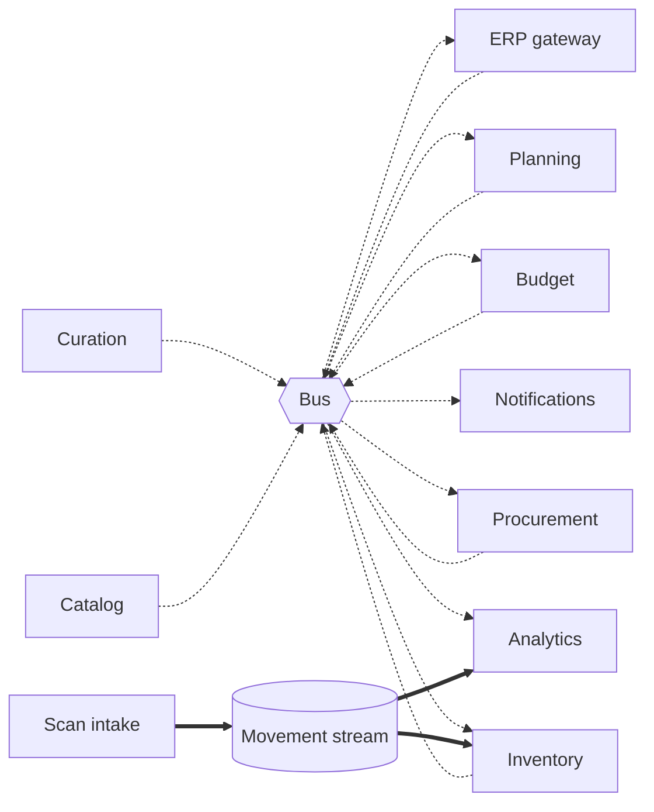

# Event catalogue

Every business event planned for the platform, who publishes it and who consumes it. The conventions (naming, envelope, delivery rules) are in [decision record 0006](../adr/0006-event-backbone-and-messaging-conventions.md).

> This is the planned catalogue. Each event is marked as implemented when its producer is merged, and its schema is added then.

## Events on the bus

| Event                      | Published by | When                                                         | Consumed by                               | Status       |
| -------------------------- | ------------ | ------------------------------------------------------------ | ----------------------------------------- | ------------ |
| `SupplierFileReceived`     | Curation     | A supplier file passed format checks                         | Analytics                                 | Planned (M6) |
| `ProductPublished`         | Catalog      | A product was approved into the product master, or changed   | Inventory, planning, analytics            | Planned (M6) |
| `ProductWithdrawn`         | Catalog      | A product was removed from sale                              | Inventory, planning, procurement          | Planned (M6) |
| `StockChanged`             | Inventory    | The stock level of a batch in a zone changed                 | Planning, analytics                       | Planned (M7) |
| `BatchShortDated`          | Inventory    | A batch entered its minimum remaining shelf life             | Planning, notifications                   | Planned (M7) |
| `BatchExpired`             | Inventory    | A batch passed its expiry date and was quarantined           | Analytics, notifications                  | Planned (M7) |
| `BatchRecalled`            | Inventory    | A recall quarantined a batch everywhere                      | Procurement, notifications                | Planned (M7) |
| `StockDiscrepancyDetected` | Inventory    | A movement was rejected because it would make stock negative | Notifications                             | Planned (M7) |
| `PurchaseOrderRaised`      | Procurement  | A draft order was created                                    | Budget                                    | Planned (M8) |
| `PurchaseOrderSent`        | Procurement  | An order was sent to the supplier                            | Planning, ERP gateway, analytics          | Planned (M8) |
| `PurchaseOrderCancelled`   | Procurement  | An order was cancelled                                       | Budget, planning                          | Planned (M8) |
| `GoodsReceived`            | Procurement  | A delivery was accepted against an order                     | Inventory, budget, ERP gateway, analytics | Planned (M8) |
| `BudgetCommitted`          | Budget       | Budget was reserved for an order                             | Procurement, analytics                    | Planned (M8) |
| `BudgetCommitmentReleased` | Budget       | A reservation was released                                   | Analytics                                 | Planned (M8) |
| `BudgetExceeded`           | Budget       | A request was refused for lack of budget                     | Notifications                             | Planned (M8) |
| `ApprovalRequested`        | Budget       | An order needs a finance controller                          | Notifications                             | Planned (M8) |
| `ForecastUpdated`          | Planning     | A new demand forecast was produced                           | Analytics                                 | Planned (M9) |
| `ReplenishmentProposed`    | Planning     | Proposals are ready for buyers                               | Notifications                             | Planned (M9) |
| `PaymentStatusChanged`     | ERP gateway  | The finance system reported a payment                        | Procurement, budget                       | Planned (M8) |

## The movement stream

Warehouse scans do not go over the bus. They are written to a Kinesis stream partitioned by warehouse, so that the movements of one warehouse are processed in order.

| Record                                                              | Written by  | Read by                                                                              |
| ------------------------------------------------------------------- | ----------- | ------------------------------------------------------------------------------------ |
| `MovementRecorded` (receipt, transfer, pick, adjustment, write-off) | Scan intake | Inventory, which applies it to the ledger. Firehose, which lands it in the data lake |

## Who talks to whom

No arrow goes directly from one service to another. Every dependency between services at run time is on the bus or the stream, with two exceptions that are synchronous by design: procurement asking budget for a commitment, and the curation workflow calling the catalog API.
