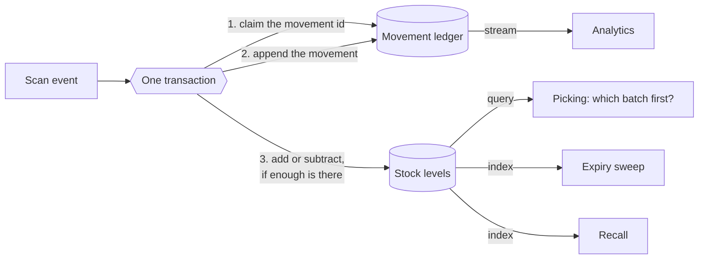

# Inventory data model

How stock is stored in DynamoDB: the two tables, their keys, the questions each key answers, and how the domain rules are enforced by the database and not by hoping application code is careful.

- [What the model must do](#what-the-model-must-do)
- [Two tables](#two-tables)
- [The movement ledger](#the-movement-ledger)
- [Stock levels](#stock-levels)
- [Recording a movement](#recording-a-movement)
- [Access patterns](#access-patterns)
- [Why not one table, and why not SQL](#why-not-one-table-and-why-not-sql)
- [Checking the design](#checking-the-design)
- [Limits](#limits)

## What the model must do

From the [domain model](../domain/domain-model.md#inventory):

| Rule  | Requirement                                                                      | Where it is enforced                                                                          |
| ----- | -------------------------------------------------------------------------------- | --------------------------------------------------------------------------------------------- |
| INV-1 | Stock is tracked per batch, per zone                                             | The sort key of a stock level contains both                                                   |
| INV-3 | First expired, first out                                                         | The sort key orders batches by expiry date, so the first item of a query is the batch to pick |
| INV-4 | Batches are quarantined at expiry                                                | An index lists everything that expires on a given day                                         |
| INV-5 | Stock is never negative                                                          | A condition on the update. DynamoDB rejects the write                                         |
| INV-6 | Levels change only through recorded movements. The ledger is the source of truth | A level and its movement are written in one transaction                                       |
| INV-7 | A recalled batch can be found everywhere at once                                 | An index by batch                                                                             |

And one that is not a domain rule: the same scan event may arrive more than once, because the pipeline delivers at least once ([decision record 0006](../adr/0006-event-backbone-and-messaging-conventions.md)). Recording it twice must be impossible.

## Two tables

| Table                                   | Holds                                           | Changes                   | Could be rebuilt from       |
| --------------------------------------- | ----------------------------------------------- | ------------------------- | --------------------------- |
| `meridian-<env>-inventory-movements`    | Every movement that ever happened               | Append only               | Nothing. It is the record   |
| `meridian-<env>-inventory-stock-levels` | The current quantity of each batch in each zone | Updated by every movement | The ledger, by replaying it |

Both are defined in `infra/environments/<env>/data/tables.tf` with the [`dynamodb-table` module](../../infra/modules/dynamodb-table/README.md).

## The movement ledger

Two kinds of item share the table.

| Item               | `pk`                     | `sk`                        | `gsi1pk`                    | `gsi1sk`               |
| ------------------ | ------------------------ | --------------------------- | --------------------------- | ---------------------- |
| Movement           | `BATCH#<batch>`          | `MOVE#<time>#<movement id>` | `WH#<warehouse>#DAY#<date>` | `<time>#<movement id>` |
| Movement id marker | `MOVEMENT#<movement id>` | `MOVEMENT`                  |                             |                        |

- A movement carries the product, zone, signed quantity, type (receipt, pick, transfer, adjustment, quarantine) and who or what caused it.
- Movements of a batch sort by time, because the sort key starts with an ISO 8601 timestamp, which sorts as text in time order.
- The marker exists only to make a movement id unique. It is written with the condition that it does not already exist.
- The table has a stream of new items. It feeds analytics, and is how a second copy of stock levels could be derived.

Index `by-warehouse-day` answers "what happened in this warehouse today", in time order. The partition is one warehouse for one day, which keeps any single partition from growing without limit.

## Stock levels

One kind of item: the quantity of one batch in one zone.

| Attribute          | Value                                                        | Purpose                                               |
| ------------------ | ------------------------------------------------------------ | ----------------------------------------------------- |
| `pk`               | `PRODUCT#<sku>`                                              | All stock of a product is one query                   |
| `sk`               | `WH#<warehouse>#EXP#<expiry date>#BATCH#<batch>#ZONE#<zone>` | Within a warehouse, batches come back in expiry order |
| `quantity`         | Number                                                       | What is on hand                                       |
| `gsi1pk`, `gsi1sk` | `EXP#<expiry date>`, `PRODUCT#<sku>#BATCH#<batch>`           | Index `by-expiry-date`: everything expiring on a day  |
| `gsi2pk`, `gsi2sk` | `BATCH#<batch>`, `WH#<warehouse>#ZONE#<zone>`                | Index `by-batch`: everywhere a batch is held          |

The order of the parts of the sort key is the design. Warehouse first, because picking always happens in one warehouse. Expiry date second, because within a warehouse the question is which batch expires first. With the date in ISO format, DynamoDB's ordinary ascending sort is first expired, first out. No sorting happens in application code and no batch can be overlooked.

`by-expiry-date` projects keys only. The sweep needs to know which items to update, and reading them is a separate step.

## Recording a movement

Every movement is one `TransactWriteItems` call with three writes:

| #   | Write                                              | Condition                                   | If the condition fails                                                                                            |
| --- | -------------------------------------------------- | ------------------------------------------- | ----------------------------------------------------------------------------------------------------------------- |
| 1   | Put the movement id marker                         | The marker does not exist                   | The movement was already recorded. The whole transaction is cancelled, which is the right outcome for a duplicate |
| 2   | Put the movement                                   | None                                        |                                                                                                                   |
| 3   | Update the stock level, adding the signed quantity | For a removal: `quantity >= amount removed` | There is not enough stock. The whole transaction is cancelled and nothing is recorded                             |

All three happen or none does. That gives:

- **Exactly once.** A duplicate fails on write 1 and changes nothing.
- **Never negative.** The check and the subtraction are one atomic operation inside DynamoDB. Two picks racing for the last units cannot both succeed, however many instances of the service are running.
- **The ledger and the level cannot disagree.** There is no moment at which a movement exists without its effect, or the effect without its movement.

A receipt uses `ADD`, which creates the level if it does not exist, and sets the index attributes at the same time.

The caller tells a duplicate from a shortage by the cancellation reason of each write, and treats the first as success and the second as a rejection to report.

## Access patterns

Every question the service asks, and how it is answered. There is no `Scan`: the [read policy](../../infra/modules/dynamodb-table/README.md) does not grant it.

| Question                                                                   | Table or index     | Key condition                                                   |
| -------------------------------------------------------------------------- | ------------------ | --------------------------------------------------------------- |
| How much of this product is in this warehouse, and which batch goes first? | `stock-levels`     | `pk = PRODUCT#<sku>` and `sk` begins with `WH#<warehouse>#EXP#` |
| How much of this product is there anywhere?                                | `stock-levels`     | `pk = PRODUCT#<sku>`                                            |
| What expires on this day?                                                  | `by-expiry-date`   | `gsi1pk = EXP#<date>`                                           |
| Where is this batch?                                                       | `by-batch`         | `gsi2pk = BATCH#<batch>`                                        |
| What is the history of this batch?                                         | `movements`        | `pk = BATCH#<batch>` and `sk` begins with `MOVE#`               |
| What happened in this warehouse on this day?                               | `by-warehouse-day` | `gsi1pk = WH#<warehouse>#DAY#<date>`                            |
| Has this movement been recorded?                                           | `movements`        | `pk = MOVEMENT#<id>`, `sk = MOVEMENT`                           |

## Why not one table, and why not SQL

**One table for both.** Single-table design puts everything a query needs in one partition. Here the two kinds of data are never read together: picking reads levels, audit reads the ledger. They also differ in every operational respect. The ledger only grows and is kept for seven years. Levels are small and constantly rewritten. Separate tables let each have its own stream, its own backup schedule and its own cost line.

**PostgreSQL.** A relational database could enforce all of this with a transaction and a check constraint, and the queries would be easier to write. It was not chosen because of the write volume in the [domain model](../domain/domain-model.md) and its shape: hundreds of thousands of movements a day at peak, arriving in bursts when a warehouse shift starts. That is a workload where a single primary becomes the limit and the access patterns are few and known in advance, which is the case DynamoDB is built for. The services with relational data and modest volume, catalog, procurement and budget, do use PostgreSQL.

The cost of the choice is that a new question needs a new index, decided in advance. A question nobody anticipated is answered from the data lake, not from these tables.

## Checking the design

`make data-check ENV=<env>` runs [`scripts/data-model-check.sh`](../../scripts/data-model-check.sh) against the real tables of an applied environment. It writes a few items under a product code of its own, checks each promise through the DynamoDB API, and removes what it wrote.

| Check                                                                                                | Rule                     |
| ---------------------------------------------------------------------------------------------------- | ------------------------ |
| A receipt creates the level with the received quantity                                               | INV-1                    |
| The same movement sent twice is refused, and changes nothing                                         | Exactly once             |
| A pick within stock succeeds and reduces the level                                                   | INV-6                    |
| A pick of more than is on hand is refused, changes nothing and leaves no trace in the ledger         | INV-5                    |
| Ten picks at the same moment against stock for five: exactly five succeed and the level ends at zero | INV-5, under concurrency |
| A product query returns batches earliest expiry first                                                | INV-3                    |
| The expiry index lists what expires on a day                                                         | INV-4                    |
| The batch index finds every place a batch is held                                                    | INV-7                    |
| The ledger lists a batch's movements in time order                                                   | INV-6                    |
| The warehouse index lists a day's movements in time order                                            | Operations               |

It runs in the pipeline after every apply, in every environment. A change to a key or an index that breaks an access pattern fails the pull request.

The infrastructure side, that the tables are encrypted with the data key, can be restored to a point in time and have their indexes and stream, is in the smoke test.

## Limits

- **The emulator is not DynamoDB.** Conditional writes, transactions and indexes all behaved as documented in these checks, including under ten concurrent writers. That is evidence about the design and about the emulator. It is not a load test. Throughput, throttling, hot partitions and the latency of index updates can only be observed on AWS.
- **Indexes are eventually consistent.** A query on an index can miss a write made milliseconds earlier. The sweep and a recall therefore run again after a delay, and picking uses the table itself, where reads can be strongly consistent.
- **A transaction is limited to 100 items and cannot span regions.** A movement uses three.
- **The service does not exist yet.** The transaction above is implemented in the check script. The inventory service, in milestone 7, implements it in application code and is tested against the same tables.
