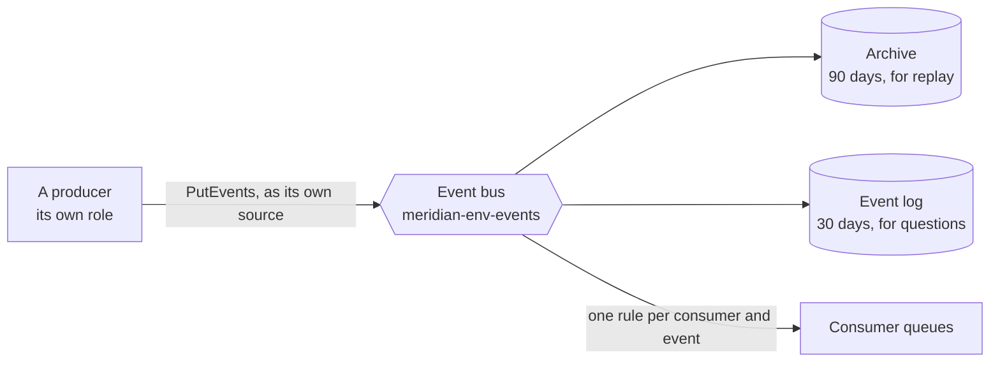
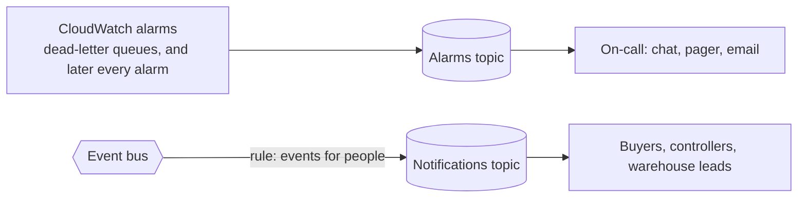

# Messaging

How services tell each other what happened: the bus, the contract every event follows, and who is allowed to say what. The reasoning is in [decision record 0006](../adr/0006-event-backbone-and-messaging-conventions.md), and the list of events is the [event catalogue](events.md).

This document grows through milestone 4. It covers the bus, the contract, consumer queues and notification topics. The movement stream is added when it is built.

- [The shape of it](#the-shape-of-it)
- [The bus](#the-bus)
- [The contract](#the-contract)
- [Who may publish what](#who-may-publish-what)
- [Consumer queues](#consumer-queues)
- [Topics](#topics)
- [The messaging layer](#the-messaging-layer)
- [How it is enforced](#how-it-is-enforced)
- [What the emulator does not prove](#what-the-emulator-does-not-prove)

## The shape of it



A producer puts an event on the bus and knows nothing about who receives it. A consumer never reads the bus: it has a queue of its own, fed by a rule. Adding a consumer changes nothing for the producer.

## The bus

One bus per environment, `meridian-<env>-events`, built by the [`event-bus` module](../../infra/modules/event-bus/README.md).

| Part             | Purpose                                                                                                   |
| ---------------- | --------------------------------------------------------------------------------------------------------- |
| Bus              | Receives events and matches them against rules                                                            |
| Bus policy       | Denies publishing to anything outside the account                                                         |
| Archive          | Keeps every event for 90 days, so a new consumer, or one that lost data, can have the past replayed to it |
| Event log        | A readable copy of every event for 30 days. "Was it published, and what did it say" is a query            |
| Publish policies | One per producer, limited to that producer's source                                                       |

The archive and the log overlap on purpose. The archive can be replayed and cannot be read. The log can be read and cannot be replayed.

## The contract

Every event has the same envelope, defined as JSON Schema in [`contracts/events`](../../contracts/events/README.md):

```json
{
  "id": "0193b2a4-7c1e-7d3a-9f0b-2a6c1e4d5f60",
  "type": "ProductPublished",
  "version": 1,
  "source": "meridian.catalog",
  "occurredAt": "2031-03-04T09:30:00Z",
  "correlationId": "0193b2a4-6f00-7b11-8e2a-91c0d4e7a3b2",
  "causationId": "0193b2a4-6f9d-7c40-a1d3-5b8e2f0c9a71",
  "data": { "sku": "SKU-1042" }
}
```

| Rule in the schema                           | Why                                                                            |
| -------------------------------------------- | ------------------------------------------------------------------------------ |
| `type` is PascalCase with at least two words | An event is a fact in the past tense: `ProductPublished`, not `publishProduct` |
| `source` is `meridian.<service>`             | It is what the publish policy checks                                           |
| `occurredAt` is UTC, with a time and a `Z`   | A local time read in another zone is a wrong time                              |
| `version` is an integer from 1               | It selects the schema for `data`                                               |
| No field outside the envelope                | Business data goes under `data`, where its own schema applies                  |

`scripts/validate-event.py` checks an event against the envelope, and `data` against the schema for its type and version when the repository has one. It is tested in CI with events that must pass and events that must fail.

## Who may publish what

Two controls, at different levels.

| Control                                                                         | Stops                                                                  |
| ------------------------------------------------------------------------------- | ---------------------------------------------------------------------- |
| Each producer's IAM policy allows `events:PutEvents` only with its own `source` | A service publishing an event that claims to come from another service |
| The bus policy denies principals outside the account                            | Anyone adding the bus to another account's reach                       |

What neither stops: a service publishing a well-formed event with wrong content under its own name. A consumer trusts the producer for the facts. That is why the producer is identified and cannot be impersonated.

## Consumer queues

A consumer never reads the bus. It has a queue for each event it is interested in, built by the [`event-consumer-queue` module](../../infra/modules/event-consumer-queue/README.md), which has the diagram.

| The queue gives the consumer | How                                                                                                                    |
| ---------------------------- | ---------------------------------------------------------------------------------------------------------------------- |
| Buffering                    | Events wait in the queue while the consumer is slow, deploying or down. Four days by default                           |
| Retries                      | A message that is received and not deleted becomes visible again and is delivered again                                |
| Isolation                    | Each consumer has its own queue. One consumer's backlog or poison message does not touch another                       |
| A place for failures         | After five failed receives a message moves to the dead-letter queue, raises an alarm and waits 14 days to be looked at |

The first three queues:

| Queue                                        | Consumer  | Event              | For                                                                         |
| -------------------------------------------- | --------- | ------------------ | --------------------------------------------------------------------------- |
| `meridian-<env>-inventory-product-published` | Inventory | `ProductPublished` | Knowing a product's storage class and shelf life before stock of it arrives |
| `meridian-<env>-inventory-goods-received`    | Inventory | `GoodsReceived`    | Recording the receipt as a movement                                         |
| `meridian-<env>-budget-goods-received`       | Budget    | `GoodsReceived`    | Turning a commitment into actual spend                                      |

Two of them take the same event. That is the point of the design: procurement publishes `GoodsReceived` once and does not know that two services act on it.

A queue is added to `messaging/consumers.tf` when its consumer is about to be built. Each queue's URL is published under the consumer's own path, `/meridian/<env>/<service>/queues/<event>-url`.

**What a consumer must do.** Delivery is at least once, so a consumer records each event `id` with its effect and ignores one it has seen. It deletes a message only after its effect is committed. It lets a message it cannot process fail, so that the message reaches the dead-letter queue, and does not swallow the error.

## Topics

Two per environment, built by the [`notification-topic` module](../../infra/modules/notification-topic/README.md).



| Topic                          | Receives                                                                                                                                                                                         | From              |
| ------------------------------ | ------------------------------------------------------------------------------------------------------------------------------------------------------------------------------------------------ | ----------------- |
| `meridian-<env>-alarms`        | Every alarm state change, to alarm and back to OK                                                                                                                                                | CloudWatch        |
| `meridian-<env>-notifications` | The events that exist to tell a person something: `ApprovalRequested`, `BatchExpired`, `BatchRecalled`, `BatchShortDated`, `BudgetExceeded`, `ReplenishmentProposed`, `StockDiscrepancyDetected` | A rule on the bus |

**Why notifications go through a topic and not a queue.** A queue has one consumer that must process every message. A topic fans out to whoever is subscribed and does not care whether anyone is. An approval request should reach a controller's inbox and the team's chat, and adding a third destination should not involve the budget service.

**Subscriptions are not in this repository.** Who is on call, and which chat channel, differ by environment and change without a deployment. The module takes them as an input, and an environment adds them in its own values. An environment with no subscriptions still has working topics: the messages go nowhere.

**The key policy.** CloudWatch and EventBridge publish as services, so both are named in the topic policy and, in the foundation layer, in the messaging key's policy. Without the second, a message is refused at encryption and the alarm silently notifies nobody. The baseline review of this milestone checks for exactly that.

## The messaging layer

`infra/environments/<env>/messaging`, applied after `data` and destroyed before it. It reads the messaging key, the logs key and the workload boundary from Parameter Store, and publishes the bus under `/meridian/<env>/events/`.

| Parameter             | Used by                                     |
| --------------------- | ------------------------------------------- |
| `bus-name`, `bus-arn` | Producers, and the rules of consumer queues |
| `archive-arn`         | Starting a replay                           |
| `log-group-name`      | Queries during an incident                  |

## How it is enforced

| Rule                                                         | Where                                                                                        |
| ------------------------------------------------------------ | -------------------------------------------------------------------------------------------- |
| A producer publishes only under its own source               | Module tests on the rendered publish policies                                                |
| Nothing outside the account publishes                        | Module test, and the smoke test reading the bus policy back                                  |
| Events follow the envelope                                   | `make contract-test`, in CI                                                                  |
| A contract cannot contain a rule the validator ignores       | The validator refuses unsupported keywords, and a test checks every schema in the repository |
| The bus, archive, log rule and log group exist as configured | `make smoke`                                                                                 |

## What the emulator does not prove

- **Delivery to the event log.** The emulator stores a rule that targets a log group and delivers nothing to it. Difference 23.
- **The `events:source` condition.** IAM is not evaluated, so a producer publishing under another's source is not refused here.
- **Encryption of the bus.** The key is accepted and not returned. Difference 24.

The archive does behave: it counted an event that matched its pattern and ignored one that did not.
