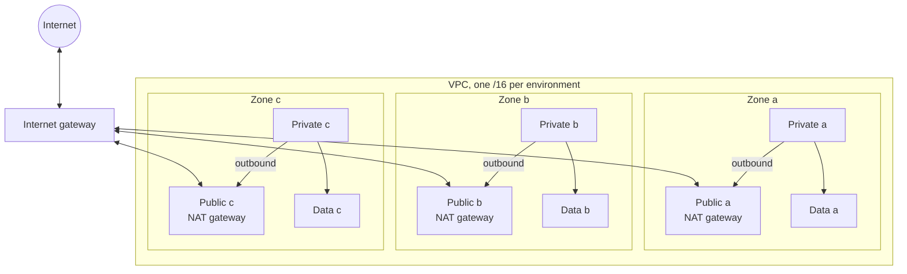

# Network

How each environment's network is laid out, why, and how to check it. The network is built by the [`vpc` module](../../infra/modules/vpc/README.md) and lives in the `foundation` layer.

- [Layout](#layout)
- [Address plan](#address-plan)
- [Routing](#routing)
- [Security groups](#security-groups)
- [Endpoints](#endpoints)
- [Flow logs](#flow-logs)
- [Design decisions](#design-decisions)
- [What other layers read](#what-other-layers-read)
- [Verifying it](#verifying-it)
- [What the emulator does not prove](#what-the-emulator-does-not-prove)

## Layout



| Tier    | Holds                                                                 | Reachable from the internet | Can reach the internet     |
| ------- | --------------------------------------------------------------------- | --------------------------- | -------------------------- |
| Public  | Load balancers, NAT gateways                                          | Yes, through load balancers | Yes                        |
| Private | ECS tasks, EKS nodes and pods, Lambda functions, the EC2 gateway host | No                          | Outbound only, through NAT |
| Data    | RDS, ElastiCache                                                      | No                          | No                         |

## Address plan

The ranges are in [environments, naming and tagging](environments.md#network-address-plan). The module computes them from the VPC's /16, so they cannot drift between environments:

| Tier    | Formula                          | In `10.30.0.0/16`                                    |
| ------- | -------------------------------- | ---------------------------------------------------- |
| Public  | `cidrsubnet(vpc, 8, zone)`       | `10.30.0.0/24`, `10.30.1.0/24`, `10.30.2.0/24`       |
| Private | `cidrsubnet(vpc, 3, zone + 1)`   | `10.30.32.0/19`, `10.30.64.0/19`, `10.30.96.0/19`    |
| Data    | `cidrsubnet(vpc, 8, 160 + zone)` | `10.30.160.0/24`, `10.30.161.0/24`, `10.30.162.0/24` |

What is left free, and what it is for:

| Range                        | Size            | Reserved for                                 |
| ---------------------------- | --------------- | -------------------------------------------- |
| `x.x.3.0` to `x.x.31.255`    | 29 /24 networks | More public subnets, or a fourth zone        |
| `x.x.128.0` to `x.x.159.255` | One /19         | A fourth private subnet                      |
| `x.x.163.0` to `x.x.191.255` | 29 /24 networks | More data subnets                            |
| `x.x.192.0` to `x.x.255.255` | One /18         | Unallocated. A second cluster, or a new tier |

## Routing

| Route table | Count      | Routes                                         |
| ----------- | ---------- | ---------------------------------------------- |
| Public      | 1          | Local, and `0.0.0.0/0` to the internet gateway |
| Private     | 1 per zone | Local, and `0.0.0.0/0` to a NAT gateway        |
| Data        | 1          | Local only                                     |

A network ACL sits in front of the data subnets as a second barrier:

| Direction | Allowed                                           |
| --------- | ------------------------------------------------- |
| Inbound   | TCP from the private subnets and the data subnets |
| Outbound  | TCP to the VPC range                              |

Everything else is denied by the ACL's implicit final rule.

## Security groups

Built by the [`tier-security-groups` module](../../infra/modules/tier-security-groups/README.md), which has the diagram and the rule table. Each tier has one group, and each allowed path is a pair of rules between two groups:

```
internet -> load balancer (443) -> application (8080) -> data (5432, 6379)
```

Rules name groups, not address ranges. A workload is allowed to reach the database because of what it is (a member of the application group), not because of where it happens to be. Moving a workload to another subnet changes nothing, and a host that lands in a private subnet without the application group gets nothing.

Subnets and security groups are two separate controls, and both must fail for the data tier to be exposed: the route table gives it no path out, and its group accepts connections from the application group only.

## Endpoints

Built by the [`vpc-endpoints` module](../../infra/modules/vpc-endpoints/README.md).

| Kind      | Services                                                  | Attached to                                 | Cost               |
| --------- | --------------------------------------------------------- | ------------------------------------------- | ------------------ |
| Gateway   | S3, DynamoDB                                              | The private route tables                    | None               |
| Interface | ECR, KMS, CloudWatch Logs, Secrets Manager, SQS, SSM, STS | The private subnets, one interface per zone | Per zone, per hour |

Every endpoint carries a policy. Without one, an endpoint lets any principal reach any resource of its service, which would make it a path for copying data to a bucket or table in another account without touching the internet. Gateway endpoints admit this account's principals and reach this account's resources. Interface endpoints admit this account's principals. The S3 endpoint has one exception, read-only, for the bucket ECR serves image layers from.

The data tier is not given a route to the gateway endpoints. It holds managed databases and caches, which open no connections of their own: backups and exports are done by the service, outside the VPC. Its network ACL allows traffic to the VPC range only, so a route would be unusable in any case. An earlier version attached the data route table and described it as the data tier's path to S3. The [baseline review](security/baseline-review.md) found that this contradicted the ACL.

Staging and production get the full interface set, so a container can start, log and read its secrets with NAT unavailable. Dev keeps three (the two ECR endpoints and Secrets Manager) and sends the rest through NAT. That list is `interface_endpoint_services` in `infra/environments/dev/env.tfvars`.

All interface endpoints share one security group that accepts HTTPS from the VPC range.

## Flow logs

Built by the [`vpc-flow-logs` module](../../infra/modules/vpc-flow-logs/README.md). Every VPC records all traffic, accepted and rejected, to the log group `/meridian/<environment>/network/flow-logs`.

| Environment | Retention |
| ----------- | --------- |
| dev         | 30 days   |
| staging     | 90 days   |
| production  | 90 days   |

A question such as "what did this address talk to yesterday" is answered with a CloudWatch Logs Insights query on that group:

```
fields @timestamp, srcAddr, dstAddr, dstPort, action
| filter srcAddr = "10.30.33.17"
| sort @timestamp desc
```

## Design decisions

**Three tiers, not two.** A two-tier network puts databases next to workloads, where one wrong route gives a database a path out. A separate data tier with its own route table makes "the database cannot reach the internet" a property of the network and not of each security group.

**A private route table per zone.** With one table per zone, each zone sends outbound traffic through the NAT gateway in the same zone. Losing a zone then costs only that zone's capacity. A shared table would send every zone through one gateway.

**NAT per zone in staging and production, one in dev.** A NAT gateway is billed by the hour and by traffic. Development accepts that an outage of zone a stops outbound traffic everywhere, in return for a third of the cost. The switch is `single_nat_gateway` in `infra/environments/dev/env.tfvars`, and it is the only structural difference between the environments' networks.

**Large private subnets.** With the VPC network plugin on EKS, every pod takes an address from its subnet. A /19 gives 8,187 usable addresses per zone.

**Zone letters as resource keys.** Subnets are stored in state as `aws_subnet.private["a"]`, not `aws_subnet.private[0]`. Removing zone b therefore plans only zone b's resources for deletion. With list positions, zone c would have been renumbered and replaced.

**The default security group is emptied.** It cannot be deleted, and by default it allows all traffic between its members. The module adopts it and removes every rule.

**Stateless ACL as a second barrier, on the data tier only.** Network ACLs are awkward to operate, because return traffic must be allowed explicitly, so they are used only where a mistake costs the most. The other tiers rely on security groups.

## What other layers read

The `foundation` layer publishes the network to Parameter Store under `/meridian/<environment>/network/`:

| Parameter                         | Type       | Used by                                                        |
| --------------------------------- | ---------- | -------------------------------------------------------------- |
| `vpc-id`                          | String     | Security groups, load balancers, clusters                      |
| `vpc-cidr`                        | String     | Security group rules for whole-VPC access                      |
| `availability-zones`              | StringList | Anything spread across zones                                   |
| `public-subnet-ids`               | StringList | Internet-facing load balancers                                 |
| `private-subnet-ids`              | StringList | Workloads                                                      |
| `data-subnet-ids`                 | StringList | Database and cache subnet groups                               |
| `private-route-table-ids`         | StringList | Gateway endpoints                                              |
| `data-route-table-id`             | String     | Checks that the data tier has no route out                     |
| `flow-log-group`                  | String     | Queries and alarms on network traffic                          |
| `s3-prefix-list-id`               | String     | Security group rules that allow S3 only                        |
| `dynamodb-prefix-list-id`         | String     | Security group rules that allow DynamoDB only                  |
| `load-balancer-security-group-id` | String     | Load balancers                                                 |
| `application-security-group-id`   | String     | ECS services, EKS node groups, Lambda functions, EC2 instances |
| `data-security-group-id`          | String     | Databases and caches                                           |

Lists are in zone order: the first element is zone a.

## Verifying it

| Check                                                                                                                                                            | Where                                               |
| ---------------------------------------------------------------------------------------------------------------------------------------------------------------- | --------------------------------------------------- |
| The address plan, and that no route targets the data table                                                                                                       | Module tests, `make test`                           |
| Network resources are named for their environment                                                                                                                | Policy `POL-NAME-5`, `make policy`                  |
| Three zones per tier, data table has only local and endpoint routes, every private table has a NAT route                                                         | `make smoke`, which asks the EC2 API after an apply |
| Gateway endpoints on the three private route tables with a policy limited to this account, interface endpoints in three zones, an active flow log with retention | `make smoke`                                        |
| Log groups have a retention period of at least 30 days                                                                                                           | Policies `POL-LOG-1` and `POL-LOG-2`                |
| Only the load balancer group is open to the internet, the data group has no egress, the default group is empty                                                   | `make smoke`                                        |
| No ingress rule opens anything but 80 or 443 to the world, and every rule is described                                                                           | Policies `POL-SG-1` and `POL-SG-2`                  |

## What the emulator does not prove

The emulator records routes, network ACLs and gateways and returns them through the API, so the configuration can be checked. It does not route packets through them: a container the emulator starts is on a Docker network, not in these subnets. That traffic from the data tier really is dropped is therefore verified by configuration, not by a connection attempt. A real account would add a reachability test. The emulator also does not add the prefix list routes of a gateway endpoint to the route tables, and it does not write flow log records. These are rows 6 to 8 in [emulator differences](emulator-differences.md).
