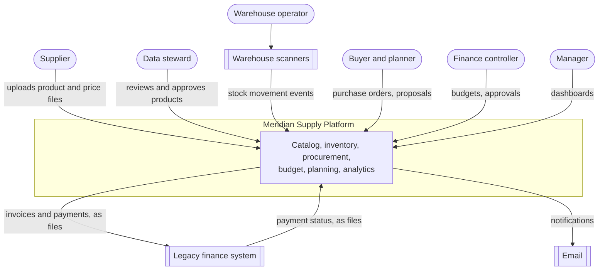
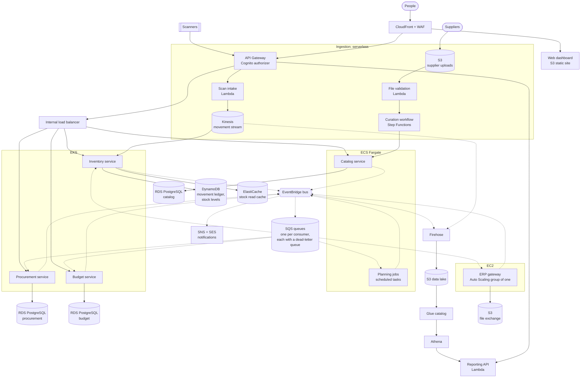
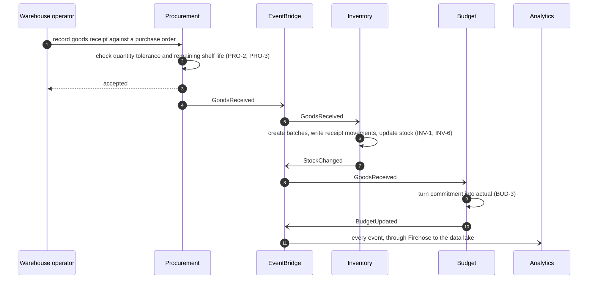
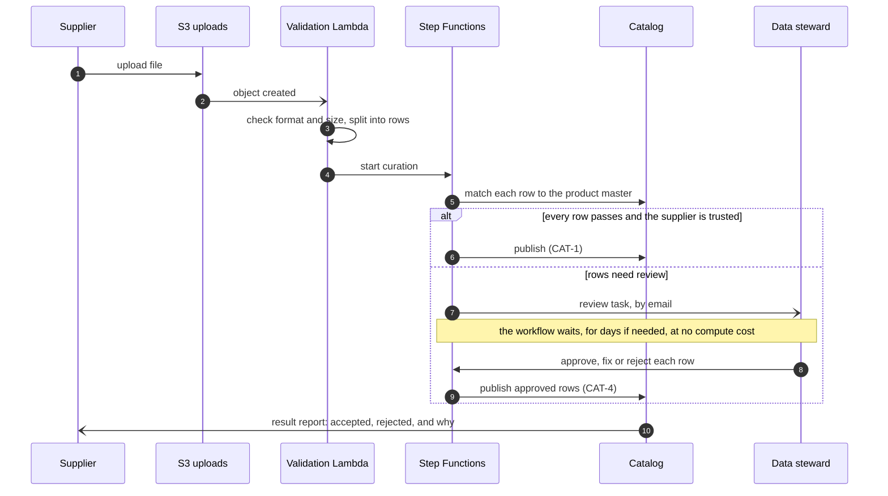
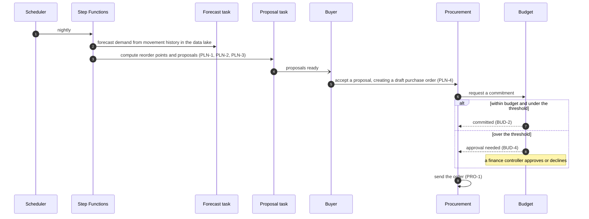
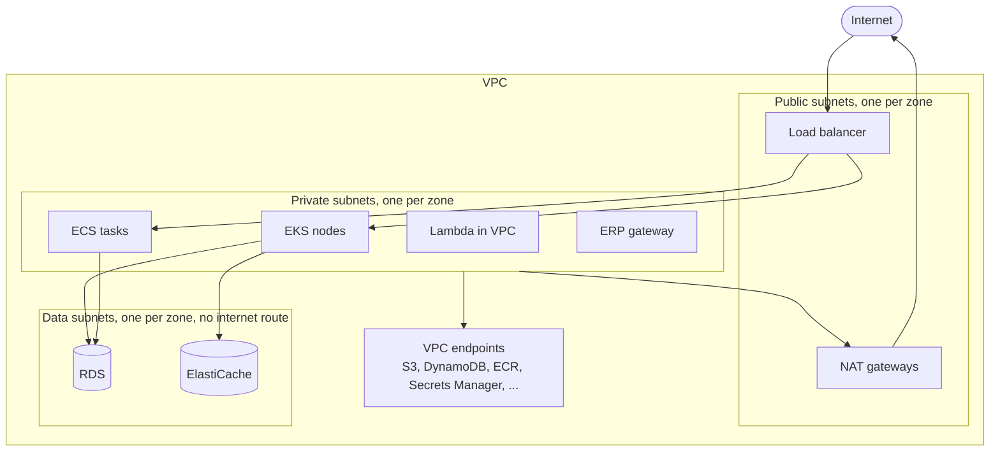

# Architecture overview

What Meridian is made of and how the parts work together. Read the [domain model](../domain/domain-model.md) first: the architecture follows from it.

> This describes the target design. The [milestones](https://github.com/Akinz-bobo/meridian-supply-platform/milestones) show how much of it exists today.

- [System context](#system-context)
- [Quality goals](#quality-goals)
- [The parts](#the-parts)
- [How the parts talk](#how-the-parts-talk)
- [Network](#network)
- [Security](#security)
- [Observability](#observability)
- [AWS service catalogue](#aws-service-catalogue)
- [What this document does not cover](#what-this-document-does-not-cover)

## System context

Who and what the platform talks to.

| External party        | Direction | How                   | Why it matters to the design                                                    |
| --------------------- | --------- | --------------------- | ------------------------------------------------------------------------------- |
| Suppliers             | In        | File upload           | Files are large, slow and unreliable in format. Processing must be asynchronous |
| Warehouse scanners    | In        | HTTPS, in bursts      | Volume and burstiness make this a streaming problem                             |
| Legacy finance system | Both      | Files on a schedule   | It cannot call an API. It needs a host that exchanges files                     |
| Email                 | Out       | Managed email service | Approvals and alerts must reach people who are not in the application           |

## Quality goals

The properties the design is optimised for, in priority order. When two conflict, the higher one wins.

| #   | Goal                                     | What it means here                                                                      | How the design meets it                                                                                                           | How it is verified                             |
| --- | ---------------------------------------- | --------------------------------------------------------------------------------------- | --------------------------------------------------------------------------------------------------------------------------------- | ---------------------------------------------- |
| 1   | **Correctness of stock and money**       | Stock is never negative or double counted. Budget is never overspent silently           | A ledger of movements as the source of truth, conditional writes, idempotent consumers, integer money                             | Invariant tests, reconciliation jobs           |
| 2   | **Availability of warehouse operations** | A warehouse can keep scanning when planning, analytics or the finance link is down      | Asynchronous events between services, three availability zones, no synchronous dependency from the scan path to anything optional | Failure injection tests                        |
| 3   | **Security**                             | Least privilege, encryption everywhere, a full audit trail                              | Private subnets, per-workload IAM roles, KMS, secrets management, audit logging, policy checks in CI                              | Policy as code, security scans, a threat model |
| 4   | **Operability**                          | A problem is visible, diagnosable and recoverable by someone who did not write the code | Structured logs, metrics, traces, alarms, runbooks, everything as code                                                            | Runbook drills                                 |
| 5   | **Cost awareness**                       | Pay for load, not for idle. Know what each part costs                                   | Serverless and scale-to-zero where load is bursty, budgets and tags, a cost model                                                 | Tag policy, cost estimates per environment     |
| 6   | **Changeability**                        | A new service or a new environment is routine                                           | Reusable modules, one event backbone, documented standards                                                                        | A new environment is one directory             |

## The parts

Every service, data store and channel. Solid arrows are requests, dotted arrows are events.

### Services

| Service               | Responsibility                                           | Compute                                             | Data                                   | Reason for the compute choice                                                                           |
| --------------------- | -------------------------------------------------------- | --------------------------------------------------- | -------------------------------------- | ------------------------------------------------------------------------------------------------------- |
| **Catalog**           | Product master, suppliers, the result of curation        | ECS Fargate                                         | RDS PostgreSQL                         | Steady, modest load. A long-running container with no cluster to operate                                |
| **Curation workflow** | Validate, match, route to a steward, publish             | Step Functions and Lambda                           | S3, catalog API                        | A multi-step process with waits for a human. A state machine makes each step visible and retryable      |
| **Scan intake**       | Accept and validate movement events, write to the stream | Lambda behind API Gateway                           | Kinesis                                | Bursty and stateless. Scales to the burst and costs nothing between shifts                              |
| **Inventory**         | Movement ledger, stock levels, FEFO allocation, expiry   | EKS                                                 | DynamoDB, ElastiCache                  | The busiest service. Benefits from fine-grained autoscaling, pod disruption budgets and rolling deploys |
| **Procurement**       | Purchase orders and goods receipts                       | EKS                                                 | RDS PostgreSQL                         | Transactional, relational, and co-evolves with inventory and budget                                     |
| **Budget**            | Budgets, commitments, approvals                          | EKS                                                 | RDS PostgreSQL                         | Strong consistency on money. Relational transactions                                                    |
| **Planning**          | Forecast, reorder points, proposals                      | ECS scheduled tasks, orchestrated by Step Functions | S3, Athena, catalog and inventory APIs | Batch work that runs for minutes on a schedule. No reason to keep it running                            |
| **Reporting API**     | Serve dashboard queries                                  | Lambda                                              | Athena over the data lake              | Infrequent, read-only requests                                                                          |
| **Web dashboard**     | Charts and tables for every role                         | Static site on S3 behind CloudFront                 | None                                   | No servers to run                                                                                       |
| **ERP gateway**       | Exchange files with the finance system                   | EC2                                                 | S3                                     | The finance system's client software needs a persistent host and a fixed address                        |

The rule behind these choices is recorded in a decision record (tracked in [#6](https://github.com/Akinz-bobo/meridian-supply-platform/issues/6)).

### Data ownership

Each service owns its store. No service reads another's database. Data crosses a boundary through an API call or an event, never through a shared table.

| Store                                    | Owner                            | Why this technology                                                                                               |
| ---------------------------------------- | -------------------------------- | ----------------------------------------------------------------------------------------------------------------- |
| RDS PostgreSQL, one database per service | Catalog, procurement, budget     | Relational data with transactions and constraints                                                                 |
| DynamoDB                                 | Inventory                        | Very high write volume with simple access patterns by batch and zone. Conditional writes enforce "never negative" |
| ElastiCache                              | Inventory                        | Stock lookups are read far more often than they change                                                            |
| S3                                       | Curation, analytics, ERP gateway | Files, and the data lake                                                                                          |
| Kinesis                                  | Scan intake                      | Ordered, replayable stream of movements, per warehouse                                                            |

## How the parts talk

Two styles, chosen by one question: does the caller need the answer to continue?

| Style                    | Used when                                                                                                    | Mechanism                                                |
| ------------------------ | ------------------------------------------------------------------------------------------------------------ | -------------------------------------------------------- |
| **Request and response** | A person is waiting, or the caller cannot proceed without the result                                         | HTTPS through API Gateway and the internal load balancer |
| **Events**               | Something happened that others may care about. The producer does not wait and does not know who is listening | EventBridge bus, delivered to one SQS queue per consumer |

Events are the default between services. The conventions (naming, envelope, idempotency, dead-letter handling) are decided in their own record (tracked in [#7](https://github.com/Akinz-bobo/meridian-supply-platform/issues/7)).

### Flow 1: a delivery arrives

Receiving goods touches four services. Only the first step is synchronous.

If inventory is down when the delivery is recorded, the event waits in its queue and is applied when inventory returns. The operator is not blocked.

### Flow 2: a supplier file is curated

### Flow 3: replenishment, from forecast to purchase order

The commitment request is one of the few synchronous calls between services, because the buyer needs the answer and a purchase order must not be sent without it.

## Network

One VPC per environment, across three availability zones, in three tiers.

| Tier    | Holds                        | Reachable from                              | Can reach                                                               |
| ------- | ---------------------------- | ------------------------------------------- | ----------------------------------------------------------------------- |
| Public  | Load balancers, NAT gateways | The internet, on 443 only                   | The private tier                                                        |
| Private | All compute                  | The public tier's load balancer             | The data tier, AWS services through endpoints, the internet through NAT |
| Data    | Databases and caches         | The private tier, on the database port only | Nothing                                                                 |

Nothing that holds data has a route to the internet, and nothing that runs code has a public address.

## Security

| Concern                | Approach                                                                                                                                                                         |
| ---------------------- | -------------------------------------------------------------------------------------------------------------------------------------------------------------------------------- |
| Identity for people    | Cognito user pools, with groups mapped to the roles in the domain model                                                                                                          |
| Identity for workloads | One IAM role per workload, assumed through the platform's native mechanism: task roles on ECS, service account roles on EKS, execution roles on Lambda, instance profiles on EC2 |
| Authorization          | Checked at the gateway (is the caller signed in?) and again in the service (may this role do this?)                                                                              |
| Encryption at rest     | KMS customer managed keys, one per data domain, with rotation                                                                                                                    |
| Encryption in transit  | TLS everywhere, including inside the VPC                                                                                                                                         |
| Secrets                | Secrets Manager, read at start-up by role. Nothing sensitive in images, code or environment files                                                                                |
| Edge protection        | WAF in front of CloudFront and the API                                                                                                                                           |
| Audit                  | CloudTrail for API activity, VPC flow logs for network traffic, AWS Config for configuration drift                                                                               |
| Prevention             | Policy checks on every Terraform plan                                                                                                                                            |

## Observability

| Signal  | Collected by                                                                                                     | Used for                                     |
| ------- | ---------------------------------------------------------------------------------------------------------------- | -------------------------------------------- |
| Logs    | CloudWatch Logs, structured JSON with a correlation identifier that follows a request across services and events | Diagnosis                                    |
| Metrics | CloudWatch metrics and Managed Prometheus for the cluster                                                        | Dashboards, alarms, autoscaling              |
| Traces  | X-Ray                                                                                                            | Finding where time goes across services      |
| Alarms  | CloudWatch alarms to SNS                                                                                         | Telling a person, with a link to the runbook |

Every alarm has a runbook. An alarm nobody knows how to act on is noise.

## AWS service catalogue

Every AWS service in the design, the job it does, and the milestone that introduces it. A service is on this list only because something needs it.

| Service                    | Job in Meridian                                                                | Milestone  |
| -------------------------- | ------------------------------------------------------------------------------ | ---------- |
| **VPC**                    | Network isolation in three tiers across three zones                            | M2         |
| **IAM**                    | Least-privilege roles for workloads, pipelines and people                      | M2         |
| **KMS**                    | Encryption keys per data domain                                                | M2         |
| **Secrets Manager**        | Database credentials and third-party secrets                                   | M2         |
| **Systems Manager**        | Configuration in Parameter Store. Shell access to the EC2 gateway without SSH  | M2, M5     |
| **S3**                     | Terraform state, supplier uploads, file exchange, data lake, static site, logs | M1 onwards |
| **DynamoDB**               | Terraform state locks. Inventory movement ledger and stock levels              | M1, M3     |
| **RDS**                    | PostgreSQL for catalog, procurement and budget                                 | M3         |
| **ElastiCache**            | Read cache for stock lookups                                                   | M3         |
| **SQS**                    | One queue per event consumer, each with a dead-letter queue                    | M4         |
| **SNS**                    | Fan-out of alarms and notifications                                            | M4         |
| **Kinesis Data Streams**   | Ordered stream of warehouse movements                                          | M4         |
| **EventBridge**            | The event bus between services. Schedules for planning jobs                    | M4         |
| **ECR**                    | Container images, scanned on push                                              | M5         |
| **ECS on Fargate**         | Catalog service and scheduled planning tasks                                   | M5         |
| **EKS**                    | Inventory, procurement and budget services                                     | M5         |
| **EC2 and Auto Scaling**   | The ERP gateway host, replaced automatically if it fails                       | M5         |
| **Elastic Load Balancing** | Internal application load balancer in front of the services                    | M5         |
| **Lambda**                 | Scan intake, file validation, reporting API, small glue functions              | M6 onwards |
| **API Gateway**            | The single public API entry point                                              | M6         |
| **Cognito**                | Sign-in and roles for people                                                   | M6         |
| **Step Functions**         | Curation workflow and planning orchestration                                   | M6, M9     |
| **SES**                    | Email for approvals and reports                                                | M6         |
| **Data Firehose**          | Delivery of events into the data lake                                          | M10        |
| **Glue**                   | Schema catalog for the data lake                                               | M10        |
| **Athena**                 | SQL over the data lake for reports and forecasts                               | M10        |
| **CloudFront**             | Delivery of the web dashboard and the API over one domain                      | M10        |
| **WAF**                    | Request filtering at the edge                                                  | M10        |
| **Route 53**               | DNS                                                                            | M10        |
| **ACM**                    | TLS certificates                                                               | M10        |
| **CloudWatch**             | Logs, metrics, alarms and dashboards                                           | M1 onwards |
| **X-Ray**                  | Distributed tracing                                                            | M11        |
| **Managed Prometheus**     | Cluster and application metrics                                                | M11        |
| **CloudTrail**             | Audit log of API activity                                                      | M11        |
| **AWS Config**             | Detection of configuration drift from policy                                   | M11        |
| **AWS Backup**             | Scheduled, tested backups of databases                                         | M11        |
| **AWS Budgets**            | Spend alerts per environment                                                   | M11        |

## What this document does not cover

- **Per-service design.** API contracts, schemas and internal structure land with each service milestone.
- **Sizing.** Instance classes and capacity are set per environment in milestone 2 onwards.
- **Measured performance or cost.** The platform is developed against an emulator ([decision record 0002](../adr/0002-develop-against-an-aws-emulator.md)), so any figure will be an estimate and labelled as one.
