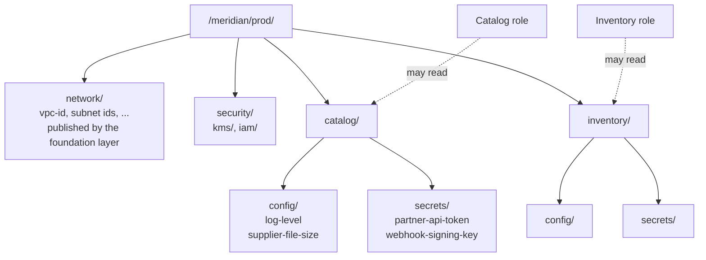

# Secrets and configuration

Where a service keeps its settings and its secrets, how it is allowed to read them, and how secret values are kept out of code, images and Terraform state.

- [The convention](#the-convention)
- [What goes where](#what-goes-where)
- [Access by path](#access-by-path)
- [Secret values and Terraform state](#secret-values-and-terraform-state)
- [Rotation](#rotation)
- [How a workload receives its configuration](#how-a-workload-receives-its-configuration)
- [Tasks](#tasks)
- [How it is enforced](#how-it-is-enforced)
- [What the emulator does not prove](#what-the-emulator-does-not-prove)

## The convention

Every service owns one path, and everything it owns is under it:

```
/meridian/<environment>/<service>/
    config/<key>        plain configuration      Parameter Store, String
    secrets/<name>      secrets                  Secrets Manager
    <fact>              facts the service publishes for other layers
```



The path is produced by the [`context` module](../../infra/modules/context/README.md) (`ssm_path`), and parameters and secrets are created by the [`service-config` module](../../infra/modules/service-config/README.md).

## What goes where

| Kind                 | Examples                                               | Store                                                     | In Terraform state?      |
| -------------------- | ------------------------------------------------------ | --------------------------------------------------------- | ------------------------ |
| Plain configuration  | Log level, feature switch, batch size, a partner's URL | Parameter Store, `String`, under `config/`                | Yes. It is not sensitive |
| Infrastructure facts | VPC id, queue URL, key ARN                             | Parameter Store, `String`, under the publisher's path     | Yes                      |
| Generated secrets    | Signing key, internal API key                          | Secrets Manager, under `secrets/`, generated at apply     | No                       |
| Issued secrets       | A partner's API token, a certificate's private key     | Secrets Manager, under `secrets/`, value set by its owner | No                       |
| Database credentials | The master user of an RDS instance                     | Secrets Manager, created and rotated by RDS itself        | No                       |

A parameter whose name contains `password`, `secret`, `token`, `api-key`, `private-key` or `credential` is refused by the module. It is a crude check and it catches the usual mistake.

Parameter Store `SecureString` is not used for secrets. Secrets Manager adds rotation, a recovery window and resource policies, and one place for secrets is simpler to audit than two.

## Access by path

Because a service's configuration is under one path, its read access is one policy, rendered by the `service-config` module as the output `read_policy_json`:

| Statement           | Actions                                                    | Resource                                                                                                                |
| ------------------- | ---------------------------------------------------------- | ----------------------------------------------------------------------------------------------------------------------- |
| Read own parameters | `ssm:GetParameter`, `GetParameters`, `GetParametersByPath` | `parameter/meridian/<env>/<service>/*`                                                                                  |
| Read own secrets    | `secretsmanager:GetSecretValue`, `DescribeSecret`          | `secret:/meridian/<env>/<service>/secrets/*`                                                                            |
| Decrypt own secrets | `kms:Decrypt`                                              | The secrets key, only through Secrets Manager, only when the encryption context names a secret under the service's path |

The service attaches that policy to its [workload role](access-model.md#workload-roles). Three details make "its own path and nothing else" true:

- **The pattern ends in `/<service>/*`, with the slash.** `catalog*` would also match a service called `catalog-import`.
- **The key statement is tied to the secret.** All secrets in an environment share one key ([decision record 0010](../adr/0010-one-encryption-key-per-data-class.md)). Without the encryption context condition, a role that may decrypt its own secret could decrypt any ciphertext made with that key. With it, the role can use the key only for secrets under its path.
- **The permission boundary** limits every workload role to `/meridian/<env>/`, so even a hand-written policy cannot reach another environment.

Reading facts published by another component, such as the network's subnet ids, is a separate, explicit statement on the consumer's role.

## Secret values and Terraform state

Terraform state records every argument of every resource. A secret passed to Terraform in the ordinary way is stored in state in plain text, in every old version of the state, and in every saved plan file.

The platform's rule is that **no secret value is ever in state**. Three mechanisms make that possible:

| Case                            | Mechanism                                                                                                                                                                                                                         |
| ------------------------------- | --------------------------------------------------------------------------------------------------------------------------------------------------------------------------------------------------------------------------------- |
| A secret that can be random     | An ephemeral resource generates it during the run, and a write-only argument (`secret_string_wo`) sends it to Secrets Manager. Terraform stores neither. It stores a version number, and raising the number generates a new value |
| A secret issued by someone else | Terraform creates the secret empty. Its owner stores the value with the CLI or console                                                                                                                                            |
| A database master password      | RDS creates and rotates it in Secrets Manager itself (`manage_master_user_password`). Terraform never sees it                                                                                                                     |

This needs Terraform 1.11 or later, where write-only arguments were introduced.

It was checked directly. A generated secret was applied with local state, its value was read back from Secrets Manager, and that value was searched for in the state file and in the plan file. It occurred in neither. The state holds:

```json
{ "secret_string": "", "secret_string_wo": null, "secret_string_wo_version": 1 }
```

`make state-audit ENV=<env>` repeats a broader version of that check against the real remote state of every layer, and runs in the pipeline after every apply.

## Rotation

| Secret                           | Rotated by                                                                 | How often                                     |
| -------------------------------- | -------------------------------------------------------------------------- | --------------------------------------------- |
| RDS master credentials           | RDS, natively                                                              | Every 7 days by default                       |
| Generated secrets                | Raising `version` in the module call, through a pull request               | When needed, and on any suspicion of exposure |
| Secrets with a rotation function | Secrets Manager, calling a Lambda function passed as `rotation.lambda_arn` | Every 30 days by default, never more than 90  |
| Issued secrets                   | Their owner                                                                | Per the issuer's policy                       |

A consumer must read the secret at start-up or cache it briefly, and never bake it into an image or a long-lived environment. A service that caches for longer than the rotation interval will fail after a rotation.

## How a workload receives its configuration

| Compute | Plain configuration                                                                                                     | Secrets                                                                                                                                                 |
| ------- | ----------------------------------------------------------------------------------------------------------------------- | ------------------------------------------------------------------------------------------------------------------------------------------------------- |
| ECS     | `secrets` in the container definition with `valueFrom` set to the parameter's ARN, or `GetParametersByPath` at start-up | `secrets` in the container definition with `valueFrom` set to the secret's ARN. The value is injected at start and never appears in the task definition |
| Lambda  | `GetParametersByPath` on cold start, cached                                                                             | `GetSecretValue` on cold start, cached for a few minutes                                                                                                |
| EKS     | `GetParametersByPath` at start-up, using the pod's role                                                                 | `GetSecretValue` at start-up, using the pod's role                                                                                                      |

The value of a secret is never written into a task definition, a function's environment variables or a Kubernetes manifest. Those are stored and displayed as configuration. A reference is.

## Tasks

**Store an issued secret.**

```bash
aws secretsmanager put-secret-value \
  --secret-id /meridian/prod/catalog/secrets/partner-api-token \
  --secret-string file://token.txt
```

Read the value from a file or standard input so that it does not enter shell history.

**Replace a generated secret.** Raise its `version` in the module call and merge. The next apply generates and stores a new value.

**Add a setting.** Add a key to `parameters` in the service's module call.

**Recover a deleted secret.** Within the recovery window (30 days by default):

```bash
aws secretsmanager restore-secret --secret-id /meridian/prod/catalog/secrets/partner-api-token
```

## How it is enforced

| Rule                                                                     | Where                                                  |
| ------------------------------------------------------------------------ | ------------------------------------------------------ |
| Secrets and parameters live under `/meridian/<env>/`                     | Policy `POL-NAME-3`                                    |
| A secret value is not given to Terraform in a stored argument            | Policies `POL-SECRET-1` and `POL-SECRET-2`             |
| A secret is recoverable for at least 7 days after deletion               | Policy `POL-SECRET-3`                                  |
| The read policy names only the service's own path, and only read actions | Module tests that read the rendered JSON               |
| Generated values are not planned into state                              | Module tests, on the planned resource                  |
| Secrets are created, re-generated and destroyed correctly                | Apply tests against the emulator, `make test-emulator` |
| No secret value is in any layer's remote state                           | `make state-audit`, in the pipeline after each apply   |

## What the emulator does not prove

The emulator stores parameters and secrets and returns them, and it does not evaluate IAM. That a role with the read policy is refused another service's secret is shown by the tests on the policy document, and not by a denied request. Rotation by a Lambda function is supported by the module and is not exercised until a service has a rotation function.
