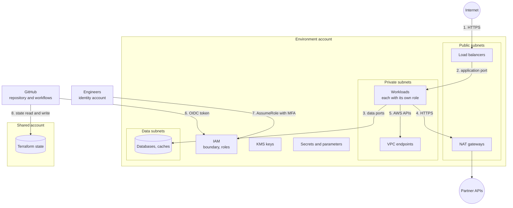

# Threat model: network and identity

What could go wrong in the network and identity layers of an environment, what stops it, and what is left. It covers milestone 2 and is extended as data stores, messaging, compute and services are added.

- [Scope](#scope)
- [What is being protected](#what-is-being-protected)
- [Trust boundaries](#trust-boundaries)
- [Who might attack, and how they get in](#who-might-attack-and-how-they-get-in)
- [Threats and controls](#threats-and-controls)
- [Residual risks](#residual-risks)
- [Assumptions](#assumptions)
- [How this document is kept current](#how-this-document-is-kept-current)

## Scope

| In scope                                                                | Out of scope until the milestone that builds it                              |
| ----------------------------------------------------------------------- | ---------------------------------------------------------------------------- |
| The VPC, subnets, routing, endpoints, flow logs and security groups     | Data stores and their contents (milestone 3)                                 |
| Encryption keys and their policies                                      | Queues, topics and streams (milestone 4)                                     |
| IAM: the boundary, workload roles, the deploy, operator and audit roles | Clusters, load balancers and instances (milestone 5)                         |
| Secrets and configuration                                               | Application code and its inputs (milestones 6 to 10)                         |
| The pipeline's access to an environment, and Terraform state            | Detection and response: audit trail, threat detection, alarms (milestone 11) |

The method is a walk through each trust boundary asking the STRIDE questions: can someone pretend to be something they are not, tamper, deny an action, read what they should not, stop the service, or gain privileges.

## What is being protected

| Asset                                                          | Why it matters                                                                                                |
| -------------------------------------------------------------- | ------------------------------------------------------------------------------------------------------------- |
| Business data: product master, stock, purchase orders, budgets | Wrong stock or budget figures cause real orders and real payments. Supplier prices are commercially sensitive |
| Secrets: database credentials, partner tokens, signing keys    | Each one opens a further system                                                                               |
| Encryption keys                                                | Whoever can use a key can read everything it protects. Whoever can delete it can destroy that data            |
| The ability to change infrastructure                           | The deploy role can create, change and delete almost everything                                               |
| Terraform state                                                | Describes every resource. Changing it changes what the next apply does                                        |
| The audit record: flow logs, and later the API audit trail     | Without it an intrusion cannot be reconstructed                                                               |

## Trust boundaries

Each numbered arrow crosses a boundary and is examined below.

## Who might attack, and how they get in

| Actor                                        | Starting position                                                                              | What they want                                                    |
| -------------------------------------------- | ---------------------------------------------------------------------------------------------- | ----------------------------------------------------------------- |
| An attacker on the internet                  | Can reach the load balancers and nothing else                                                  | Data, or a foothold in a workload                                 |
| An attacker who has compromised a workload   | Runs code as one service, with that service's role and network position                        | Other services' data, secrets, a way to persist                   |
| An attacker who can run a workflow           | A malicious pull request, a compromised dependency in the pipeline, or a stolen GitHub account | The deploy role                                                   |
| An insider or a compromised engineer account | The operator or audit role                                                                     | Data they are not entitled to, or to hide an action               |
| Mistake                                      | An engineer with good intentions and the deploy role, through a pull request                   | Nothing. Mistakes are the most likely cause of every threat below |

## Threats and controls

Status: **Mitigated** means a control exists and is checked automatically. **Partly** means a control exists and a gap is recorded. **Accepted** means the risk is known and carried. **Tracked** means the control is planned in the issue named.

### Network

| #   | Threat                                                                                             | Boundary | Controls                                                                                                                                                                                                                                                               | Status                                                                              |
| --- | -------------------------------------------------------------------------------------------------- | -------- | ---------------------------------------------------------------------------------------------------------------------------------------------------------------------------------------------------------------------------------------------------------------------- | ----------------------------------------------------------------------------------- |
| N1  | A database or cache is reachable from the internet                                                 | 1, 3     | Data subnets have no route out of the VPC. A network ACL admits the private and data subnets only. The data security group accepts the application group only. Policy `POL-SG-1` rejects any rule opening a non-web port to the world. Smoke test reads all three back | Mitigated                                                                           |
| N2  | A workload is reachable from the internet directly                                                 | 1, 2     | Private subnets have no internet gateway route. Subnets do not assign public addresses. The application group accepts the load balancer group only                                                                                                                     | Mitigated                                                                           |
| N3  | A compromised workload sends data to an attacker's server                                          | 4        | Outbound is HTTPS only. The data tier has no egress at all. Destination is not filtered                                                                                                                                                                                | Partly. Finding F3                                                                  |
| N4  | A compromised workload sends data to an attacker's bucket or table through a VPC endpoint          | 5        | None. Endpoint policies are the default, which allows any principal to reach any resource of the service                                                                                                                                                               | Open. Finding F2                                                                    |
| N5  | A compromised workload attacks other workloads                                                     | 2        | Workloads share one security group that allows any port between members. The permission boundary limits what a stolen role can do                                                                                                                                      | Accepted until compute exists. Finding F6                                           |
| N6  | A resource launched without a security group joins the default group and talks to everything in it |          | The default security group is adopted and emptied. Smoke test checks it                                                                                                                                                                                                | Mitigated                                                                           |
| N7  | Traffic to AWS services crosses the internet and can be observed or blocked                        | 5        | Gateway and interface endpoints with private DNS. TLS in any case                                                                                                                                                                                                      | Mitigated in staging and production. Dev sends some services through NAT, by choice |
| N8  | An intrusion cannot be reconstructed because traffic was not recorded                              |          | Flow logs for all traffic, kept 90 days, encrypted with the logs key. The boundary denies workloads the ability to delete logs or change retention                                                                                                                     | Mitigated for recording. Alerting on it is tracked in F8                            |
| N9  | An outage of one zone stops the platform                                                           |          | Three zones per tier. A NAT gateway and a private route table per zone in staging and production                                                                                                                                                                       | Mitigated. Dev has one NAT gateway, by choice                                       |

### Identity and access

| #   | Threat                                                                                             | Boundary | Controls                                                                                                                                                                                        | Status                                                                                            |
| --- | -------------------------------------------------------------------------------------------------- | -------- | ----------------------------------------------------------------------------------------------------------------------------------------------------------------------------------------------- | ------------------------------------------------------------------------------------------------- |
| I1  | A long-lived credential leaks                                                                      | 6, 7     | There are none. No IAM users, no access keys. All credentials last one hour                                                                                                                     | Mitigated                                                                                         |
| I2  | A workflow in another repository, or a pull request from a fork, obtains the deploy role           | 6        | The trust policy matches the token's audience and its exact subject: this repository and one GitHub environment. A wildcard subject is refused by the module                                    | Mitigated, given assumption A2                                                                    |
| I3  | The pipeline grants itself or a new role administrator access                                      | 6        | The deploy role can create a role only with the workload boundary, cannot remove a boundary, and cannot change the boundary, its own role and policy, the people roles or the identity provider | Mitigated                                                                                         |
| I4  | A mistake in one service's policy exposes another environment or another service's resources       |          | The permission boundary on every workload role. Policies `POL-IAM-1`, `POL-IAM-2`, `POL-IAM-4`                                                                                                  | Mitigated across environments. Between services in one environment it rests on each role's policy |
| I5  | A policy escapes the checks because it is unknown at plan time                                     |          | Policies are built from values known at plan. `POL-IAM-5` warns when one is not                                                                                                                 | Mitigated                                                                                         |
| I6  | A service is tricked into using a role for another account (confused deputy)                       |          | `aws:SourceAccount` on trust policies and key policies wherever the service supports it                                                                                                         | Mitigated where supported. Lambda and EC2 trust policies have no such condition                   |
| I7  | A stolen engineer session is used later                                                            | 7        | MFA is required and must be under an hour old. Sessions last an hour                                                                                                                            | Mitigated                                                                                         |
| I8  | An operator or auditor reads business data                                                         | 7        | Neither role has `ReadOnlyAccess`. Both have `ViewOnlyAccess`, which cannot read objects, items or messages. Operators can read application logs                                                | Partly. Logs may contain business data. Tracked in F8                                             |
| I9  | A compromised pipeline rewrites a workload role's trust policy so an outside account can assume it | 6        | The role remains limited by the boundary. Access Analyzer reports a role shared outside the account                                                                                             | Partly. Detection exists, nothing alerts on it yet. Tracked in F8                                 |
| I10 | A workload destroys data it is allowed to write, including old versions                            |          | Bucket versioning, where a bucket has it. The boundary allows deleting object versions, which defeats it                                                                                        | Open. Finding F4                                                                                  |

### Keys, secrets and state

| #   | Threat                                                                           | Boundary | Controls                                                                                                                                                                                         | Status                                                                        |
| --- | -------------------------------------------------------------------------------- | -------- | ------------------------------------------------------------------------------------------------------------------------------------------------------------------------------------------------ | ----------------------------------------------------------------------------- |
| K1  | A key is deleted and everything it protected is lost                             |          | 30 day deletion window. `POL-PROTECT-1` refuses a plan that deletes a key outside dev. The boundary denies it to workloads. The deploy role can still schedule deletion directly, outside a plan | Partly. Finding F5                                                            |
| K2  | One role can decrypt everything in an environment                                |          | Four keys per data class. The secrets key is usable by a workload only for secrets under its own path, through the encryption context                                                            | Partly. All services share the `data` key, which decision record 0010 accepts |
| K3  | A secret value is exposed through Terraform state, a plan file or the repository | 8        | Write-only arguments and ephemeral values. `POL-SECRET-1` and `POL-SECRET-2`. The state audit after every apply                                                                                  | Mitigated                                                                     |
| K4  | A workload reads another service's secret                                        |          | Access by path, with the trailing slash. Encryption context condition on the key                                                                                                                 | Mitigated in policy. Not proven by a denied request, see assumption A1        |
| K5  | State is read or changed by someone who should not                               | 8        | The bucket is private, encrypted with its own key, versioned, and TLS-only. The deploy role reaches only its environment's prefix                                                                | Mitigated                                                                     |
| K6  | A deleted secret cannot be recovered                                             |          | Recovery window of 30 days, never under 7. `POL-SECRET-3`                                                                                                                                        | Mitigated                                                                     |
| K7  | A new volume or bucket is created unencrypted or public, outside Terraform       |          | Account-wide EBS encryption by default and S3 public access block                                                                                                                                | Mitigated                                                                     |
| K8  | Flow logs are written unencrypted because a caller forgot the key                |          | The environments pass the logs key, and `POL-LOG-3` checks every log group. The module itself leaves the key optional                                                                            | Partly. Finding F1                                                            |

## Residual risks

What remains after the controls above, in order of concern.

1. **Nothing here is enforced by the emulator.** Every control is verified as configuration: by tests that read rendered policies, by policy checks on plans, and by reading resources back through the API. None has been proven by a request being refused. This is the largest gap and it closes only on a real account (assumption A1).
2. **No audit trail of API calls yet, and nothing alerts.** Flow logs record network traffic. Who called which API is not recorded until CloudTrail is added in milestone 11 (F7), and no finding raises an alarm (F8). Until then an intrusion would be reconstructed from flow logs alone.
3. **Egress is filtered by port, not by destination** (N3, F3). A compromised workload can reach any HTTPS server.
4. **Services in one environment are separated by policy, not by structure** (I4, K2, N5). They share an account, a data key and a security group. A fault in one service's role policy can expose another service's data in the same environment.
5. **The deploy role is powerful by design** (I3, I9). It cannot escalate its own privileges or weaken the boundary, and it can still delete most resources in its region. The defences are the pull request review, the policy checks, and protection on the GitHub environment.
6. **People's access depends on the identity account**, which is outside this repository.

## Assumptions

| #   | Assumption                                                                                                                                          | If it is wrong                                                                                                                                                         |
| --- | --------------------------------------------------------------------------------------------------------------------------------------------------- | ---------------------------------------------------------------------------------------------------------------------------------------------------------------------- |
| A1  | AWS enforces what the emulator only stores: routes, security groups, IAM policies, key policies                                                     | Every "Mitigated" above must be re-verified on a real account before it is relied on                                                                                   |
| A2  | The GitHub environments named in the deploy trust policies have protection rules, so a job cannot use the `production` environment without approval | Anyone who can push a workflow to the repository can obtain the production deploy role                                                                                 |
| A3  | The identity account enforces MFA and removes leavers                                                                                               | The operator and audit roles are only as safe as that account                                                                                                          |
| A4  | The repository's default branch is protected and changes need review                                                                                | The policy checks and plan review can be bypassed                                                                                                                      |
| A5  | Resource names follow the naming standard                                                                                                           | A resource outside the standard is invisible to the boundary's allow statements, which fails closed, and to its scoping, which does not matter if nothing can reach it |

## How this document is kept current

- Each milestone that adds a layer adds its threats here, in the same pull request series as the review that closes the milestone.
- A finding is either fixed, with the pull request named in the [review](baseline-review.md), or tracked in an issue.
- The whole model is revisited in milestone 11, when detection and response exist.
