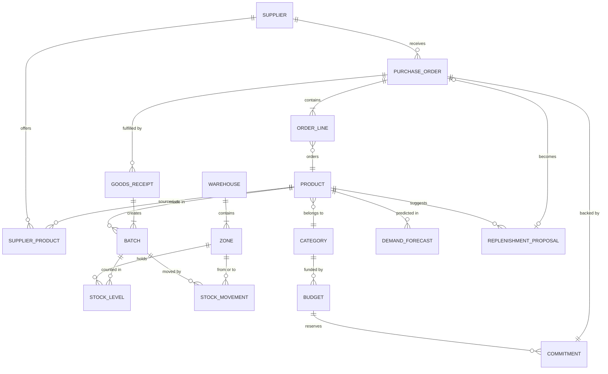
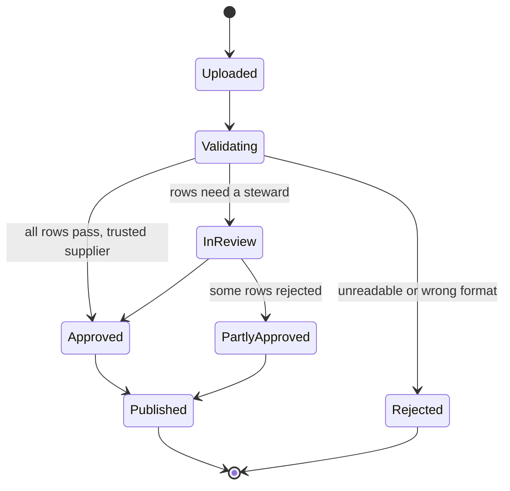
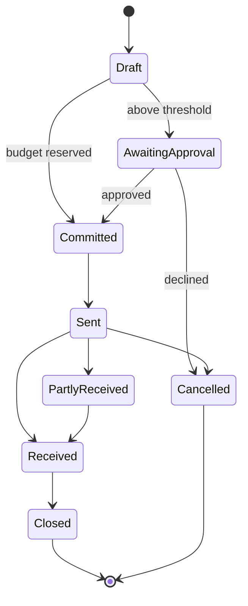
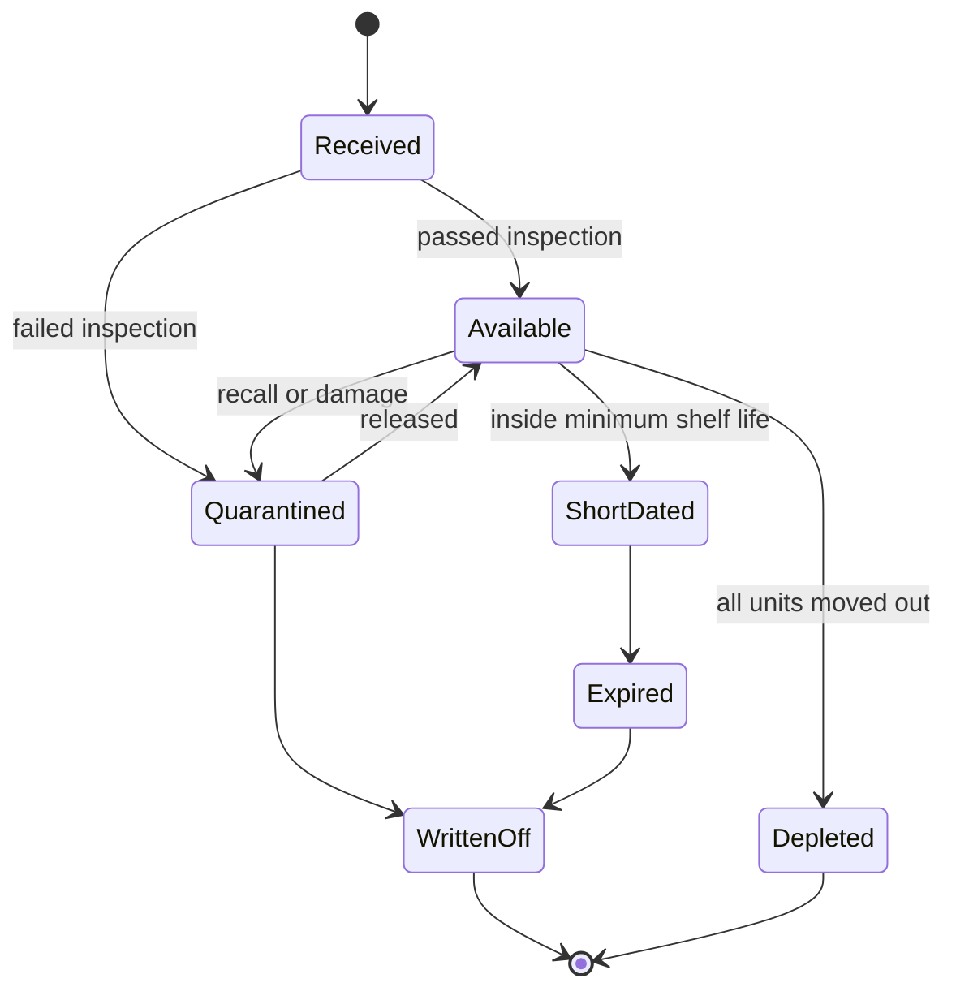

# Domain model

What the business does, who is involved, and the concepts the software has to represent. Service boundaries, data stores and events all follow from this document. Terms in **bold** are defined in the [glossary](glossary.md).

- [The business](#the-business)
- [People and their goals](#people-and-their-goals)
- [Concepts and how they relate](#concepts-and-how-they-relate)
- [Business rules](#business-rules)
- [Lifecycles](#lifecycles)

## The business

Meridian is modelled on a regional distributor of perishable goods. It buys food and pharmaceutical products from manufacturers and importers, holds them in its own warehouses, and supplies retailers, pharmacies and clinics.

Three facts about the goods drive most of the design:

1. **They expire.** Every unit belongs to a **batch** with an expiry date. Stock that passes it is a write-off, so the oldest sellable stock must leave first.
2. **Some need temperature control.** Chilled and frozen products can only be stored in **zones** that hold the right temperature range.
3. **They must be traceable.** If a manufacturer recalls a batch, the distributor must be able to say where every unit of it is, and where it went.

The scale assumed for design purposes is illustrative, not taken from any real company:

| Dimension       | Assumed order of magnitude                              |
| --------------- | ------------------------------------------------------- |
| Suppliers       | Around 150                                              |
| Active products | Around 20,000                                           |
| Warehouses      | 6, each with ambient, chilled and frozen zones          |
| Stock movements | Hundreds of thousands a day at peak, arriving in bursts |
| Purchase orders | Hundreds a day                                          |

The movement volume is what makes the warehouse event pipeline a streaming problem and not a request and response one.

## People and their goals

| Actor                    | What they need from the platform                                                                |
| ------------------------ | ----------------------------------------------------------------------------------------------- |
| **Supplier**             | Submit a product list and price file, and learn what was rejected and why                       |
| **Data steward**         | Review incoming product data, fix or reject it, and approve it into the product master          |
| **Warehouse operator**   | Record receipts, moves, picks and write-offs by scanning, even when the network is poor         |
| **Inventory controller** | See stock across all warehouses, by batch and expiry, and investigate discrepancies             |
| **Buyer**                | Raise purchase orders, guided by proposals, and know whether the budget allows it               |
| **Planner**              | Trust the forecast, tune reorder parameters, and see what is at risk of expiring or running out |
| **Finance controller**   | Set budgets, approve spending above a threshold, and see committed against actual               |
| **Manager**              | One view of service level, stock value, waste and spend                                         |
| **Platform engineer**    | Operate the system: deploy safely, see what is wrong, recover quickly                           |

## Concepts and how they relate

The model falls into six areas. Each becomes a service that owns its data and shares it only through its API and its events.

| Area            | Concepts it owns                                        | Central question                                 |
| --------------- | ------------------------------------------------------- | ------------------------------------------------ |
| **Catalog**     | Product, category, supplier, supplier product           | What do we sell, and who do we buy it from?      |
| **Inventory**   | Warehouse, zone, batch, stock level, stock movement     | What do we have, where, and when does it expire? |
| **Procurement** | Purchase order, order line, goods receipt               | What have we ordered, and what has arrived?      |
| **Budget**      | Budget, commitment, actual                              | Can we afford it, and what have we spent?        |
| **Planning**    | Demand forecast, reorder policy, replenishment proposal | What should we order, and when?                  |
| **Analytics**   | Read models built from every other area's events        | How is the business doing?                       |

### Why these boundaries

- **Catalog is separate from inventory** because product data changes rarely and is read constantly, while stock changes constantly. They have opposite load profiles and different owners.
- **Procurement is separate from budget** because a purchase order has a life of its own (sent, part received, closed), and budget rules belong to finance, who change them independently.
- **Planning owns no operational data.** It reads events from the others and produces proposals. If it is down, the warehouses keep working.
- **Analytics is downstream of everything** and nothing depends on it, so reporting load can never slow an operation.

## Business rules

These are the rules the software must enforce. Each has an identifier so that code, tests and events can refer to it.

### Catalog and curation

| Id    | Rule                                                                                                                                      |
| ----- | ----------------------------------------------------------------------------------------------------------------------------------------- |
| CAT-1 | A product enters the product master only after a data steward approves it, or it passes every automatic check and the supplier is trusted |
| CAT-2 | A product has exactly one storage class: ambient, chilled or frozen                                                                       |
| CAT-3 | A product identifier (GTIN) is unique in the product master                                                                               |
| CAT-4 | A supplier file is processed as a whole for reporting, but each row succeeds or fails on its own. One bad row does not reject the file    |
| CAT-5 | Every change to an approved product is versioned and attributed                                                                           |

### Inventory

| Id    | Rule                                                                                                                                |
| ----- | ----------------------------------------------------------------------------------------------------------------------------------- |
| INV-1 | Stock is tracked per batch, per zone. There is no stock without a batch                                                             |
| INV-2 | A batch can only be stored in a zone whose temperature class matches the product's storage class                                    |
| INV-3 | Stock is allocated **first expired, first out**: the batch with the earliest expiry that is still sellable goes first               |
| INV-4 | A batch is not sellable within its product's minimum remaining shelf life, and is quarantined automatically at expiry               |
| INV-5 | Stock on hand is never negative. A movement that would make it so is rejected and investigated                                      |
| INV-6 | Stock levels change only through recorded movements. The ledger of movements is the source of truth, and levels are derived from it |
| INV-7 | A recalled batch is quarantined everywhere at once, and every movement of it can be listed                                          |

### Procurement

| Id    | Rule                                                                                                         |
| ----- | ------------------------------------------------------------------------------------------------------------ |
| PRO-1 | A purchase order can be sent only when a budget commitment for its full value exists                         |
| PRO-2 | A goods receipt creates batches and stock. Receiving more than was ordered needs approval beyond a tolerance |
| PRO-3 | A received batch with less remaining shelf life than agreed with the supplier is rejected at the dock        |
| PRO-4 | A purchase order moves only forward through its states and is never deleted                                  |

### Budget

| Id    | Rule                                                                                                            |
| ----- | --------------------------------------------------------------------------------------------------------------- |
| BUD-1 | A budget is an amount for one category in one period                                                            |
| BUD-2 | Available = budget - committed - actual. It is never allowed to go below zero without an approved exception     |
| BUD-3 | Raising a purchase order commits budget. Receiving goods turns commitment into actual. Cancelling releases it   |
| BUD-4 | A single order above the approval threshold needs a finance controller's approval, whatever the budget position |
| BUD-5 | Money is held in minor units as integers, with a currency. No floating point                                    |

### Planning

| Id    | Rule                                                                                                  |
| ----- | ----------------------------------------------------------------------------------------------------- |
| PLN-1 | Reorder point = expected demand over the supplier's lead time + safety stock                          |
| PLN-2 | A proposal never suggests more than can be sold before it would expire                                |
| PLN-3 | A proposal respects the supplier's minimum order quantity and pack size                               |
| PLN-4 | Proposals are suggestions. A buyer accepts, changes or dismisses each one, and the reason is recorded |

## Lifecycles

### Supplier file

### Purchase order

### Batch

