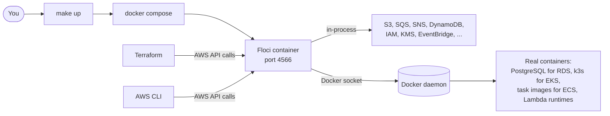

# Local development

How to run the platform's infrastructure on your own machine. Nothing here needs an AWS account or costs anything: everything is provisioned against [Floci](https://github.com/floci-io/floci), an open-source AWS emulator. Why, and what that does and does not prove, is in [decision record 0002](../adr/0002-develop-against-an-aws-emulator.md).

- [What you need](#what-you-need)
- [Start and stop](#start-and-stop)
- [Talking to the emulator](#talking-to-the-emulator)
- [How it works](#how-it-works)
- [Troubleshooting](#troubleshooting)

## What you need

| Tool                                    | Minimum                                                         | Used for                                       |
| --------------------------------------- | --------------------------------------------------------------- | ---------------------------------------------- |
| Docker with Compose                     | 24.0, Compose 2.20                                              | Runs the emulator and the containers it starts |
| Terraform                               | The version in [`.terraform-version`](../../.terraform-version) | Provisioning                                   |
| AWS CLI                                 | 2.13                                                            | Inspecting what was provisioned                |
| make, curl, jq, python3                 | Any recent version                                              | Developer commands and checks                  |
| tflint, trivy, conftest, terraform-docs | Pinned. Install with `make tools`                               | [Static analysis](static-analysis.md)          |

About 4 GB of free memory is enough for the foundation milestones. The full platform, with an EKS cluster and several databases running as containers, will need more. That figure will be measured and recorded when those milestones land.

Check your machine:

```bash
make doctor
```

It lists each required tool with its version, fails if one is missing or too old, and shows which optional tools later milestones will need.

## Start and stop

```bash
make up        # start the emulator and wait until it is healthy
make bootstrap # create the remote state bucket in the emulator
make status    # is it running, and how many services answer
make logs      # follow its logs
make down      # stop it and remove everything it created
make help      # list every command
```

`make down` removes the emulator and every container it started on your behalf. State is not kept between runs on purpose: an environment that can always be rebuilt from nothing is the property the infrastructure code is meant to have.

## Talking to the emulator

The emulator listens on `http://localhost:4566` and accepts any non-empty credentials. To use the AWS CLI against it:

```bash
export AWS_ENDPOINT_URL=http://localhost:4566
export AWS_DEFAULT_REGION=eu-west-1
export AWS_ACCESS_KEY_ID=test
export AWS_SECRET_ACCESS_KEY=test

aws s3 mb s3://scratch
aws s3 ls
```

`test` is not a secret. It is the conventional placeholder for emulators, and it is useless against real AWS.

There is also a browser console for looking at what exists: <http://localhost:4566/_floci/ui>.

To use a different port, set `FLOCI_PORT` before any `make` command:

```bash
FLOCI_PORT=4600 make up
```

## How it works



Most services are emulated inside the Floci process. Where that would lose too much fidelity, it starts a real container instead: an actual PostgreSQL for an RDS instance, an actual Kubernetes API server for an EKS cluster. To do that it needs the Docker socket, which [`compose.yaml`](../../compose.yaml) mounts.

**Mounting the Docker socket gives the emulator full control of your Docker daemon.** That is acceptable for a pinned, open-source image on a development machine or a throwaway CI runner. It is not something to do with an image you do not trust, and it is one reason the emulator version is pinned and upgraded only through a reviewed pull request. The port is bound to `127.0.0.1` so the emulator is not reachable from the network.

## Troubleshooting

| Symptom                                          | Likely cause                                         | What to do                                                                                             |
| ------------------------------------------------ | ---------------------------------------------------- | ------------------------------------------------------------------------------------------------------ |
| `make up` times out                              | The image is still downloading, or the port is taken | `make logs`. If the port is in use, set `FLOCI_PORT`                                                   |
| `port is already allocated`                      | Something else is on 4566, often another emulator    | `docker ps` to find it, or use `FLOCI_PORT`                                                            |
| `permission denied` on the Docker socket         | Your user is not in the `docker` group               | Add it, then log out and back in                                                                       |
| RDS, ECS or EKS resources fail to create         | The Docker socket is not mounted or not accessible   | Check the volume in `compose.yaml` and the socket's permissions                                        |
| Containers named `floci-aws-...` are left behind | The emulator was killed without `make down`          | `make down` removes them                                                                               |
| A resource behaves differently from AWS          | Emulator difference                                  | Check [emulator differences](../architecture/emulator-differences.md). If it is not listed, open a bug |
