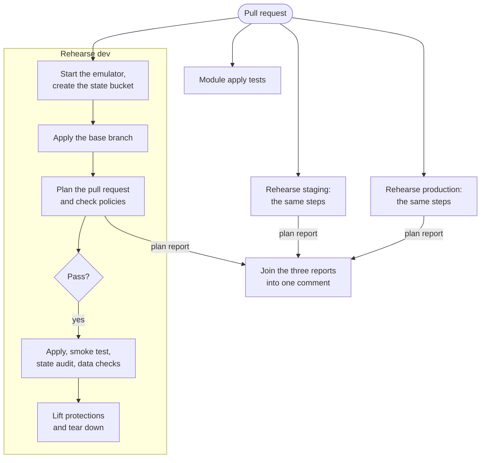
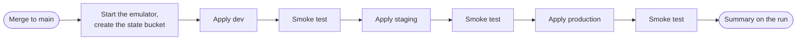

# The infrastructure pipeline

How an infrastructure change is checked on a pull request and applied on merge, what the pipeline proves, and how it would differ against real AWS accounts.

- [At a glance](#at-a-glance)
- [On a pull request](#on-a-pull-request)
- [On merge](#on-merge)
- [Reading the plan comment](#reading-the-plan-comment)
- [Running it yourself](#running-it-yourself)
- [What this proves, and what it does not](#what-this-proves-and-what-it-does-not)
- [The same pipeline against real AWS](#the-same-pipeline-against-real-aws)
- [When the pipeline fails](#when-the-pipeline-fails)

## At a glance

Nobody applies infrastructure from a laptop. A change is proposed as a pull request, the pipeline shows what it would do and whether it breaks a rule, a reviewer reads that, and the pipeline applies it after merge.

| Workflow                                                     | Runs on                | Does                                                              | Needs the emulator |
| ------------------------------------------------------------ | ---------------------- | ----------------------------------------------------------------- | ------------------ |
| [Docs](../../.github/workflows/docs.yml)                     | Every pull request     | Formatting, links, decision record index                          | No                 |
| [Tooling](../../.github/workflows/tooling.yml)               | Every pull request     | Shell lint, emulator boots                                        | Yes                |
| [Terraform](../../.github/workflows/terraform.yml)           | Changes under `infra/` | Format, validate, module tests, lint, security scan, policy tests | No                 |
| [Infrastructure](../../.github/workflows/infrastructure.yml) | Changes under `infra/` | Plan, policy check, rehearsal on a pull request. Apply on merge   | Yes                |

The first three are fast and need nothing running. They fail first. The fourth is the one this guide is about.

## On a pull request

Each environment is rehearsed in a job of its own, with an emulator of its own. The three run in parallel.



| Job                      | Runs                                                   | Does                                                                                                                    |
| ------------------------ | ------------------------------------------------------ | ----------------------------------------------------------------------------------------------------------------------- |
| Rehearse `<environment>` | Three times, in parallel                               | Applies the base branch, plans the pull request, checks policies, applies, verifies and tears down, for one environment |
| Module apply tests       | Once                                                   | `make test-emulator`. These tests use an account of their own and no environment                                        |
| Plan comment             | Once, after the rehearsals, whether they passed or not | Joins the three plan reports into the single comment on the pull request                                                |

**Why in parallel.** The first version did all three environments one after another in one job. It took about seven minutes with the foundation layer alone and sixteen once the data layer had a bucket and two tables, and every store added made it longer. A check that slow gets worked around. The environments are independent, so each now has its own job, and a pull request waits for the slowest one and not for the sum.

**One comment, three jobs.** Each rehearsal uploads its plan report. The comment job joins them, in promotion order, and updates the one plan comment. If a job fails before it can plan, its environment appears in the table as having no report, so an environment cannot quietly drop out.

**One failing environment does not cancel the others.** They are allowed to finish, so the comment shows the whole picture.

**Why the base branch is applied first.** The emulator starts empty on every run. A plan against an empty environment always says "create everything", which tells a reviewer nothing and can never show a deletion. So the pipeline first applies `main` as it is, and then plans the pull request against that. The plan is then the real difference the pull request makes: additions, changes, replacements and deletions. This is also what lets the protected-resource policy (POL-PROTECT-1) see a database being deleted.

**Why the apply is rehearsed.** A plan can be valid and still fail to apply: an ordering problem, a name that is too long, a value the API rejects. The pull request is applied to each environment, which is then smoke tested by asking the AWS API directly, has its state audited and its stores used, and is torn down in reverse order. A change that cannot be cleanly removed fails here.

## On merge



Environments are applied in promotion order, one at a time, in a single job. Each must pass its checks before the next begins, so a problem stops in `dev`. This is deliberately not parallel: on merge the order is the point.

A run on `main` is never cancelled by a newer one. Cancelling an apply halfway is how state and reality come apart.

## Reading the plan comment

The pipeline posts one comment and updates it on each push:

| Environment  | Layer        | Add | Change | Replace | Destroy | Policy |
| ------------ | ------------ | --: | -----: | ------: | ------: | ------ |
| `dev`        | `foundation` |   3 |      1 |       0 |       0 | pass   |
| `staging`    | `foundation` |   3 |      1 |       0 |       0 | pass   |
| `production` | `foundation` |   3 |      1 |       0 |       0 | pass   |

What to look for, in order:

1. **Destroy and Replace.** Anything other than zero deserves a reason in the pull request description. A replace destroys the old resource.
2. **The three environments should match.** They are identical in structure, so a change that adds three resources in `dev` and four in production means a value differs in a way worth understanding.
3. **Policy.** A failure lists the rule and the resource underneath. See [policy as code](policy-as-code.md#reading-a-failure).
4. **The resource list** under each environment, to confirm the change touches what the description says and nothing else.

## Running it yourself

The pipeline only calls `make` targets, so every step can be reproduced locally:

```bash
make up && make bootstrap

make apply-all ENV=dev        # every layer, in order
make smoke ENV=dev            # ask the API whether it looks right
make state-audit ENV=dev      # check that no secret value is in the remote state
make data-check ENV=dev       # use the stores the way a service would
make test-emulator            # module apply tests
make report                   # plan all environments, check policies, write plan-report.md
make destroy-all ENV=dev      # every layer, in reverse
make teardown ENV=staging     # lift deletion protections, then destroy. For a protected environment
```

To reproduce the pull request plan exactly, apply `main` from a second worktree first:

```bash
git worktree add ../meridian-base origin/main
make -C ../meridian-base apply ENV=dev
make report ENVS=dev
```

## What this proves, and what it does not

The pipeline runs against an emulator ([decision record 0002](../adr/0002-develop-against-an-aws-emulator.md)), and it is important to be exact about what a green run means.

| A green run proves                                                   | It does not prove                                                                     |
| -------------------------------------------------------------------- | ------------------------------------------------------------------------------------- |
| The Terraform is valid, and applies in dependency order from nothing | That AWS will accept every value. The emulator is more permissive                     |
| The change applies on top of what is already on `main`               | Behaviour of a change against long-lived resources with real data                     |
| No organisation policy is violated                                   | That IAM policies are sufficient or minimal. The emulator does not enforce them fully |
| Every environment passes its smoke test                              | Performance, quotas or cost                                                           |
| Everything can be destroyed again                                    | That production deletion protection behaves as configured                             |
| Environments are isolated from each other in the emulator            | Real cross-account isolation                                                          |

Two structural differences from a real pipeline follow from the emulator being rebuilt for every run:

- **Nothing persists.** On merge the pipeline applies to a fresh emulator, which is then thrown away. It proves `main` is always deployable. It is not a deployment that anyone uses.
- **The apply is not the reviewed plan.** A real pipeline saves the plan file from the pull request and applies exactly that file. Here the state it was planned against no longer exists by the time of the merge, so the merge run plans again.

## The same pipeline against real AWS

Moving to real accounts changes how the pipeline authenticates and how production is gated. The steps, the `make` targets and the Terraform stay the same.

| Concern            | Here                                     | Against AWS                                                                                                                                                                                                               |
| ------------------ | ---------------------------------------- | ------------------------------------------------------------------------------------------------------------------------------------------------------------------------------------------------------------------------- |
| Credentials        | None. The emulator accepts a placeholder | GitHub's OIDC provider, exchanged for a short-lived role in each account. No long-lived keys stored anywhere                                                                                                              |
| Role per job       | Not applicable                           | One deploy role per environment, `meridian-<env>-access-deploy`, trusted only for this repository and for the GitHub environment of the same name. A separate read-only role for `plan` on pull requests is not built yet |
| Base state         | Recreated by applying `main`             | Already there. The plan is against real state                                                                                                                                                                             |
| Reviewed plan      | Planned again on merge                   | The plan file is saved as an artifact on the pull request and applied unchanged                                                                                                                                           |
| Promotion          | All three environments in one run        | `dev` on merge. `staging` and `production` on a release tag                                                                                                                                                               |
| Production gate    | None                                     | A GitHub environment with required reviewers, so a person approves the production apply after seeing the staging result                                                                                                   |
| Teardown rehearsal | Every pull request                       | A scheduled job in a sandbox account, not in the long-lived environments                                                                                                                                                  |
| Drift              | Cannot occur                             | A scheduled plan per environment that alerts when reality differs from code                                                                                                                                               |

The authentication step would look like this, and nothing after it changes:

```yaml
permissions:
  id-token: write # lets the job request an OIDC token
  contents: read

steps:
  - uses: aws-actions/configure-aws-credentials@v4
    with:
      role-to-assume: arn:aws:iam::<account>:role/meridian-<env>-access-deploy
      aws-region: eu-west-1
  - run: make apply-all ENV=production TARGET=aws
```

The deploy role and its trust policy are built by the [`access-roles` module](../../infra/modules/access-roles/README.md) and described in the [access model](../architecture/access-model.md#the-deploy-role). The job must declare `environment: <name>`, because the trust policy matches the token subject `repo:<owner>/<repository>:environment:<name>` exactly.

### Tearing down a protected environment

Staging and production stores are protected against deletion: tables and databases refuse to be deleted, a database takes a final snapshot, a bucket refuses to be emptied. `make destroy-all` therefore fails there, which is the protection doing its job.

The rehearsal still has to prove that everything can be destroyed, so it uses `make teardown`. That is two steps: an apply with the environment marked disposable, which lifts the protections as ordinary in-place changes, and then the destroy. The override is passed as `-var disposable=true` after the variable file. An environment variable would not work: staging and production state `disposable = false` in their `env.tfvars`, and a value in a variable file takes precedence over `TF_VAR_disposable`. It is the same procedure a real environment would be decommissioned with, where the first step is a reviewed pull request and not a flag.

The first run of the pipeline with protected tables failed at this point with `DeleteTable ... ValidationException`. That failure is what showed the rehearsal needed the first step.

### Layers and the plan

An environment is several state layers, planned one after another. A layer reads what the layers below it published in Parameter Store. A pull request that adds a parameter to one layer and reads it in the layer above cannot plan the upper layer until the lower one is applied, because the parameter does not exist yet. The plan fails with the name of the missing parameter.

Split such a change in two: publish the parameter first, then consume it. That is also the safe order on a real account, where a consumer deployed before its dependency fails in the same way.

## When the pipeline fails

| Step that failed      | Usual cause                                                                                                                                        | What to do                                                                                                                                                                                                                                |
| --------------------- | -------------------------------------------------------------------------------------------------------------------------------------------------- | ----------------------------------------------------------------------------------------------------------------------------------------------------------------------------------------------------------------------------------------- |
| Start the emulator    | The image could not be pulled, or the runner is short of resources                                                                                 | Re-run. If it persists, check the emulator logs printed at the end of the run                                                                                                                                                             |
| Apply the base branch | `main` itself does not apply                                                                                                                       | This is a broken `main` and takes priority over the pull request. Open a bug                                                                                                                                                              |
| Plan the pull request | Invalid Terraform that validate did not catch, often a value only resolved at plan time                                                            | Read the plan output in the comment. Reproduce with `make plan`                                                                                                                                                                           |
| Policy                | A rule is violated                                                                                                                                 | The comment names the rule and the resource. See [policy as code](policy-as-code.md)                                                                                                                                                      |
| Rehearse the apply    | The plan was valid but the API rejected something, or an ordering problem                                                                          | Reproduce with `make apply-all`. If the emulator behaves differently from AWS, record it in [emulator differences](../architecture/emulator-differences.md)                                                                               |
| Smoke test            | The environment applied but does not look right                                                                                                    | Run `make smoke ENV=<env>` locally. Each check prints what it expected                                                                                                                                                                    |
| State audit           | A resource was given a secret value through an ordinary argument, so the value is in state                                                         | Use a write-only argument or set the value outside Terraform. See [secrets and configuration](../architecture/secrets-and-configuration.md#secret-values-and-terraform-state). The value in state must be treated as exposed and replaced |
| Data model check      | A change to a table's keys or indexes broke an access pattern, or a condition no longer protects a rule                                            | Run `make data-check ENV=<env>` locally. The failing line names the rule. See the [inventory data model](../architecture/inventory-data-model.md)                                                                                         |
| Database check        | The database cannot be reached with the credentials RDS manages, or does not behave as PostgreSQL should                                           | Run `make data-check ENV=<env>` locally. It needs `psql`. Check that the address and secret are published under `/meridian/<env>/catalog/`                                                                                                |
| Cache access check    | The access rule of a cache user lets a client do something it should not, or stops something it needs                                              | Run `make data-check ENV=<env>` locally. It needs Docker. The failing line says which command. Change the access string in the `data` layer                                                                                               |
| Backup check          | A store lost its backup tag, a resource that is not a store gained it, or the backup role is not accepted                                          | Run `make data-check ENV=<env>` locally. The failing line names the resource                                                                                                                                                              |
| Module apply tests    | A module cannot be created, changed or destroyed in the emulator                                                                                   | Run `make test-emulator` locally                                                                                                                                                                                                          |
| Rehearse the teardown | Something cannot be destroyed: a dependency Terraform does not know about, or a deletion protection that does not follow the `disposable` variable | Add the missing dependency. For a new protected store, make its protections follow `var.disposable` in the layer, as the existing stores do                                                                                               |

State problems (a stuck lock, a state that disagrees with reality) are covered in the [state runbook](../runbooks/terraform-state.md).
