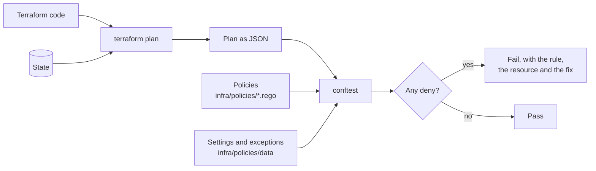

# Policy as code

The organisation's own rules for infrastructure, written as code and checked against every Terraform plan.

- [Why a third kind of check](#why-a-third-kind-of-check)
- [The rules](#the-rules)
- [Running the checks](#running-the-checks)
- [Reading a failure](#reading-a-failure)
- [Exceptions](#exceptions)
- [Adding or changing a rule](#adding-or-changing-a-rule)
- [Limits](#limits)

## Why a third kind of check

| Check            | Knows                     | Does not know                     |
| ---------------- | ------------------------- | --------------------------------- |
| Linter           | Terraform and the AWS API | Anything about this organisation  |
| Security scanner | General security practice | Our naming, our tags, our regions |
| **Policy**       | **Our rules**             |                                   |

The linter and scanner read the code. Policies read the **plan**: what Terraform would actually do, after variables, modules and provider defaults have been resolved. That matters. A tag that comes from provider defaults is invisible in the code of a resource and present in the plan. A delete is not in the code at all: it is the absence of something that used to be there.



The policies are written in [Rego](https://www.openpolicyagent.org/docs/latest/policy-language/) and run by [conftest](https://www.conftest.dev).

## The rules

Every rule has an identifier, which appears in its failure message.

### Tags

| Rule      | Requires                                                                          | Reason                                                                                   |
| --------- | --------------------------------------------------------------------------------- | ---------------------------------------------------------------------------------------- |
| POL-TAG-1 | Every taggable resource has `Project`, `Environment`, `Component` and `ManagedBy` | Cost allocation, finding the owner in an incident, and IAM conditions all depend on tags |
| POL-TAG-2 | `ManagedBy` is `terraform`                                                        | Marks what must not be changed by hand                                                   |
| POL-TAG-3 | The `Environment` tag matches the environment being applied to                    | Catches a module called with the wrong environment                                       |

A resource type counts as taggable if its planned values include `tags_all`, so new resource types are covered without maintaining a list.

### Naming

| Rule       | Requires                                                                     | Reason                                                                   |
| ---------- | ---------------------------------------------------------------------------- | ------------------------------------------------------------------------ |
| POL-NAME-1 | Names start with `<project>-<environment>-`                                  | A name says where a resource lives. IAM policies can be scoped by prefix |
| POL-NAME-2 | Names are lower case letters, digits and single hyphens                      | Valid in every AWS service, including S3 and DNS                         |
| POL-NAME-3 | Parameter, secret and log group paths start with `/<project>/<environment>/` | Access is granted by path                                                |
| POL-NAME-4 | Key aliases start with `alias/<project>-<environment>-`                      | Same as POL-NAME-1                                                       |
| POL-NAME-5 | Network resources carry a `Name` tag starting with the same prefix           | They have no name attribute. The tag is what the console shows           |

The standard itself is in [environments, naming and tagging](../architecture/environments.md#naming-standard). The resource types covered are listed in [`naming.rego`](../../infra/policies/naming.rego). A type is added there when the first module that creates it lands.

### Region

| Rule         | Requires                           | Reason                                                 |
| ------------ | ---------------------------------- | ------------------------------------------------------ |
| POL-REGION-1 | The region is in the approved list | Where data is stored is a legal and contractual matter |

The list is in [`data/settings.yaml`](../../infra/policies/data/settings.yaml).

### IAM

| Rule      | Rejects                                                           | Reason                                                                                |
| --------- | ----------------------------------------------------------------- | ------------------------------------------------------------------------------------- |
| POL-IAM-1 | A policy allowing every action on every resource                  | It is administrator access under another name                                         |
| POL-IAM-2 | A policy allowing a whole service (`s3:*`) on every resource      | Almost never what was needed                                                          |
| POL-IAM-3 | A role that any principal can assume, with no condition           | Anyone in any account could take the role                                             |
| POL-IAM-4 | A role with no permission boundary                                | The boundary is what contains a mistake in a single role's policy                     |
| POL-IAM-5 | Nothing. It warns when a policy document is not known until apply | Such a document passes POL-IAM-1 and POL-IAM-2 unread. The warning makes that visible |

These catch the shapes that defeat least privilege outright. They are a floor. Whether a policy is as narrow as it could be is a matter for review.

POL-IAM-2 and POL-IAM-4 accept recorded exceptions, listed with their reasons in [`data/exceptions.yaml`](../../infra/policies/data/exceptions.yaml): the pipeline's deploy policy, and the three roles through which the pipeline and people enter an account. An exception for POL-IAM-2 does not excuse POL-IAM-1. How policies are written so that these checks can read them is in the [access model](../architecture/access-model.md#policies-are-built-so-they-can-be-checked).

### Protected resources

| Rule          | Behaviour                                                                                                                                          | Reason                                                                                                                |
| ------------- | -------------------------------------------------------------------------------------------------------------------------------------------------- | --------------------------------------------------------------------------------------------------------------------- |
| POL-PROTECT-1 | Outside `dev`, a plan that would delete or replace a data-holding resource fails, unless the resource is listed as an exception. In `dev` it warns | Deleting a database, bucket or key is not undone by applying again. It must be a recorded decision, not a side effect |
| POL-PROTECT-2 | Warns when an exception matches nothing in the plan                                                                                                | Stale exceptions are standing permission to delete                                                                    |

Data-holding types: RDS instances and clusters, DynamoDB tables, S3 buckets, KMS keys, EFS file systems, ElastiCache replication groups, Kinesis streams and Secrets Manager secrets.

A replacement counts as a delete. Changing an attribute that forces Terraform to recreate a database destroys the data just as surely as removing it.

### Security groups

| Rule     | Rejects                                                                   | Reason                                                                                           |
| -------- | ------------------------------------------------------------------------- | ------------------------------------------------------------------------------------------------ |
| POL-SG-1 | An ingress rule open to the internet on anything except TCP 80 or TCP 443 | A database, cache or SSH port reachable by the world is the most common serious misconfiguration |
| POL-SG-2 | A security group rule with no description                                 | A rule that does not say what it is for cannot be reviewed or safely removed                     |

POL-SG-1 reads all three ways Terraform can express a rule: the per-rule resources, the older `aws_security_group_rule`, and rules written inline in `aws_security_group`. A port range that merely includes a web port, such as 0 to 65535, is rejected.

### Encryption keys

| Rule      | Requires                              | Reason                                                                                      |
| --------- | ------------------------------------- | ------------------------------------------------------------------------------------------- |
| POL-KMS-1 | Every key rotates                     | Limits how much data one version of key material protects                                   |
| POL-KMS-2 | A deletion window of at least 14 days | Deleting a key destroys access to everything it encrypted. The window is the time to notice |

### Secrets

| Rule         | Rejects                                                                     | Reason                                                                            |
| ------------ | --------------------------------------------------------------------------- | --------------------------------------------------------------------------------- |
| POL-SECRET-1 | A secret version whose value is given in `secret_string` or `secret_binary` | Those arguments are written to state and to plan files. `secret_string_wo` is not |
| POL-SECRET-2 | A `SecureString` parameter whose value is given in `value`                  | The same, for Parameter Store                                                     |
| POL-SECRET-3 | A secret with a recovery window under 7 days                                | A mistaken delete must be reversible                                              |

A value that is unknown until apply is rejected as well: it will be stored once it is known. The convention behind these rules is in [secrets and configuration](../architecture/secrets-and-configuration.md).

### Logging

| Rule      | Requires                                                 | Reason                                                                                              |
| --------- | -------------------------------------------------------- | --------------------------------------------------------------------------------------------------- |
| POL-LOG-1 | Every log group has a retention period                   | Without one, logs are kept and paid for indefinitely                                                |
| POL-LOG-2 | The retention period is at least 30 days                 | Shorter, and the logs are gone before an incident is noticed                                        |
| POL-LOG-3 | Every log group is encrypted with a customer managed key | Logs contain request data. The [encryption standard](../architecture/encryption.md) applies to them |

## Running the checks

```bash
make tools          # once: installs conftest with the other pinned tools

make policy-test    # test the rules themselves. No emulator needed
make policy         # plan dev/foundation and evaluate the plan
make policy ENV=production LAYER=foundation
```

`make policy` needs the emulator running and bootstrapped, because it produces a real plan.

## Reading a failure

```
FAIL - plan.json - terraform.naming - POL-NAME-1: aws_sqs_queue.orders is named
"Orders_Queue". Names must start with "meridian-prod-"
```

| Part                   | Meaning                                                               |
| ---------------------- | --------------------------------------------------------------------- |
| `terraform.naming`     | The policy package: [`naming.rego`](../../infra/policies/naming.rego) |
| `POL-NAME-1`           | The rule. Look it up in the tables above                              |
| `aws_sqs_queue.orders` | The resource address in the plan                                      |
| The rest               | What is wrong and what would be right                                 |

`WARN` lines do not fail the check. They report something that could not be verified at plan time, or something allowed that deserves a second look.

In almost every case the fix is in the code: take the name and tags from the `context` module, narrow the policy, or do not delete the resource.

## Exceptions

Only POL-PROTECT-1 has exceptions, because sometimes a database really is meant to be deleted. Add an entry to [`data/exceptions.yaml`](../../infra/policies/data/exceptions.yaml) in the same pull request as the change:

```yaml
exceptions:
  protected_deletes:
    - address: module.catalog_db.aws_db_instance.this
      environment: stg
      reason: Replaced by the new instance after the migration in #123.
      issue: 123
```

- The address and environment must match exactly. An exception for staging does nothing in production.
- The reviewer of that pull request is approving the deletion. That is the point.
- Remove the entry in the next pull request. POL-PROTECT-2 warns until you do.

No other rule can be excepted. If a rule is wrong for a legitimate case, change the rule, with a test for the case, so the reasoning is recorded and applies to everyone.

## Adding or changing a rule

1. Write the failing test first, in `<name>_test.rego`: a plan fragment that should be rejected, and one that should be allowed. [`lib/fixtures.rego`](../../infra/policies/lib/fixtures.rego) has builders for plan fragments.
2. Write the rule in `<name>.rego`. Give it the next identifier in its family and put the identifier at the start of the message.
3. Say what is wrong and what would be right in the message. Someone will read it in a failed pipeline without this guide open.
4. `make policy-test`, then `make policy` against each environment.
5. Add the rule to the tables in this document.

Conventions:

- One package per concern, under `terraform.<concern>`.
- `deny` fails the check. `warn` reports without failing.
- A value that is not known until apply cannot be checked. Skip it, and warn if the check matters.
- Organisation settings go in `data/`, not in the rule, so changing the approved regions is not a code change to the policy.

## Limits

- **A policy sees only the plan it is given.** A resource created by hand, or by another tool, is never evaluated. AWS Config rules, planned for milestone 11, cover what exists as opposed to what is planned.
- **Unknown values are skipped.** A name built from an attribute that only exists after apply is not checked at plan time.
- **The IAM rules are deliberately coarse.** They do not prove a policy is least privilege. They prove it is not obviously the opposite.
- **Policies are only as good as their tests.** A rule with no failing test case may be silently matching nothing. Every rule here has one.
