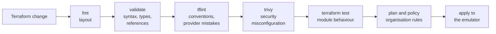

# Static analysis

The checks that run on Terraform before anything is provisioned: what each one catches, how to run it, and what to do when it fails.

- [The checks](#the-checks)
- [Running them](#running-them)
- [When a check fails](#when-a-check-fails)
- [Suppressing a finding](#suppressing-a-finding)
- [Tool versions](#tool-versions)

## The checks

Each check catches a class of mistake the others cannot. They are ordered from cheapest to most expensive, and CI runs them in that order so the fastest failure comes first.



| Check         | Tool                                                                       | Catches                                                                      | Example                                                              |
| ------------- | -------------------------------------------------------------------------- | ---------------------------------------------------------------------------- | -------------------------------------------------------------------- |
| Format        | `terraform fmt`                                                            | Inconsistent layout                                                          | Misaligned arguments                                                 |
| Validate      | `terraform validate`                                                       | Invalid syntax, wrong types, references to things that do not exist          | A typo in a resource name                                            |
| Lint          | [tflint](https://github.com/terraform-linters/tflint) with the AWS ruleset | Values AWS will reject, unused declarations, undocumented variables, naming  | An instance type that does not exist. A variable with no description |
| Security scan | [trivy](https://github.com/aquasecurity/trivy)                             | Insecure configuration                                                       | A bucket without encryption. A security group open to the world      |
| Module tests  | `terraform test`                                                           | A module that does not behave as it promises                                 | The state bucket losing its versioning                               |
| Policy        | [conftest](https://www.conftest.dev)                                       | Rules specific to this organisation. See [policy as code](policy-as-code.md) | A resource without the required tags                                 |

The linter and the scanner overlap a little and are both kept: the linter knows Terraform and the AWS API well, the scanner knows security practice well.

### What the linter enforces beyond its defaults

| Rule                                                                     | Why                                                                               |
| ------------------------------------------------------------------------ | --------------------------------------------------------------------------------- |
| Every variable and output has a description                              | Module documentation is generated from them                                       |
| Names are `snake_case`                                                   | One convention across every module                                                |
| Modules have the standard files: `main.tf`, `variables.tf`, `outputs.tf` | A reader knows where to look                                                      |
| No unused variables, locals or data sources                              | Dead declarations mislead, and an unused data source is an API call on every plan |
| Local modules are followed                                               | A bad value passed from a layer into a module is caught at the call               |

## Running them

```bash
make tools      # once: install the pinned linter and scanner
make check      # everything below, in order

make validate   # format check and validate
make lint       # tflint
make scan       # trivy, failing on medium severity and above
make scan-all   # trivy, reporting everything including low, without failing
make test       # module tests
make policy-test  # tests of the policies
make docs-check   # module READMEs are up to date
```

### The scanner and shared variables

Every environment layer links to one shared `variables.tf`. The scanner does not follow symbolic links, so in place it sees a layer with no variable declarations and treats every `var.` value as unknown. A setting that depends on a variable is then either reported as missing or not checked at all.

This was found when the scanner reported that the production database had no deletion protection, although `deletion_protection = !var.disposable` and `disposable` is false there. Replacing the link with a copy of the file made the finding go away, which showed the link was the cause. It also meant that until then the layers had been scanned with their variables unknown.

`make scan` therefore runs [`scripts/terraform-scan.sh`](../../scripts/terraform-scan.sh), which scans a temporary copy of `infra` in which each link is replaced by the file it points to. Layers are evaluated with production's values, so the scan answers the question "is this safe as production would run it". A deliberately inverted setting is now caught.

To run them automatically on commit, install the optional hooks:

```bash
pipx install pre-commit
pre-commit install
```

The hooks run the same commands as CI. They are a convenience. CI is the gate.

## When a check fails

1. **Read the message.** Both tools name the rule and link to an explanation.
2. **Fix the code.** That is the right answer almost every time.
3. If the finding is correct in general and wrong for this case, [suppress it with a reason](#suppressing-a-finding).
4. If the tool is simply wrong, suppress it and open an issue so the suppression can be removed when the tool is fixed.

A failing check is never fixed by lowering the severity threshold or removing the rule for everyone.

## Suppressing a finding

Suppressions are rare, narrow and explained.

**Scanner.** Add an entry to [`.trivyignore.yaml`](../../.trivyignore.yaml) with the rule, the paths it applies to and the reason:

```yaml
misconfigurations:
  - id: AWS-0000
    paths:
      - infra/modules/example/main.tf
    statement: >-
      Why this finding does not apply here, or why the risk is accepted,
      and the issue that tracks removing this entry if there is one.
```

**Linter.** Put the annotation on the line above, with the reason on the same line:

```hcl
# tflint-ignore: terraform_unused_declarations # kept for the migration in #123
variable "legacy_name" {}
```

Rules for both:

- The reason says why, not what. "False positive" is not a reason.
- The scope is the narrowest that works: one rule, one file.
- A suppression is reviewed like code. One without a reason is not merged.

There are no suppressions in the repository at the time of writing.

## Tool versions

| Tool                                    | Pinned in                                                    | Installed by                                   |
| --------------------------------------- | ------------------------------------------------------------ | ---------------------------------------------- |
| Terraform                               | [`.terraform-version`](../../.terraform-version)             | You, or a version manager that reads that file |
| tflint, trivy, conftest, terraform-docs | [`scripts/install-tools.sh`](../../scripts/install-tools.sh) | `make tools`                                   |
| tflint AWS ruleset                      | [`.tflint.hcl`](../../.tflint.hcl)                           | `tflint --init`, run by `make lint`            |

`make tools` downloads each release, verifies it against the checksum file published with it, and installs it into `~/.local/bin`. CI uses the same script, so a check cannot pass locally and fail in CI because of a version difference.

Third-party GitHub Actions are deliberately not used to install or run the scanner. A compromised action runs with the repository's token. A pinned download verified by checksum does not.

Upgrading a tool is a pull request that changes the pinned version. If the new version reports new findings, they are fixed or suppressed in the same pull request.
