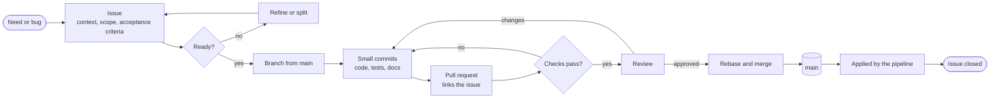
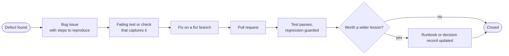

# Delivery process

How a piece of work moves from an idea to a change on `main`. The process is the same for a one-line fix and a new service, and the same whether one person or a team is working.

- [Principles](#principles)
- [The path of a change](#the-path-of-a-change)
- [Issues](#issues)
- [Branches](#branches)
- [Commits](#commits)
- [Pull requests](#pull-requests)
- [Definition of ready](#definition-of-ready)
- [Definition of done](#definition-of-done)
- [Bugs and incidents](#bugs-and-incidents)
- [Releases](#releases)
- [Roles](#roles)

## Principles

1. **`main` is always deployable.** Every commit on it has passed every check.
2. **Work is visible before it starts.** An issue exists before a branch does.
3. **Small changes, merged often.** A pull request should be reviewable in one sitting.
4. **Decisions are written down** next to the change that implements them.
5. **Documentation ships with the change.** A feature without its documentation is not finished.
6. **History is honest.** Commits are not squashed away, rewritten after merge or backdated.

## The path of a change



## Issues

Every change starts as an issue using one of two templates.

**Task** issues have three parts:

| Part | Purpose |
| --- | --- |
| Context | Why the work is needed and where it fits |
| Scope | What is included, and what is deliberately left out |
| Acceptance criteria | A checklist. The issue is done when every box is ticked |

**Bug** issues record what happened, what should have happened, the steps to reproduce and the evidence. A bug is not fixed until it has been reproduced.

### Labels

| Group | Labels | Meaning |
| --- | --- | --- |
| Type | `type: feature`, `type: infra`, `type: docs`, `type: bug`, `type: chore`, `type: decision` | What kind of work it is |
| Area | `area: network`, `area: security`, `area: data`, `area: messaging`, `area: compute`, `area: services`, `area: analytics`, `area: observability`, `area: ci`, `area: planning` | Which part of the system it touches |
| Scale | `epic` | Tracks a milestone-sized body of work, broken into issues when that milestone starts |

### Milestones

Issues are grouped into milestones, each with a goal and exit criteria. Later milestones begin as a single epic. The epic is broken into issues only when the milestone before it closes, so the breakdown reflects what was learned along the way. Planning everything in detail up front would produce a plan that is wrong in detail.

## Branches

One branch per issue, cut from `main`:

```
<type>/<issue-number>-<short-description>
```

| Type | Used for | Example |
| --- | --- | --- |
| `feat` | New capability, application or infrastructure | `feat/16-vpc-module` |
| `fix` | Bug fix | `fix/57-nat-route-missing` |
| `docs` | Documentation only | `docs/4-architecture-overview` |
| `chore` | Tooling, dependencies, pipelines | `chore/12-terraform-static-analysis` |
| `refactor` | Structure change with no behaviour change | `refactor/88-split-network-module` |

Branches are short-lived. One that has been open for more than a few days is a sign the issue should have been split.

## Commits

Commits follow [Conventional Commits](https://www.conventionalcommits.org):

```
<type>(<scope>): <what changed, in the imperative>

<why, when it is not obvious from the subject>
```

```
feat(network): add private subnets in three availability zones
fix(state): use a separate lock key per environment
docs(adr): record the choice of an AWS emulator
```

Each commit is one logical step that leaves the tree in a working state. "Add the module", "add its tests" and "document it" are three commits, not one. The body explains why when the subject cannot.

## Pull requests

A pull request:

- links its issue with `Closes #<number>`
- says what changed and why, in a few sentences
- says how the change was verified: commands, tests, plan output
- passes every check
- for infrastructure, includes the plan summary and calls out anything destroyed or replaced

Pull requests are merged by **rebase**. `main` stays linear, every commit on it is one that was reviewed, and `git bisect` works. Squash merging would discard the step-by-step history, and merge commits would add noise without information.

## Definition of ready

An issue can be started when:

- [ ] the context explains why it matters
- [ ] the scope says what is in and what is out
- [ ] the acceptance criteria can each be checked objectively
- [ ] anything it depends on is merged, or the dependency is named
- [ ] it is small enough for one pull request

## Definition of done

An issue is closed when:

- [ ] every acceptance criterion is met
- [ ] the change is merged to `main` with all checks passing
- [ ] new behaviour has tests, including the failure cases
- [ ] documentation is updated: module README, architecture page, runbook or decision record, whichever applies
- [ ] for infrastructure: the change applies cleanly from an empty environment, and destroying it leaves nothing behind
- [ ] no secret, account identifier or personal data was added to the repository
- [ ] follow-up work is captured as new issues, not left as comments in code

## Bugs and incidents



- A defect found while working on something else gets its own issue and its own pull request. It is not folded into unrelated work, so the history shows what was wrong and what fixed it.
- The fix starts with a test or check that fails for the right reason. That test stays, so the defect cannot return unnoticed.
- If the defect reveals a gap in a standard, a policy or a runbook, that document is updated in the same pull request.

## Releases

The repository is versioned as a whole with [Semantic Versioning](https://semver.org). A tag is cut when a milestone closes:

| Milestone | Tag |
| --- | --- |
| M0 to M5 (foundations) | `v0.1.0` to `v0.6.0` |
| M6 to M11 (services and operations) | `v0.7.0` to `v0.12.0` |
| M12 | `v1.0.0` |

Each tag has release notes generated from the merged pull requests and a changelog entry written by hand, because a list of commits is not an explanation.

## Roles

On a team these are different people. Here they are different hats, and the process keeps them separate on purpose: the checks, the plan review and the acceptance criteria do not care who wrote the change.

| Role | Responsibility |
| --- | --- |
| Author | Writes the change, its tests and its documentation |
| Reviewer | Reads the diff and the plan, checks it against the issue |
| Pipeline | Runs every check, applies infrastructure, refuses anything failing |
| Owner | Decides priority and accepts the milestone |
