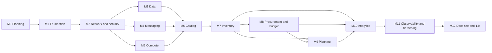

# Roadmap

The plan for building Meridian, milestone by milestone: what each delivers, what it depends on and how we know it is finished. Day-to-day tracking is in the [GitHub milestones](https://github.com/Akinz-bobo/meridian-supply-platform/milestones). This document explains the order and the reasoning.

- [Status](#status)
- [Order and dependencies](#order-and-dependencies)
- [Milestones](#milestones)
- [How the plan is kept honest](#how-the-plan-is-kept-honest)

## Status

| Milestone                                                                                                         | Delivers                                                                           | Release | Status   |
| ----------------------------------------------------------------------------------------------------------------- | ---------------------------------------------------------------------------------- | ------- | -------- |
| [M0: Planning and architecture](https://github.com/Akinz-bobo/meridian-supply-platform/milestone/1)               | The problem, domain, architecture, decisions and process, in writing               | v0.1.0  | Complete |
| [M1: Infrastructure foundation](https://github.com/Akinz-bobo/meridian-supply-platform/milestone/2)               | Emulator, Terraform layout, remote state, static analysis, policy checks, pipeline | v0.2.0  | Complete |
| [M2: Network and security baseline](https://github.com/Akinz-bobo/meridian-supply-platform/milestone/3)           | VPC, endpoints, security groups, KMS, IAM, secrets                                 | v0.3.0  | Next     |
| [M3: Data layer](https://github.com/Akinz-bobo/meridian-supply-platform/milestone/4)                              | RDS, DynamoDB, S3, ElastiCache modules                                             | v0.4.0  | Planned  |
| [M4: Messaging and events](https://github.com/Akinz-bobo/meridian-supply-platform/milestone/5)                    | SQS, SNS, Kinesis, EventBridge modules                                             | v0.5.0  | Planned  |
| [M5: Compute platforms](https://github.com/Akinz-bobo/meridian-supply-platform/milestone/6)                       | ECR, ECS, EKS, load balancing, the EC2 gateway                                     | v0.6.0  | Planned  |
| [M6: Catalog and curation](https://github.com/Akinz-bobo/meridian-supply-platform/milestone/7)                    | Supplier file ingestion, curation workflow, product master                         | v0.7.0  | Planned  |
| [M7: Inventory and warehouse events](https://github.com/Akinz-bobo/meridian-supply-platform/milestone/8)          | Movement pipeline, ledger, stock levels, expiry                                    | v0.8.0  | Planned  |
| [M8: Procurement and budgeting](https://github.com/Akinz-bobo/meridian-supply-platform/milestone/9)               | Purchase orders, receiving, budgets, approvals, ERP exchange                       | v0.9.0  | Planned  |
| [M9: Planning engine](https://github.com/Akinz-bobo/meridian-supply-platform/milestone/10)                        | Forecast, reorder points, replenishment proposals                                  | v0.10.0 | Planned  |
| [M10: Analytics and dashboards](https://github.com/Akinz-bobo/meridian-supply-platform/milestone/11)              | Data lake, queries, web dashboard                                                  | v0.11.0 | Planned  |
| [M11: Observability, hardening and recovery](https://github.com/Akinz-bobo/meridian-supply-platform/milestone/12) | Dashboards, alarms, tracing, audit, backups, recovery plan                         | v0.12.0 | Planned  |
| [M12: Documentation site and 1.0](https://github.com/Akinz-bobo/meridian-supply-platform/milestone/13)            | Published documentation, onboarding guide, final review                            | v1.0.0  | Planned  |

This table is updated in the pull request that closes each milestone.

## Order and dependencies

The order follows three rules.

1. **Platform before product.** Milestones 1 to 5 build what every service stands on. No service is written until there is a network to put it in, a pipeline to deploy it and a standard for its module.
2. **Follow the data.** The services are built in the order information flows through the business: products must exist (M6) before stock of them can (M7), stock before orders for more (M8), history of both before a forecast (M9), and all of it before dashboards (M10).
3. **Security and operability are not a phase.** The baseline is in M2, every module ships with its alarms and its policy checks, and M11 is a review and a tightening, not the first time anyone thinks about it.

M3, M4 and M5 are independent of each other and could be worked in parallel by a team.

## Milestones

Each milestone has a goal, deliverables and exit criteria. Milestones 0 to 2 are broken into issues. Later ones are a single epic that is broken down when the milestone before it closes, as the [delivery process](delivery-process.md#milestones) describes.

### M0: Planning and architecture

**Goal.** Agree what is being built, for whom and how, before any infrastructure exists.

**Delivered.** The [delivery process](delivery-process.md), [domain model](../domain/domain-model.md) and [glossary](../domain/glossary.md), the [architecture overview](../architecture/overview.md), the [event catalogue](../architecture/events.md), the [environment, naming and tagging standards](../architecture/environments.md), seven [decision records](../adr/README.md) and this roadmap.

**Exit criteria.** A new engineer can read the documents and explain the system. Every later milestone can be checked against them.

### M1: Infrastructure foundation

**Goal.** Make it possible to change infrastructure safely: one command to start the emulator, a layout for modules and environments, remote state, and a pipeline that checks and applies every change.

**Delivered.** A pinned [emulator stack](../guides/local-development.md). The [Terraform layout](../../infra/README.md) with a naming and tagging module and the `foundation` layer for three environments. [Remote state](../adr/0009-remote-state-in-s3-with-native-locking.md) with locking and a [recovery runbook](../runbooks/terraform-state.md). [Static analysis](../guides/static-analysis.md). [Policy as code](../guides/policy-as-code.md) with 13 rules. The [pipeline](../guides/pipeline.md). [Module standards](../architecture/module-standards.md) with generated documentation. Decision records 0008 and 0009.

**Exit criteria, as verified.** A pull request that changes infrastructure shows a plan as a comment (first seen on pull request 46). A plan that violates a policy fails, checked with a deliberately non-compliant change. On merge, all three environments are applied to a clean emulator and smoke tested.

**What changed from the plan.** State locking uses the S3 backend's own lock file, not a DynamoDB table, which is deprecated. State is split into layers per environment, which was not in the original issue list and is recorded in decision record 0008.

### M2: Network and security baseline

**Goal.** The network and identity foundations every workload depends on.

**Deliverables.** Three-tier VPC across three zones. VPC endpoints and flow logs. Security groups by tier. KMS keys and the encryption standard. IAM foundations. Secrets and configuration management. A threat model and a review.

**Exit criteria.** Data subnets have no internet route. No policy has a wildcard action on a wildcard resource. Every finding from the review is fixed or tracked.

### M3: Data layer

**Goal.** Reusable modules for every kind of store the services need: RDS PostgreSQL, DynamoDB, S3 and ElastiCache, each encrypted, backed up and monitored by default.

**Exit criteria.** Each module has tests, a generated README and an example. A database can be created, connected to from the private tier, backed up and destroyed.

### M4: Messaging and events

**Goal.** The event backbone from [decision record 0006](../adr/0006-event-backbone-and-messaging-conventions.md): the bus, a module that gives a consumer its queue and dead-letter queue in one call, the movement stream and notification topics.

**Exit criteria.** An event put on the bus arrives in a consumer's queue, a poisoned message lands in the dead-letter queue, and that raises an alarm.

### M5: Compute platforms

**Goal.** Somewhere to run each kind of workload from [decision record 0005](../adr/0005-compute-model-per-workload.md): a registry, an ECS cluster, an EKS cluster with its add-ons and workload identity, load balancing, and the EC2 gateway host.

**Exit criteria.** A sample container is deployed to ECS and to EKS through the pipeline, reachable through the load balancer, with its own IAM role.

### M6: Catalog and curation

**Goal.** Solve the first business problem: turn messy supplier files into a trusted product master.

**Exit criteria.** A supplier file uploaded to S3 is validated, routed to a steward when needed, and published. The supplier receives a report of what was rejected and why. Rules CAT-1 to CAT-5 are covered by tests.

### M7: Inventory and warehouse events

**Goal.** One view of stock across every warehouse, correct under load.

**Exit criteria.** Scan events flow from the API through the stream into the ledger. Stock is never negative, allocation is first expired first out, and expired batches are quarantined. Rules INV-1 to INV-7 are covered by tests, including concurrent movements.

### M8: Procurement and budgeting

**Goal.** Purchase orders that cannot overspend, and a link to the finance system.

**Exit criteria.** An order cannot be sent without a commitment, receiving turns commitment into actual, and orders above the threshold wait for approval. Rules PRO-1 to PRO-4 and BUD-1 to BUD-5 are covered by tests. Files are exchanged with a stand-in finance system.

### M9: Planning engine

**Goal.** Replace guesswork with proposals a buyer can accept.

**Exit criteria.** A nightly workflow produces a forecast and proposals that respect expiry, minimum order quantity and pack size. Rules PLN-1 to PLN-4 are covered by tests. The forecast method and its limits are documented.

### M10: Analytics and dashboards

**Goal.** One view for management, built on events and never on the operational databases.

**Exit criteria.** Every event reaches the data lake. Dashboards show service level, stock value, waste and spend against budget, with charts, for each role.

### M11: Observability, hardening and recovery

**Goal.** Make the platform operable by someone who did not build it, and prove it can be recovered.

**Exit criteria.** Every alarm has a runbook. A backup has been restored in a drill. Audit logging and drift detection are on. The threat model is updated for the whole system. A cost model exists, labelled as an estimate.

### M12: Documentation site and 1.0

**Goal.** Publish the documentation as a site, write the onboarding guide, review everything against the architecture overview and release 1.0.

**Exit criteria.** A new engineer can go from clone to a running platform by following the guide alone.

## How the plan is kept honest

- **Status means merged.** A milestone is complete when every issue in it is closed by a merged pull request with passing checks. Nothing is marked done on intent.
- **Later milestones are deliberately coarse.** They are broken into issues only when they are next, so the breakdown uses what the earlier work taught us.
- **Scope changes are visible.** If a milestone gains or loses scope, the change is made in a pull request to this document with the reason.
- **Limits are stated.** The platform is developed against an emulator. What that does and does not prove is in [decision record 0002](../adr/0002-develop-against-an-aws-emulator.md), and no figure in this repository is presented as measured on AWS.
