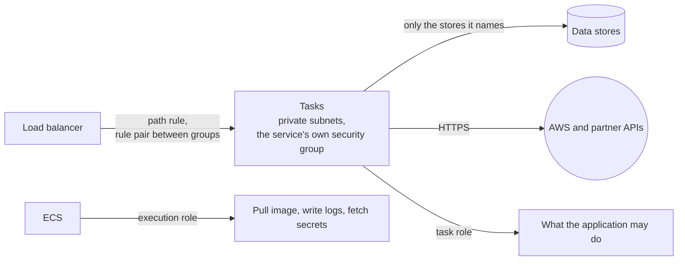

# ecs-service

One service on ECS Fargate, behind the load balancer: its task definition, its own security group, its target group and listener rule, its log group and its scaling.



Always on, whatever the caller passes:

| Protection | How |
| --- | --- |
| Not root | The container runs as a numeric user that is not 0 |
| Read-only root filesystem | Nothing can be written into the image at run time |
| No capabilities, not privileged | Every Linux capability is dropped |
| No public address | Tasks run in the given subnets with `assign_public_ip` off |
| Reached only through the load balancer | The service's own security group accepts the load balancer's group on the container port, and nothing else |
| A bad deployment rolls back | The deployment circuit breaker is on, with rollback, and a deployment never runs fewer healthy tasks than desired |
| An exact image | `latest` and an untagged image are refused |
| Secrets by reference | `secrets` takes ARNs. A variable in `environment` whose name looks like a secret is refused |

What a caller needs to know:

- **The service has a security group of its own.** It is not a member of a shared application group, so another service cannot reach it unless a rule says so. The output `security_group_id` is what a caller's rule refers to.
- **A service reaches only the data stores it names.** `data_access` creates a rule pair between this service's group and the store's group, for one port. With none, the service cannot open a connection to any store.
- **Two roles, passed in.** `execution_role_arn` is what ECS uses to start the task. `task_role_arn` is what the application runs as. Create both with the `workload-role` module, so both carry the permission boundary.
- **The path patterns must name the service's own prefix.** `/` and `/*` are refused: they would take every request on the load balancer.
- **The health check path must do no work.** It is called every 15 seconds on every task.
- **Draining matches stopping.** The load balancer stops sending to a task for as long as the container is given to finish, `stop_timeout_seconds`.
- **Scaling has a ceiling.** Between `desired_count` and `max_count`, on average CPU.
- **A shell is off by default.** `enable_execute_command` turns it on for an incident. The cluster records the session.

See [compute](../../../docs/architecture/compute.md).

<!-- BEGIN_TF_DOCS -->
## Usage

```hcl
module "context" {
  source = "../../../context"

  environment = "prod"
  component   = "catalog"
}

module "ecs_service" {
  source = "../.."

  name = module.context.prefix
  tags = module.context.tags

  cluster_arn  = "arn:aws:ecs:eu-west-1:333333333333:cluster/meridian-prod-compute"
  cluster_name = "meridian-prod-compute"

  vpc_id         = "vpc-0123456789abcdef0"
  vpc_cidr_block = "10.30.0.0/16"
  subnet_ids     = ["subnet-0123456789abcdef0", "subnet-0123456789abcdef1", "subnet-0123456789abcdef2"]

  image = "333333333333.dkr.ecr.eu-west-1.amazonaws.com/meridian-prod-catalog:589969013abb"

  execution_role_arn = "arn:aws:iam::333333333333:role/meridian-prod-catalog-execution-role"
  task_role_arn      = "arn:aws:iam::333333333333:role/meridian-prod-catalog-task-role"

  listener_arn                    = "arn:aws:elasticloadbalancing:eu-west-1:333333333333:listener/app/meridian-prod-compute/0123456789abcdef/0123456789abcdef"
  listener_rule_priority          = 100
  path_patterns                   = ["/catalog", "/catalog/*"]
  health_check_path               = "/catalog/healthz"
  load_balancer_security_group_id = "sg-0123456789abcdef0"

  # The catalog service uses the catalog database and nothing else.
  data_access = {
    postgresql = { security_group_id = "sg-0123456789abcdef1", port = 5432 }
  }

  environment = { LOG_LEVEL = "info" }
  secrets = {
    PARTNER_TOKEN = "arn:aws:secretsmanager:eu-west-1:333333333333:secret:/meridian/prod/catalog/secrets/partner-api-token-AbCdEf"
  }

  log_group_name   = "${module.context.ssm_path}/ecs"
  logs_kms_key_arn = "arn:aws:kms:eu-west-1:333333333333:key/33333333-3333-3333-3333-333333333333"
}
```

## Requirements

| Name | Version |
| ---- | ------- |
| terraform | >= 1.10.0, < 2.0.0 |
| aws | >= 6.0 |

## Inputs

| Name | Description | Type | Default | Required |
| ---- | ----------- | ---- | ------- | :------: |
| cluster\_arn | ARN of the ECS cluster the service runs in. | `string` | n/a | yes |
| cluster\_name | Name of the same cluster. Autoscaling addresses a service by cluster name. | `string` | n/a | yes |
| execution\_role\_arn | ARN of the role ECS uses to start the task: pull the image, write logs, fetch secrets. Create it with the workload-role module. | `string` | n/a | yes |
| health\_check\_path | Path the load balancer calls to decide whether a task is healthy. It must answer 200 quickly and do no work. | `string` | n/a | yes |
| image | Image to run, with its tag or digest. Never latest: a tag must identify one build. | `string` | n/a | yes |
| listener\_arn | ARN of the load balancer's TLS listener. The service adds its rule to it. | `string` | n/a | yes |
| listener\_rule\_priority | Order in which the listener evaluates this service's rule. Lower runs first. Each service needs a different number. | `number` | n/a | yes |
| load\_balancer\_security\_group\_id | Security group of the load balancer. The service accepts traffic from it, and a rule is added to it so that it may send to the service. | `string` | n/a | yes |
| log\_group\_name | Name of the service's log group, a path under /<project>/<environment>/. | `string` | n/a | yes |
| logs\_kms\_key\_arn | ARN of the key that encrypts the service's log group. Pass the logs key. | `string` | n/a | yes |
| name | Name of the service, and of its task definition, security group and target group. Take it from the context module's prefix. | `string` | n/a | yes |
| path\_patterns | Paths routed to the service, for example /catalog and /catalog/*. | `list(string)` | n/a | yes |
| subnet\_ids | Subnets the tasks run in. Pass the private subnets. | `list(string)` | n/a | yes |
| tags | Tags for every resource in the module. Take them from the context module. | `map(string)` | n/a | yes |
| task\_role\_arn | ARN of the role the application runs as. Create it with the workload-role module. | `string` | n/a | yes |
| vpc\_cidr\_block | Address range of the VPC, used for the DNS rule. | `string` | n/a | yes |
| vpc\_id | Identifier of the VPC. | `string` | n/a | yes |
| container\_port | Port the container listens on. | `number` | `8080` | no |
| container\_user | User the container runs as, as uid:gid. It must not be root. | `string` | `"10001:10001"` | no |
| cpu | CPU units for the task. 1024 is one vCPU. | `number` | `256` | no |
| cpu\_architecture | Processor architecture the image was built for: X86\_64 or ARM64. | `string` | `"X86_64"` | no |
| cpu\_target\_percent | Average CPU use that autoscaling aims for. Lower leaves more headroom and costs more. | `number` | `60` | no |
| data\_access | Data stores the service may reach, keyed by what the store is: its security group and port. A rule pair is created for each. A service that lists none can reach no store. | <pre>map(object({<br/>    security_group_id = string<br/>    port              = number<br/>  }))</pre> | `{}` | no |
| desired\_count | Tasks to run, and the fewest that autoscaling keeps. | `number` | `2` | no |
| enable\_execute\_command | Allow a shell to be opened in a running container. Leave off, and turn on for an incident. Sessions are recorded by the cluster. | `bool` | `false` | no |
| environment | Environment variables that are not secret. Anyone who can describe the task definition can read them. | `map(string)` | `{}` | no |
| health\_check\_grace\_period\_seconds | Seconds a new task may fail health checks while it starts, before it is replaced. | `number` | `30` | no |
| log\_retention\_days | How long the service's logs are kept. | `number` | `90` | no |
| max\_count | The most tasks autoscaling may run. A ceiling on cost as well as on capacity. | `number` | `6` | no |
| memory | Memory for the task, in MiB. | `number` | `512` | no |
| secrets | Secrets and parameters injected as environment variables, by reference: variable name to the ARN of a Secrets Manager secret or Parameter Store parameter. ECS fetches the value when the task starts. | `map(string)` | `{}` | no |
| stop\_timeout\_seconds | Seconds a container gets to finish requests in flight after SIGTERM, before it is killed. | `number` | `30` | no |

## Outputs

| Name | Description |
| ---- | ----------- |
| log\_group\_name | Log group that receives the container's output. |
| security\_group\_id | Identifier of the service's own security group. Another service that calls this one adds a rule that refers to it. |
| service\_name | Name of the ECS service. |
| target\_group\_arn | ARN of the service's target group. |
| task\_definition\_arn | ARN of the task definition revision the service runs. |

## Resources

| Name | Type |
| ---- | ---- |
| [aws_appautoscaling_policy.cpu](https://registry.terraform.io/providers/hashicorp/aws/latest/docs/resources/appautoscaling_policy) | resource |
| [aws_appautoscaling_target.this](https://registry.terraform.io/providers/hashicorp/aws/latest/docs/resources/appautoscaling_target) | resource |
| [aws_cloudwatch_log_group.this](https://registry.terraform.io/providers/hashicorp/aws/latest/docs/resources/cloudwatch_log_group) | resource |
| [aws_ecs_service.this](https://registry.terraform.io/providers/hashicorp/aws/latest/docs/resources/ecs_service) | resource |
| [aws_ecs_task_definition.this](https://registry.terraform.io/providers/hashicorp/aws/latest/docs/resources/ecs_task_definition) | resource |
| [aws_lb_listener_rule.this](https://registry.terraform.io/providers/hashicorp/aws/latest/docs/resources/lb_listener_rule) | resource |
| [aws_lb_target_group.this](https://registry.terraform.io/providers/hashicorp/aws/latest/docs/resources/lb_target_group) | resource |
| [aws_security_group.this](https://registry.terraform.io/providers/hashicorp/aws/latest/docs/resources/security_group) | resource |
| [aws_vpc_security_group_egress_rule.dns](https://registry.terraform.io/providers/hashicorp/aws/latest/docs/resources/vpc_security_group_egress_rule) | resource |
| [aws_vpc_security_group_egress_rule.https](https://registry.terraform.io/providers/hashicorp/aws/latest/docs/resources/vpc_security_group_egress_rule) | resource |
| [aws_vpc_security_group_egress_rule.load_balancer_to_service](https://registry.terraform.io/providers/hashicorp/aws/latest/docs/resources/vpc_security_group_egress_rule) | resource |
| [aws_vpc_security_group_egress_rule.to_data](https://registry.terraform.io/providers/hashicorp/aws/latest/docs/resources/vpc_security_group_egress_rule) | resource |
| [aws_vpc_security_group_ingress_rule.data_from_service](https://registry.terraform.io/providers/hashicorp/aws/latest/docs/resources/vpc_security_group_ingress_rule) | resource |
| [aws_vpc_security_group_ingress_rule.from_load_balancer](https://registry.terraform.io/providers/hashicorp/aws/latest/docs/resources/vpc_security_group_ingress_rule) | resource |
| [aws_region.current](https://registry.terraform.io/providers/hashicorp/aws/latest/docs/data-sources/region) | data source |
<!-- END_TF_DOCS -->
