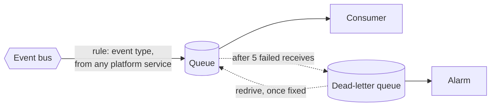

# event-consumer-queue

Everything one consumer needs to receive one kind of event: a queue, its dead-letter queue, the rule on the bus that feeds it, and an alarm.



What a caller needs to know:

- **One call per consumer per interest.** `budget` wanting `GoodsReceived` is one call. `inventory` wanting the same event is another, with its own queue. Neither can see or slow the other.
- **The consumer receives the envelope.** The rule delivers the event's detail, without the wrapper EventBridge puts around it.
- **Only this module's rule can deliver to the queue.** The queue policy admits EventBridge, and only for the ARN of the rule created here.
- **An event the bus cannot deliver is parked, not dropped.** If delivery to the queue fails, because of a wrong policy or an unusable key, the bus retries for an hour and then sends the event to the dead-letter queue. Without that it would discard the event after a day and record nothing. Such a message is the whole EventBridge event, wrapper included, and not the bare envelope.
- **A second alarm fires when the consumer falls behind**: the oldest message has waited more than `backlog_alarm_minutes`. A consumer that is down fails nothing, so nothing would ever reach the dead-letter queue.
- **A message that fails five times is moved to the dead-letter queue**, kept for 14 days, and raises an alarm. One message is enough. Pass the alarms topic in `alarm_actions`.
- **Attach `consume_policy_json` to the consumer's role.** It can receive, delete and extend the visibility of messages on this queue. It cannot send to it, purge it, or read the dead-letter queue, which is for people.
- **Set `visibility_timeout_seconds` to several times the longest processing time.** Shorter, and a slow message is delivered to a second receiver while the first is still working on it.
- **Both queues are encrypted** with the key in `kms_key_arn` and refuse requests without TLS.
- **Name the queue `<consumer prefix>-<event in kebab case>`**, with the prefix from the consuming service's context module, so it carries that service's name and tags.

Consumers must be idempotent: delivery is at least once. See [decision record 0006](../../../docs/adr/0006-event-backbone-and-messaging-conventions.md) and [messaging](../../../docs/architecture/messaging.md).

<!-- BEGIN_TF_DOCS -->
## Usage

```hcl
# The budget service wants to hear about deliveries.

module "context" {
  source = "../../../context"

  environment = "prod"
  component   = "budget"
}

module "event_consumer_queue" {
  source = "../.."

  name = "${module.context.prefix}-goods-received"
  tags = module.context.tags

  account_id    = "333333333333"
  bus_name      = "meridian-prod-events"
  source_prefix = "meridian"
  event_types   = ["GoodsReceived"]

  kms_key_arn   = "arn:aws:kms:eu-west-1:333333333333:key/55555555-5555-5555-5555-555555555555"
  alarm_actions = ["arn:aws:sns:eu-west-1:333333333333:meridian-prod-alarms"]
}

# Attached to the budget service's role.
output "consume_policy_json" {
  description = "Policy that lets the budget service receive from its queue."
  value       = module.event_consumer_queue.consume_policy_json
}
```

## Requirements

| Name | Version |
| ---- | ------- |
| terraform | >= 1.10.0, < 2.0.0 |
| aws | >= 6.0 |

## Inputs

| Name | Description | Type | Default | Required |
| ---- | ----------- | ---- | ------- | :------: |
| account\_id | Account the queue is in. | `string` | n/a | yes |
| bus\_name | Name of the event bus the rule is created on. | `string` | n/a | yes |
| event\_types | Event types delivered to the queue, as they appear in the event catalogue, for example GoodsReceived. | `set(string)` | n/a | yes |
| kms\_key\_arn | ARN of the key that encrypts both queues. Pass the messaging key. | `string` | n/a | yes |
| name | Name of the queue: <prefix>-<event in kebab case>, where the prefix comes from the context module of the consuming service. The dead-letter queue adds -dlq. | `string` | n/a | yes |
| source\_prefix | First part of every event's source on the bus. The rule matches events whose source starts with it. | `string` | n/a | yes |
| tags | Tags for every resource in the module. Take them from the context module of the consuming service. | `map(string)` | n/a | yes |
| alarm\_actions | ARNs notified when the dead-letter queue alarm changes state. Pass the alarms topic. | `list(string)` | `[]` | no |
| backlog\_alarm\_minutes | Raise an alarm when the oldest message in the queue has waited this long. It must be well inside retention\_days, or messages are discarded before anyone is told. | `number` | `15` | no |
| dead\_letter\_retention\_days | Days a failed message is kept in the dead-letter queue. | `number` | `14` | no |
| delivery\_retry\_minutes | How long the bus keeps trying to deliver an event to the queue before parking it in the dead-letter queue. | `number` | `60` | no |
| max\_receive\_count | Times a message may be received without being deleted before it is moved to the dead-letter queue. | `number` | `5` | no |
| retention\_days | Days an unprocessed message is kept in the queue before SQS discards it. | `number` | `4` | no |
| visibility\_timeout\_seconds | How long a received message is hidden from other receivers. Set it to several times the consumer's longest processing time, or a slow message is processed twice. | `number` | `60` | no |

## Outputs

| Name | Description |
| ---- | ----------- |
| alarm\_name | Name of the alarm that fires when the dead-letter queue is not empty. |
| backlog\_alarm\_name | Name of the alarm that fires when the oldest message has waited too long. |
| consume\_policy\_json | IAM policy that lets a role receive and acknowledge messages from the queue. It cannot send to it, purge it or read the dead-letter queue. Attach it to the consumer's workload role. |
| dead\_letter\_queue\_arn | ARN of the dead-letter queue. |
| dead\_letter\_queue\_url | URL of the dead-letter queue, for inspecting and redriving failed messages. |
| queue\_arn | ARN of the queue. |
| queue\_name | Name of the queue. |
| queue\_url | URL of the queue. The consumer receives from it. |
| rule\_name | Name of the rule on the bus that feeds the queue. |

## Resources

| Name | Type |
| ---- | ---- |
| [aws_cloudwatch_event_rule.this](https://registry.terraform.io/providers/hashicorp/aws/latest/docs/resources/cloudwatch_event_rule) | resource |
| [aws_cloudwatch_event_target.this](https://registry.terraform.io/providers/hashicorp/aws/latest/docs/resources/cloudwatch_event_target) | resource |
| [aws_cloudwatch_metric_alarm.backlog](https://registry.terraform.io/providers/hashicorp/aws/latest/docs/resources/cloudwatch_metric_alarm) | resource |
| [aws_cloudwatch_metric_alarm.dead_letter](https://registry.terraform.io/providers/hashicorp/aws/latest/docs/resources/cloudwatch_metric_alarm) | resource |
| [aws_sqs_queue.dead_letter](https://registry.terraform.io/providers/hashicorp/aws/latest/docs/resources/sqs_queue) | resource |
| [aws_sqs_queue.this](https://registry.terraform.io/providers/hashicorp/aws/latest/docs/resources/sqs_queue) | resource |
| [aws_sqs_queue_policy.dead_letter](https://registry.terraform.io/providers/hashicorp/aws/latest/docs/resources/sqs_queue_policy) | resource |
| [aws_sqs_queue_policy.this](https://registry.terraform.io/providers/hashicorp/aws/latest/docs/resources/sqs_queue_policy) | resource |
| [aws_sqs_queue_redrive_allow_policy.dead_letter](https://registry.terraform.io/providers/hashicorp/aws/latest/docs/resources/sqs_queue_redrive_allow_policy) | resource |
| [aws_iam_policy_document.consume](https://registry.terraform.io/providers/hashicorp/aws/latest/docs/data-sources/iam_policy_document) | data source |
| [aws_iam_policy_document.dead_letter](https://registry.terraform.io/providers/hashicorp/aws/latest/docs/data-sources/iam_policy_document) | data source |
| [aws_iam_policy_document.queue](https://registry.terraform.io/providers/hashicorp/aws/latest/docs/data-sources/iam_policy_document) | data source |
| [aws_region.current](https://registry.terraform.io/providers/hashicorp/aws/latest/docs/data-sources/region) | data source |
<!-- END_TF_DOCS -->
