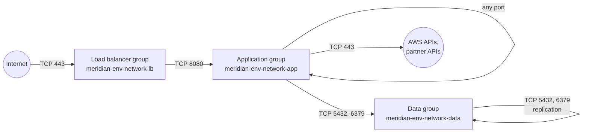

# tier-security-groups

One security group for each network tier (load balancer, application, data), with rules that refer to each other by group and never by address range.



| Group | Accepts | May send |
| --- | --- | --- |
| Load balancer | 443 from clients (and 80 if asked, to redirect) | The application ports, to the application group |
| Application | The application ports from the load balancer group, anything from itself | The data ports to the data group, anything to itself, HTTPS anywhere, DNS to the VPC |
| Data | The data ports from the application group and from itself | Nothing |

What a caller needs to know:

- **Every link is a pair of rules**: egress on one group and ingress on the next. The path can be read from either end, and removing a link takes both rules away.
- **Only the load balancer group can be opened to an address range**, and only on ports 80 and 443. A database port there is refused at plan time. `load_balancer_ingress_cidrs` narrows the default of the whole internet to known ranges.
- **The data group has no egress rule.** Security groups are stateful, so replies to workloads still flow. A database cannot open a connection to anything.
- **Each port is its own rule**, keyed by port. Adding a port adds rules and never replaces existing ones.
- **Attach these groups, do not copy them.** A workload module takes `application_security_group_id` as an input. A service that needs a path these groups do not give adds a group of its own beside them.

The policy checks `POL-SG-1` and `POL-SG-2` in the [policy guide](../../../docs/guides/policy-as-code.md) apply the same limits to every security group rule in the repository, not only to this module.

<!-- BEGIN_TF_DOCS -->
## Usage

```hcl
module "context" {
  source = "../../../context"

  environment = "prod"
  component   = "network"
}

module "tier_security_groups" {
  source = "../.."

  name           = module.context.prefix
  tags           = module.context.tags
  vpc_id         = "vpc-0123456789abcdef0"
  vpc_cidr_block = "10.30.0.0/16"
}
```

## Requirements

| Name | Version |
| ---- | ------- |
| terraform | >= 1.10.0, < 2.0.0 |
| aws | >= 6.0 |

## Inputs

| Name | Description | Type | Default | Required |
| ---- | ----------- | ---- | ------- | :------: |
| name | Prefix of the three groups. Take it from the context module's prefix. | `string` | n/a | yes |
| tags | Tags for every resource in the module. Take them from the context module. | `map(string)` | n/a | yes |
| vpc\_cidr\_block | Address range of the VPC, used for the DNS rule. | `string` | n/a | yes |
| vpc\_id | Identifier of the VPC the groups belong to. | `string` | n/a | yes |
| app\_ports | Ports workloads listen on for traffic from load balancers. | `set(number)` | <pre>[<br/>  8080<br/>]</pre> | no |
| data\_ports | Ports of the data stores, keyed by what listens there. The key appears in rule descriptions. | `map(number)` | <pre>{<br/>  "postgresql": 5432,<br/>  "redis": 6379<br/>}</pre> | no |
| load\_balancer\_ingress\_cidrs | Address ranges allowed to reach the load balancers. The default is the internet. An internal platform passes its office or VPN ranges. | `set(string)` | <pre>[<br/>  "0.0.0.0/0"<br/>]</pre> | no |
| load\_balancer\_ports | Listener ports the load balancer group accepts from clients. | `set(number)` | <pre>[<br/>  443<br/>]</pre> | no |

## Outputs

| Name | Description |
| ---- | ----------- |
| application\_security\_group\_id | Identifier of the group for workloads: ECS tasks, EKS nodes, Lambda functions and EC2 instances. |
| data\_security\_group\_id | Identifier of the group for databases and caches. |
| load\_balancer\_security\_group\_id | Identifier of the group for load balancers. |

## Resources

| Name | Type |
| ---- | ---- |
| [aws_security_group.application](https://registry.terraform.io/providers/hashicorp/aws/latest/docs/resources/security_group) | resource |
| [aws_security_group.data](https://registry.terraform.io/providers/hashicorp/aws/latest/docs/resources/security_group) | resource |
| [aws_security_group.load_balancer](https://registry.terraform.io/providers/hashicorp/aws/latest/docs/resources/security_group) | resource |
| [aws_vpc_security_group_egress_rule.application_to_application](https://registry.terraform.io/providers/hashicorp/aws/latest/docs/resources/vpc_security_group_egress_rule) | resource |
| [aws_vpc_security_group_egress_rule.application_to_data](https://registry.terraform.io/providers/hashicorp/aws/latest/docs/resources/vpc_security_group_egress_rule) | resource |
| [aws_vpc_security_group_egress_rule.application_to_dns](https://registry.terraform.io/providers/hashicorp/aws/latest/docs/resources/vpc_security_group_egress_rule) | resource |
| [aws_vpc_security_group_egress_rule.application_to_https](https://registry.terraform.io/providers/hashicorp/aws/latest/docs/resources/vpc_security_group_egress_rule) | resource |
| [aws_vpc_security_group_egress_rule.load_balancer_to_application](https://registry.terraform.io/providers/hashicorp/aws/latest/docs/resources/vpc_security_group_egress_rule) | resource |
| [aws_vpc_security_group_ingress_rule.application_from_application](https://registry.terraform.io/providers/hashicorp/aws/latest/docs/resources/vpc_security_group_ingress_rule) | resource |
| [aws_vpc_security_group_ingress_rule.application_from_load_balancer](https://registry.terraform.io/providers/hashicorp/aws/latest/docs/resources/vpc_security_group_ingress_rule) | resource |
| [aws_vpc_security_group_ingress_rule.data_from_application](https://registry.terraform.io/providers/hashicorp/aws/latest/docs/resources/vpc_security_group_ingress_rule) | resource |
| [aws_vpc_security_group_ingress_rule.data_from_data](https://registry.terraform.io/providers/hashicorp/aws/latest/docs/resources/vpc_security_group_ingress_rule) | resource |
| [aws_vpc_security_group_ingress_rule.load_balancer_from_clients](https://registry.terraform.io/providers/hashicorp/aws/latest/docs/resources/vpc_security_group_ingress_rule) | resource |
<!-- END_TF_DOCS -->
