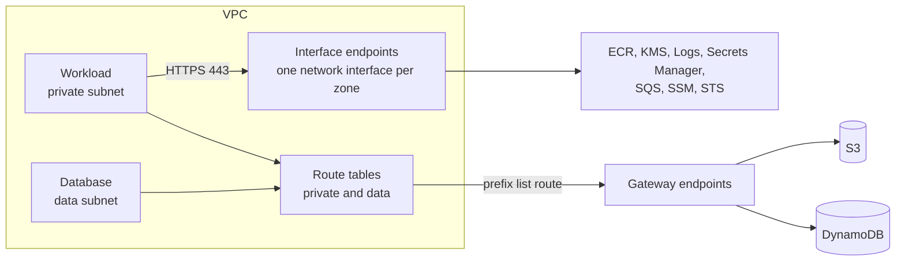

# vpc-endpoints

Private paths from a VPC to AWS services: gateway endpoints for S3 and DynamoDB, and interface endpoints for the other services workloads call.



What a caller needs to know:

- **Gateway endpoints are free and always worth having.** They add a route to each route table passed in `route_table_ids`. Pass the private and the data route tables: that is what lets the data tier reach S3 and DynamoDB while having no route to the internet.
- **Interface endpoints are billed per zone per hour**, so the set is an input. The default covers what a container workload needs to start without NAT: pull an image, write logs, read a secret, decrypt, and obtain credentials. A development environment can pass a shorter list and let the rest go through NAT.
- **One security group fronts all interface endpoints.** It accepts HTTPS from the VPC range and nothing else. With no interface endpoints it is not created.
- **Private DNS is always on.** Without it an SDK resolves the public endpoint and the interface endpoint is never used.
- **The prefix list outputs** let a security group allow outbound traffic to S3 or DynamoDB only, with no address ranges.

<!-- BEGIN_TF_DOCS -->
## Usage

```hcl
module "context" {
  source = "../../../context"

  environment = "prod"
  component   = "network"
}

module "vpc_endpoints" {
  source = "../.."

  name            = module.context.prefix
  tags            = module.context.tags
  vpc_id          = "vpc-0123456789abcdef0"
  vpc_cidr_block  = "10.30.0.0/16"
  route_table_ids = ["rtb-0123456789abcdef0"]
  subnet_ids      = ["subnet-0123456789abcdef0"]
}
```

## Requirements

| Name | Version |
| ---- | ------- |
| terraform | >= 1.10.0, < 2.0.0 |
| aws | >= 6.0 |

## Inputs

| Name | Description | Type | Default | Required |
| ---- | ----------- | ---- | ------- | :------: |
| name | Prefix for the endpoints and their security group. Take it from the context module's prefix. | `string` | n/a | yes |
| route\_table\_ids | Route tables that get routes to the gateway endpoints. Pass the private and data route tables. | `list(string)` | n/a | yes |
| subnet\_ids | Subnets that get a network interface for each interface endpoint, one per zone. Pass the private subnets. | `list(string)` | n/a | yes |
| tags | Tags for every resource in the module. Take them from the context module. | `map(string)` | n/a | yes |
| vpc\_cidr\_block | Address range of the VPC. Interface endpoints accept HTTPS from this range only. | `string` | n/a | yes |
| vpc\_id | Identifier of the VPC the endpoints belong to. | `string` | n/a | yes |
| gateway\_services | Services reached through a gateway endpoint. Only S3 and DynamoDB offer one. | `set(string)` | <pre>[<br/>  "s3",<br/>  "dynamodb"<br/>]</pre> | no |
| interface\_services | Services reached through an interface endpoint, by the last part of the service name, for example ecr.api. Each one is billed per zone per hour. | `set(string)` | <pre>[<br/>  "ecr.api",<br/>  "ecr.dkr",<br/>  "kms",<br/>  "logs",<br/>  "secretsmanager",<br/>  "sqs",<br/>  "ssm",<br/>  "sts"<br/>]</pre> | no |

## Outputs

| Name | Description |
| ---- | ----------- |
| dynamodb\_prefix\_list\_id | Prefix list of the DynamoDB gateway endpoint, for security group rules that allow traffic to DynamoDB only. Null when DynamoDB is not a gateway service. |
| gateway\_endpoint\_ids | Identifiers of the gateway endpoints, keyed by service. |
| interface\_endpoint\_ids | Identifiers of the interface endpoints, keyed by service. |
| s3\_prefix\_list\_id | Prefix list of the S3 gateway endpoint, for security group rules that allow traffic to S3 only. Null when S3 is not a gateway service. |
| security\_group\_id | Identifier of the security group in front of the interface endpoints. Null when there are no interface endpoints. |

## Resources

| Name | Type |
| ---- | ---- |
| [aws_security_group.interface](https://registry.terraform.io/providers/hashicorp/aws/latest/docs/resources/security_group) | resource |
| [aws_vpc_endpoint.gateway](https://registry.terraform.io/providers/hashicorp/aws/latest/docs/resources/vpc_endpoint) | resource |
| [aws_vpc_endpoint.interface](https://registry.terraform.io/providers/hashicorp/aws/latest/docs/resources/vpc_endpoint) | resource |
| [aws_vpc_security_group_ingress_rule.interface_https](https://registry.terraform.io/providers/hashicorp/aws/latest/docs/resources/vpc_security_group_ingress_rule) | resource |
| [aws_region.current](https://registry.terraform.io/providers/hashicorp/aws/latest/docs/data-sources/region) | data source |
<!-- END_TF_DOCS -->
