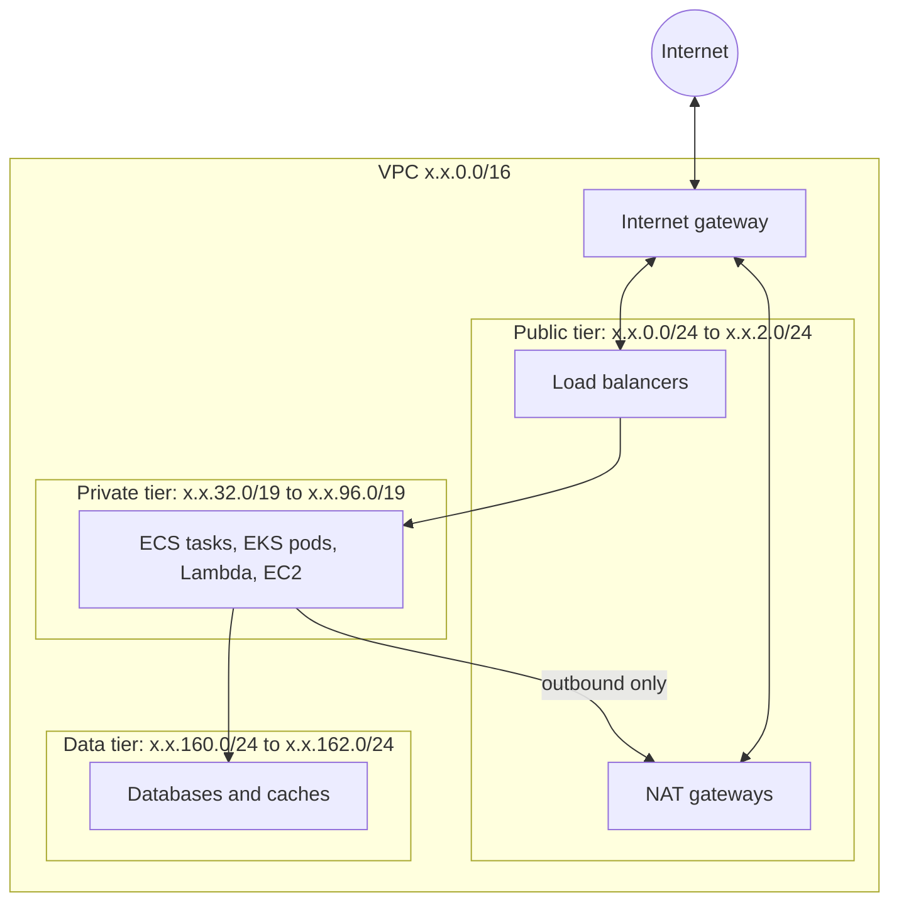

# vpc

A three-tier network spread across two or three availability zones: public subnets for load balancers and NAT gateways, private subnets for workloads, and data subnets for databases and caches.



What a caller needs to know:

- **The address plan is fixed.** The module takes a /16 and lays the subnets out as the [address plan](../../../docs/architecture/environments.md#network-address-plan) says. Every environment therefore looks the same, and a subnet's tier can be read from its address.
- **The data tier has no route to the internet, and no input adds one.** Its route table holds only the local route. A network ACL in front of it admits the private and data subnets only, as a second barrier behind security groups.
- **One NAT gateway per zone by default.** `single_nat_gateway = true` trades resilience for cost and is meant for development environments.
- **The default security group is adopted and emptied.** Anything launched without an explicit security group can reach nothing.
- **Public subnets do not assign public addresses.** Load balancers and NAT gateways bring their own.
- **Per-zone resources are keyed by zone letter**, so removing a zone does not renumber or replace the others.

<!-- BEGIN_TF_DOCS -->
## Usage

```hcl
module "context" {
  source = "../../../context"

  environment = "prod"
  component   = "network"
}

module "vpc" {
  source = "../.."

  name               = module.context.prefix
  tags               = module.context.tags
  cidr_block         = "10.30.0.0/16"
  availability_zones = ["eu-west-1a", "eu-west-1b", "eu-west-1c"]
}

# A VPC is always paired with flow logs. They are a separate module so the
# destination and retention can change without touching the network.
module "vpc_flow_logs" {
  source = "../../../vpc-flow-logs"

  name           = module.context.prefix
  tags           = module.context.tags
  vpc_id         = module.vpc.vpc_id
  account_id     = "333333333333"
  log_group_name = "/meridian/prod/network/flow-logs"
  kms_key_arn    = "arn:aws:kms:eu-west-1:333333333333:key/11111111-2222-3333-4444-555555555555"

  permissions_boundary_arn = "arn:aws:iam::333333333333:policy/meridian-prod-workload-boundary"
}
```

## Requirements

| Name | Version |
| ---- | ------- |
| terraform | >= 1.10.0, < 2.0.0 |
| aws | >= 6.0 |

## Inputs

| Name | Description | Type | Default | Required |
| ---- | ----------- | ---- | ------- | :------: |
| availability\_zones | Zones to spread the subnets across, in address plan order. The first zone holds the NAT gateway when only one is used. | `list(string)` | n/a | yes |
| cidr\_block | Address range of the VPC. Must be a /16 so the fixed address plan fits. | `string` | n/a | yes |
| name | Name of the VPC, and the prefix of everything in it. Take it from the context module's prefix. | `string` | n/a | yes |
| tags | Tags for every resource in the module. Take them from the context module. | `map(string)` | n/a | yes |
| private\_subnet\_tags | Extra tags for private subnets, for example the tag a load balancer controller uses to discover them. | `map(string)` | `{}` | no |
| public\_subnet\_tags | Extra tags for public subnets, for example the tag a load balancer controller uses to discover them. | `map(string)` | `{}` | no |
| single\_nat\_gateway | Use one NAT gateway for all zones instead of one per zone. Cheaper, and an outage of that zone cuts outbound internet access for every private subnet. | `bool` | `false` | no |

## Outputs

| Name | Description |
| ---- | ----------- |
| availability\_zones | Zones the subnets are spread across, in address plan order. |
| cidr\_block | Address range of the VPC. |
| data\_route\_table\_id | Identifier of the route table shared by the data subnets. It has no route to the internet. |
| data\_subnet\_cidr\_blocks | Address ranges of the data subnets, in zone order. |
| data\_subnet\_ids | Identifiers of the data subnets, in zone order. For databases and caches. |
| nat\_public\_ips | Public addresses that outbound traffic from the private subnets appears to come from. Give these to a partner who allow-lists by address. |
| private\_route\_table\_ids | Identifiers of the private route tables, one per zone. Gateway endpoints attach to these. |
| private\_subnet\_cidr\_blocks | Address ranges of the private subnets, in zone order. |
| private\_subnet\_ids | Identifiers of the private subnets, in zone order. For workloads. |
| public\_route\_table\_id | Identifier of the route table shared by the public subnets. |
| public\_subnet\_ids | Identifiers of the public subnets, in zone order. For load balancers. |
| vpc\_id | Identifier of the VPC. |

## Resources

| Name | Type |
| ---- | ---- |
| [aws_default_security_group.this](https://registry.terraform.io/providers/hashicorp/aws/latest/docs/resources/default_security_group) | resource |
| [aws_eip.nat](https://registry.terraform.io/providers/hashicorp/aws/latest/docs/resources/eip) | resource |
| [aws_internet_gateway.this](https://registry.terraform.io/providers/hashicorp/aws/latest/docs/resources/internet_gateway) | resource |
| [aws_nat_gateway.this](https://registry.terraform.io/providers/hashicorp/aws/latest/docs/resources/nat_gateway) | resource |
| [aws_network_acl.data](https://registry.terraform.io/providers/hashicorp/aws/latest/docs/resources/network_acl) | resource |
| [aws_network_acl_rule.data_in_from_data](https://registry.terraform.io/providers/hashicorp/aws/latest/docs/resources/network_acl_rule) | resource |
| [aws_network_acl_rule.data_in_from_private](https://registry.terraform.io/providers/hashicorp/aws/latest/docs/resources/network_acl_rule) | resource |
| [aws_network_acl_rule.data_out_to_vpc](https://registry.terraform.io/providers/hashicorp/aws/latest/docs/resources/network_acl_rule) | resource |
| [aws_route.private_nat](https://registry.terraform.io/providers/hashicorp/aws/latest/docs/resources/route) | resource |
| [aws_route.public_internet](https://registry.terraform.io/providers/hashicorp/aws/latest/docs/resources/route) | resource |
| [aws_route_table.data](https://registry.terraform.io/providers/hashicorp/aws/latest/docs/resources/route_table) | resource |
| [aws_route_table.private](https://registry.terraform.io/providers/hashicorp/aws/latest/docs/resources/route_table) | resource |
| [aws_route_table.public](https://registry.terraform.io/providers/hashicorp/aws/latest/docs/resources/route_table) | resource |
| [aws_route_table_association.data](https://registry.terraform.io/providers/hashicorp/aws/latest/docs/resources/route_table_association) | resource |
| [aws_route_table_association.private](https://registry.terraform.io/providers/hashicorp/aws/latest/docs/resources/route_table_association) | resource |
| [aws_route_table_association.public](https://registry.terraform.io/providers/hashicorp/aws/latest/docs/resources/route_table_association) | resource |
| [aws_subnet.data](https://registry.terraform.io/providers/hashicorp/aws/latest/docs/resources/subnet) | resource |
| [aws_subnet.private](https://registry.terraform.io/providers/hashicorp/aws/latest/docs/resources/subnet) | resource |
| [aws_subnet.public](https://registry.terraform.io/providers/hashicorp/aws/latest/docs/resources/subnet) | resource |
| [aws_vpc.this](https://registry.terraform.io/providers/hashicorp/aws/latest/docs/resources/vpc) | resource |
<!-- END_TF_DOCS -->
